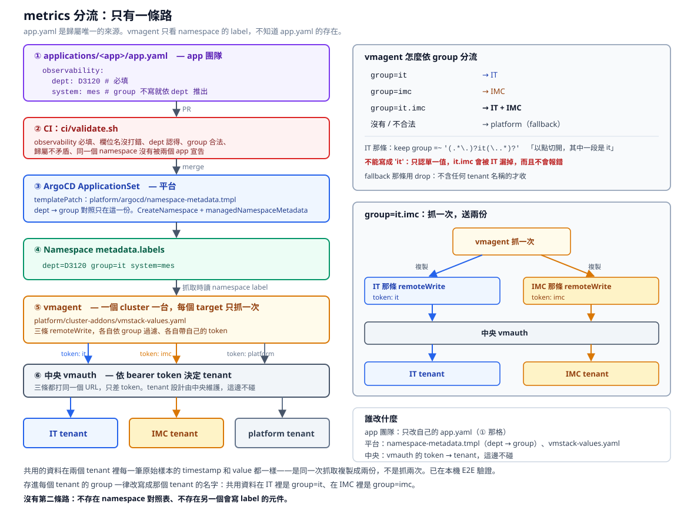

# aiops-data-foundation

替未來的 AIOps 打資料地基：**讓每筆資料一出生就帶身分證，再照身分證送進對的地方。**

## 主線：只有一條路

```
Developer
  → applications/<app>/app.yaml        每個 app 自己宣告歸屬（observability）
  → CI                                 ci/validate.sh，寫錯的在 merge 前擋掉
  → ArgoCD ApplicationSet              把歸屬轉成 namespace label
  → Namespace metadata.labels          dept / group / system
  → vmagent                            只讀 namespace label，依 group 分三條 remoteWrite
  → 中央 vmauth                        依 bearer token 決定 tenant
  → IT / IMC / platform tenant
```



- **app.yaml 是歸屬唯一的來源。** 不存在 namespace 對照表，不存在第二個會寫 label 的元件。
- **vmagent 不知道 app.yaml 的存在**，也不維護 app 或 namespace 清單，只看 namespace 的 label。
- `group=it.imc` 會同時送進 IT 和 IMC，**是同一次抓取複製成兩份，不是抓兩次**。
- 中央的 tenant 設計不碰。三條 remoteWrite 打同一個 vmauth，只差帶的 token。

每一步的細節、regex、容易寫錯的地方見 **[docs/architecture.md](docs/architecture.md)**。

## 新增一個 app

1. `services/<app>/` 放程式碼和 Dockerfile
2. 複製一份 `applications/<app>/`，改 `app.yaml` 和 `helm/values.yaml`
3. `app.yaml` 寫上歸屬：

```yaml
observability:
  dept: D3120        # 必填
  system: mes        # 選填
  # group: it.imc    # 只有要多送給別的 tenant 時才寫
```

4. 跑 `./ci/validate.sh`，過了再發 PR

`group` 平常不寫，依 dept 自動推出來。沒寫 `observability` 過不了 CI。

## 驗證與測試

```bash
./ci/validate.sh              # app.yaml 規則、observability、chart 渲染
./tests/app-yaml/run.sh       # A. app.yaml 驗證  B. app.yaml → namespace label（不需要 cluster）
./tests/routing/run.sh        # C. namespace label → tenant 的 E2E（本機 k3d）
```

三組都確認過「正確時 exit 0、故意改壞時 exit 1」。

### 測試環境

```
正式    vmagent → 中央 vmauth → IT / IMC / platform tenant
本機    vmagent → 本機 vmauth → VMSingle it / imc / platform
```

本機的 vmagent 是從正式的 `vmstack-values.yaml` 產生的，只換掉 URL，測的就是正式那份設定。

### 沒有 E2E 驗證的

本機沒有 ArgoCD。**「app.yaml → namespace label」那一步用 helm 模擬渲染**（兩者都是 Go template + sprig），E2E 裡把 label 貼上 namespace 的是 `kubectl label`。`managedNamespaceMetadata` 在你們 ArgoCD 上的實際行為要上線前確認，見 [docs/architecture.md](docs/architecture.md) 最後一節。

## 目錄

```
services/<app>/              程式碼、Dockerfile                          ← app 團隊
applications/<app>/          跟 devops repo 同格式，可以整個資料夾搬過去   ← app 團隊
  app.yaml                   ArgoCD 設定 + 歸屬（observability）
  helm/                      這個 app 的 chart，只填 values
charts/app-common/           共用 library chart                          ← 平台
platform/
  argocd/                    namespace-metadata.tmpl + CI 驗證            → 併進 devops repo
  cluster-addons/            vmstack-values.yaml（vmagent 分流）          → 每個場區叢集
  fluentd/                   fluent.conf（log 分流）                       → 每個場區叢集
  central/                   Elasticsearch 的 API key、role              → 只有 central
ci/                          validate.sh
tests/
  app-yaml/                  A + B
  routing/                   C
docs/                        設計文件與架構圖
```

目錄怎麼切的理由見 [docs/repo-layout.md](docs/repo-layout.md)。

## 文件

| 文件 | 內容 |
|---|---|
| [docs/architecture.md](docs/architecture.md) | **主線**：每一步怎麼運作、regex、改組和新增 tenant 要改哪 |
| [platform/argocd/README.md](platform/argocd/README.md) | 要改 devops repo 的哪三個地方 |
| [docs/vmagent.md](docs/vmagent.md) | vmagent 分流的上線步驟：values 放哪、token Secret、順序、驗收 |
| [docs/efk.md](docs/efk.md) | log 分流（Fluentd → Elasticsearch），讀的是同一組 namespace label |
| [docs/repo-layout.md](docs/repo-layout.md) | 目錄結構的理由 |
| [docs/roadmap.md](docs/roadmap.md) | 三階段路線圖 |
| [docs/architecture/before-after-tenant-split.svg](docs/architecture/before-after-tenant-split.svg) | 給人看的 Before / After：tenant 從「依廠分」改成「依組織分」 |

## 這套系統回答什麼、不回答什麼

先對齊期待，這是最容易誤會的地方。

| 回答 | 不回答 |
|---|---|
| **資料有沒有漏**：某台機台 20 分鐘沒回報、今天該收 500 批只收到 480 批 | **良率為什麼掉** |
| **系統哪裡出問題**：MES 交易變慢、記憶體一直漲、queue 在堆積 | **製程參數為什麼漂移** |
| **為什麼**：昨晚換版 → 記憶體洩漏 → 連線逾時 → 報工卡住 | **設備本身的異常** |

右邊那一欄是 SPC、FDC、YMS 的範圍，這套系統不會、也不該去取代它們。

**AI 的比重其實很小。** 欄位統一、資料收齊、規則告警這幾項就吃掉八成效益，而且都不需要 AI。

**跟良率分析的界線**：log 記錄的是「程式做了什麼」，良率是「產品量出來多少」。把量測值塞進 log 或 metrics 去分析良率，會因為資料量和高基數直接壓垮這套系統。正確的接點是讓 YMS 這類系統吐出彙總後的業務指標（每小時良率、各 bin 比例、資料完整度）。

**一句話定位**：從「有人打電話來說產線怪怪的」，變成「系統先叫，而且直接指出是哪台機台、從幾點開始、那時候剛好發生了什麼」。

## 還沒解決的

1. **log 那條路還有一份 dept → index 的對照。** `fluent.conf` 的 `rewrite_tag_filter` 寫著部門清單，跟 `namespace-metadata.tmpl` 的 `$groups` 是兩份，改組要兩邊一起改。而且 log 不支援 `group=it.imc`。見 [docs/efk.md](docs/efk.md)。
2. **自建的 chart 沒地方放。** `app-common` 搬到 devops repo 後要從內部 Helm repo 拉，但文件上那個 `artifacts-proxy` 看名字是代理倉庫，放不了自建的 chart。要確認有沒有 hosted 的 Helm 倉庫。
3. **token 怎麼自動進新廠的 cluster**：現在靠手動建 Secret。Vault Secrets Operator 已經是 cluster-addon，Vault 上線後可以接上，見 [docs/vmagent.md](docs/vmagent.md)。
4. **`dept` / `group` / `system` 這幾個 label 名稱在正式環境有沒有被別人用掉。** 上線前查 `kubectl get ns -L dept,group,system`。
5. **正式環境的 operator 與 Fluentd 版本。** 本機在 operator v0.74.1、Fluentd v1.17 實測可用。chart 裝的 CRD 沒帶 schema，欄位打錯不會報錯。
6. **產線資料能不能出廠、MES 是不是自己開發的**：影響路線圖第三階段。

## Branch

目前的設計都在 **`feature/efk-log-collection`**。`master` 是只有 metrics 分流的舊快照，還沒合併。
