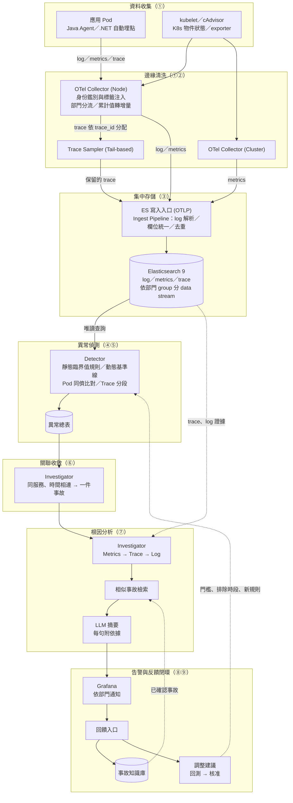

# it-aiops 系統架構規格書 (Architecture Specification)

本文件定義 it-aiops（IT 系統的 AIOps 平台）的範圍、架構、關鍵決策與模組職責，不記錄進度。現況、驗證與待辦見 [poc-status.md](poc-status.md)、[pdca/](pdca/README.md)；實作與操作細節見各主題文件（[log](log/README.md)、[metrics](metrics/README.md)、[trace](trace/README.md)、[rca](rca/README.md)、[feedback](feedback/README.md)）。

## 1. 系統目標與邊界 (System Overview & Scope)

**核心目標**

1. **縮短從「發現異常」到「確認根因」的時間**：數百個服務的正常值各不相同且隨時段變化，固定門檻不可行。以動態基準線學習 (Dynamic Baseline Learning) 判斷異常，再沿 Metrics → Trace → Log 定位根因，交給值班可直接行動的事故報告。
2. **既有應用零改動接入、資料出生即帶正確身分**：應用團隊不改程式、不接觸部門歸屬與寫入憑證；平台在邊緣統一注入身分並依部門分流，三種訊號一定對得上。
3. **以專家回饋持續校正**：值班與資深維運專家的判斷回流為事故知識庫與門檻調整（建議 → 回測 → 核准）；以統計＋LLM 為主，不自行訓練模型。

**系統邊界**

| | 範疇 |
|---|---|
| 目前支援 | 一般 IT 服務：Web API、worker、Kafka、DB；執行於 Kubernetes 的 Java 與 .NET（6 以上）應用 |
| 未來規劃 | 工廠（EAP、機台、MES／MCS／AMHS、批號載具）：不在目前範圍 |

對外介面：輸入為各應用 cluster 的 log、metrics、trace 與 K8s 資源狀態；輸出為依部門送出的 Grafana 通知、事故報告與回饋入口。

## 2. 全域架構圖 (End-to-End Architecture)

圖中括號為第 4 節的模組編號。

- **部署拓撲**：每個應用 cluster 一套 Collector（每節點一台 Node Collector、整個 cluster 一台 Cluster Collector、兩台 Trace Sampler）；中央一套 Elasticsearch 9；AIOps engine 以唯讀憑證讀取三種訊號，只寫 `aiops-*` 索引。
- **模組交接**：模組之間只透過 ES 索引交接（`aiops-anomalies`、`aiops-alerts`、`aiops-incidents`、`aiops-feedback`、`aiops-tuning`），任一模組可獨立重跑或替換。

## 3. 關鍵架構決策 (Key Architectural Decisions)

### 3.1 統一觀測儲存 (Unified Observability Storage)

- **決策**：log、metrics、trace 全部寫入中央 Elasticsearch 9，不另建時序資料庫（不採 VictoriaMetrics）。
- **理由**：
  - 三種訊號共用同一套身分欄位與路徑，跨訊號關聯不需翻譯。
  - 單一的查詢、權限與保留模型：都依部門 group 分 data stream，權限、保留天數、告警歸屬用同一套 group。
  - metrics 存為 time series data stream（TSDS），重送不重複；可降解析度長期保留供基準線學習（[retention.md](retention.md)）。
- **取捨**：
  - ES 不儲存 metrics 的 exemplar，metrics 無法直接帶 `trace_id` 到 trace（替代作法見第 5 節）。
  - TSDS 每個 backing index 只收一段時間範圍，範圍外的寫入進 failure store 但仍回應成功；需放寬可寫入時間並監控 failure store。
  - data stream 依「來源 × group」切分，數量隨部門倍增；長期只保留降解析度值與統計值。

### 3.2 零業務侵入埋點 (Zero-code Instrumentation)

- **決策**：既有應用不改程式。Java 掛 OpenTelemetry Java Agent（metrics 由 Collector 以 Prometheus 格式拉取），.NET 掛自動埋點（以 OTLP 推送）；log 一律輸出 stdout，由 Node Collector 讀取。部署規格由共用 Helm chart 產生。
- **理由**：舊專案無法排入改版；自動埋點即可取得 HTTP、DB、連線池、GC 等指標與分散式 trace，並把 `trace_id` 寫入 log 上下文。
- **邊界**：
  - 未輸出 `trace_id` 的純文字 log，需改由 agent 以 OTLP 直送才能對應 trace。
  - .NET Kafka 消費端處理訊息時的呼叫自成獨立 trace，對不回原訊息，只能以服務＋時間關聯。
  - 自動埋點通常沒有建立 TCP／TLS 連線的 span。
  - .NET 8 與 .NET 9 的 runtime 指標名稱不同，規則分兩套；.NET Framework 4.x 不支援，需先移植至 .NET 6 以上。
  - 業務 ID（交易 ID 等）無法自動取得，需在服務層補上，且只放 trace、log，不放 metrics（避免序列數爆炸）。

### 3.3 多租戶隔離 (Multi-tenancy & Isolation)

- **決策**：
  - **歸屬由 Collector 決定**：讀資料所屬 Pod 的 namespace `dept` 標籤，對應成 group（無 dept 歸 `unassigned`），寫進該 group 的 data stream。namespace 名稱不含組織資訊。
  - **邊緣身份鑑別與標籤注入 (Edge Identity Sanitization & Injection)**：應用自帶的 K8s、部門、group 欄位一律先移除，再依連線來源 Pod 注入 namespace、Pod、Deployment、版本與 dept；應用只連同節點的 Collector。
  - **讀取權限依 group 授權**；AIOps 以唯讀憑證讀取全部，只能寫 `aiops-*`。
  - **集中式資料寫入憑證 (Shared Ingest Token)**：所有 group、三種訊號共用一把；先發新、確認後才作廢舊的，輪替不掉資料、不重啟。
- **理由**：應用可任意填寫資源欄位，信任自報身分會造成跨部門冒充；以 Pod 為準，同一 Pod 的三種訊號歸屬必然一致。部門間沒有寫入隔離需求；單一憑證消除「權限漏設 → ES 回成功但默默拒收」的失效模式，被拒文件留在 failure store 由資料品質檢查回報。
- **取捨**：寫入端不再由憑證隔離，Collector 規則設錯時資料寫進錯的 group 而 ES 不擋；憑證失效時所有 group 一起中斷；所有 group 共用一個送出佇列；dept 清單需兩處同步。

### 3.4 其他已定案決策

| 決策 | 理由 | 取捨 |
|---|---|---|
| log 收集用 OTel Collector，取代 Fluent Bit | 三種訊號同一種收集器、同一份分部門規則；重啟不掉 log | 中央 pipeline 仍接受 Fluent Bit 資料，供邊緣 VM 使用（[比較](log/fluentbit-vs-otel.md)） |
| trace 尾端取樣 (Tail-based Sampling) | 錯誤、5xx、例外、超過 1 秒的請求完整保留，正常的隨機留 5% | 等待整個 trace 到齊期間資料在記憶體；比 1 秒快的變慢只剩隨機樣本（附錄 A.4） |
| 季節性時間序列基準線為主力 | 星期幾 × 小時的週期（上下班、夜間批次）只有分時段的歷史看得出來 | 需累積 2～4 週；超過一週的週期（月底批次）要另設週期放寬 |
| 統計＋LLM，不自訓模型 | 可解釋、可重現，不需大量標註與 MLOps（[llm-mlops.md](feedback/llm-mlops.md)） | 多指標複雜關聯的能力有限；準確度靠回饋與評測集校正 |
| metrics → trace 用「服務＋路由＋時間窗」，不用 exemplar | ES 不存 exemplar；exemplar 只是單一樣本，正常 trace 只留 5% 時多半查不到 | 是同時間、同路由的統計關聯，不是同一個請求 |

## 4. 核心處理模組職責 (Core Components ①～⑨)

編號 ①～⑨ 是全專案唯一的模組編號，所有文件、PDCA 紀錄、待辦都沿用。

| 編號 | 模組 | 職責定義 | 核心技術或演算法 |
|---|---|---|---|
| ① | 收值 | 不改程式收集 log、metrics、trace 與 K8s 資源、物件狀態 | 自動埋點；Node／Cluster Collector；Prometheus 拉取、OTLP 推送（30 秒）；trace 尾端取樣；磁碟佇列斷線補送 |
| ② | 清資料 | 保證每筆資料身分正確、欄位一致、不重複 | 邊緣身份鑑別與標籤注入、dept → group；累計值轉增量；例外事件轉 span 屬性；Java 指標名稱對齊 .NET；中央 pipeline 依 log 格式解析、時區正規化、去重 |
| ③ | 存 | 依部門 group 分流儲存、控管權限與保留天數 | Elasticsearch 9 data stream、TSDS、降解析度與 ILM；集中式資料寫入憑證；failure store |
| ④ | 判斷 | 判斷每條序列是否異常，分 `warning`、`anomaly` 兩級 | 靜態臨界值規則 (Static Threshold Rules)；動態基準線學習（168 時段中位數＋MAD、卜瓦松、借同組）；Pod 同儕橫向比對 (Peer Comparison)；Trace 分段基準、N+1、例外吞噬檢測 (Exception Swallowing Detection)；學習前排除事故時段、行事曆、慢性問題 |
| ⑤ | 異常總表 | 所有判斷結果的單一交接點 | `aiops-anomalies`，同序列同時間重跑覆蓋同一筆；寫入時補 `dept`、`group` |
| ⑥ | 收斂 | 把大量異常合成值班可處理的「一件」 | 同一服務、30 分鐘內接續的異常合為一件；30 分鐘無新異常即結束；全程程式計算 |
| ⑦ | 根因分析 | 對每件事故定位問題段落與證據，產出報告 | Metrics → Trace → Log 關聯（第 5 節）；相似事故檢索（指紋＋欄位比對，只檢索已確認事故）；LLM 摘要 |
| ⑧ | 出口 | 把事故送到對的人，並提供回饋入口 | `aiops-alerts` 一件一筆；Grafana 依 dept 每件一則、結束發恢復，無 dept 送平台；告警心跳 |
| ⑨ | feedback | 把專家判斷轉成知識與調整 | 確認的事故進知識庫；誤報提放寬、漏報提調降、同根因提規則草稿；回測通過才可核准；量化（件數、回饋率、誤報率） |

**④ 偵測方法的分工**：靜態臨界值規則管「狀態本身就是壞事」（重啟、副本不足、離極限太近；critical 立即觸發，其餘需持續一段時間）；動態基準線學習管有週期的服務整體指標（請求數、錯誤率、p95、log 筆數、CPU、記憶體）；Pod 同儕橫向比對管被服務平均稀釋的單一 Pod 異常（同服務至少 3 個 Pod）；Trace 分段基準管請求內部的變化（每段自身耗時、呼叫次數、錯誤、例外吞噬、Kafka 排隊）。單點偏離記為 `warning`（不觸發根因分析、不通知），同方向連續兩個時間窗或持續 30 分鐘才升為 `anomaly`；指定序列或偏離極大時採單點即判定 (Instant Anomaly)。

## 5. 資料關聯與根因定位機制 (Correlation & RCA)

**原則**：Metrics 回答「有沒有出事、何時開始」，Trace 回答「哪個服務的哪一段造成」，Log 回答「那一段裡發生了什麼」。三者靠共同鑰匙（服務、路由、Pod、namespace、時間窗、`trace_id`）串接；`dept`、`group` 是歸屬標籤，只決定資料屬於誰，不用於串接。

1. **Metrics 發現異常**：異常帶出服務、路由與時間窗，並經 ⑥ 收斂為一件事故。
2. **Trace 鎖定慢呼叫／錯誤段**：以「服務＋路由＋時間窗」撈出事時段最慢與出錯的請求，與平常（一週前同時段；沒有則用出事前同樣長的一段）比較。**只算每段自身耗時**（扣除子呼叫），增加最多的段排第一，否則鏈上每一層都顯得一樣慢；**錯誤源頭**是自己標記錯誤、子呼叫都沒錯的那一段。
3. **Log 擷取關鍵錯誤**：以樣本請求的 `trace_id` 撈同一請求在各服務的 log；可疑服務該時段的 warn／error 歸納成樣式與平常比較，找出**新出現的 log 樣式**。
4. **LLM 生成摘要**：程式把事故整理成結構化輸入（異常、主要 trace 段、log 樣式、相似的已確認事故），LLM 只寫報告開頭三到五句。**每句須附依據 id**，由程式檢查引用，引用不存在的 id 整段不顯示；模型不可用時退回固定句型。LLM 只加註，不決定是否告警。

**精度差異**：Metrics → Trace 是同服務、同路由、同時間窗的統計對應，不保證是造成指標變差的同一批請求；Trace → Log 以 `trace_id` 對應，是同一個請求。完整鑰匙清單、限制與實例見 [rca/README.md「metrics 異常怎麼串到 trace、log」](rca/README.md#metrics-異常怎麼串到-tracelog)。

## 附錄 (Appendix)

A.1 直方圖累計值轉增量 (Cumulative → Delta)

Prometheus 直方圖從應用啟動一直累加，直接存入時任一段時間的請求數、p95 要頭尾相減，在 ES 中無法聚合。Node Collector 把直方圖換成每 30 秒的增量，任一段時間可直接加總；計數器維持累加值。詳見 [metrics/README.md](metrics/README.md#應用的請求數錯誤延遲aiops-baseline-用)。

A.2 Java OOM 後 Pod 不重啟

JVM 發生 OutOfMemoryError 後不會自行結束：Pod 顯示正常、K8s 不重開、metrics 也抓不到，只剩「抓不到 metrics」看得出來。加上 `-XX:+ExitOnOutOfMemoryError` 可讓 JVM 結束、由 K8s 重開，重啟規則即可偵測；代價是原本勉強撐著的服務會直接重開。詳見 [metrics/cases.md](metrics/cases.md#實測時發現的事)。

A.3 告警心跳與 ES 斷線時的行為

- 每輪收斂寫一筆心跳；Grafana 10 分鐘收不到即通知平台「AIOps 停了」，避免排程停擺被誤判為事故全部恢復。
- 開著的事故與心跳的時間戳往前 1 分鐘，避免 Grafana 查詢窗與覆寫錯開造成假恢復。
- ES 連不上時，Grafana 發的是自己的資料來源錯誤，不是「AIOps 停了」。
- Collector 端：送 ES 的資料先寫節點磁碟、恢復後補送；ES 剛啟動時 API key 短暫被拒，入口健康檢查需以 API key 判斷。

詳見 [troubleshooting.md](troubleshooting.md#grafana-告警)。

A.4 尾端取樣的取捨

Trace Sampler 依 `trace_id` 分配，同一 trace 的所有段落到同一台；等 30 秒讓 trace 到齊後依序比對：隨機 5% → 有錯誤 → HTTP 5xx → 有例外 → 超過 1 秒，符合即保留，總量約剩 15%。代價：等待期間的 trace 在記憶體，Sampler 異常終止時會遺失；比 1 秒快的變慢（例如 200ms → 800ms）只剩隨機樣本；有問題的 trace 與隨機 trace 分開保留。詳見 [trace/scenarios.md](trace/scenarios.md#橫跨所有場景的前提取樣)、[retention.md](retention.md)。

### 術語對照表 (Glossary)

舊紀錄中的口語說法與本專案正式術語對照：

| 正式術語 | 舊說法 |
|---|---|
| 動態基準線學習 (Dynamic Baseline Learning) | 學平常的樣子、學「平常」、跟自己的歷史比 |
| Pod 同儕橫向比對 (Peer Comparison) | 跟兄弟比、兄弟比、Pod 互比、`peer` |
| 靜態臨界值規則 (Static Threshold Rules) | 規則（一次就算）、保底規則、固定門檻 |
| 單點即判定 (Instant Anomaly) | 單次就報、一次就算（`confirm_points: 1`、`instant_z`） |
| 例外吞噬檢測 (Exception Swallowing Detection) | 吞例外、吞掉的例外（規則 `swallowed`） |
| 邊緣身份鑑別與標籤注入 (Edge Identity Sanitization & Injection) | 擋冒充、補身分 |
| 集中式資料寫入憑證 (Shared Ingest Token) | 一把寫入 key |
| 資深維運專家回饋 (Expert Feedback) | 老師傅回饋 |
