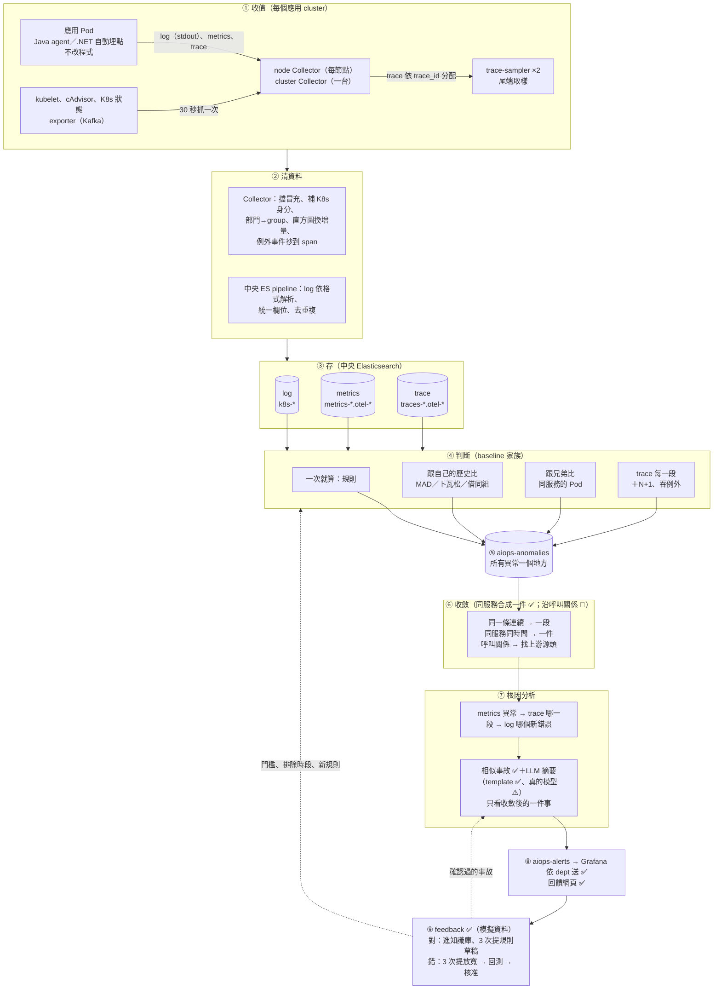
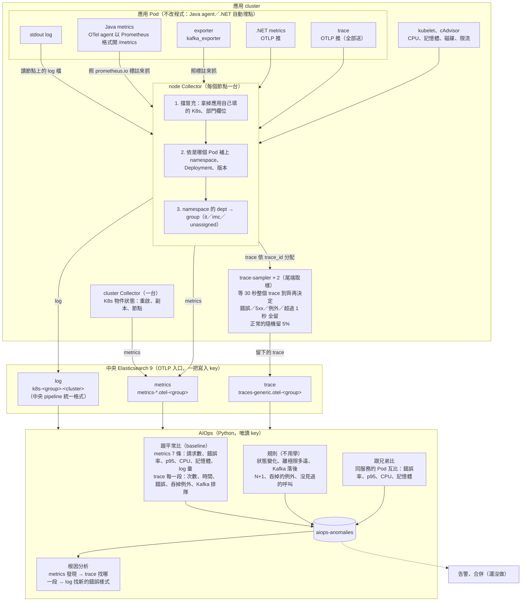
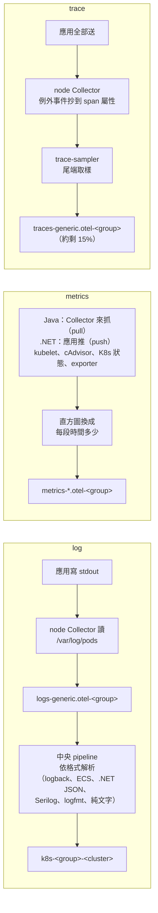

# 架構

一句話：**每個應用 cluster 一套 OpenTelemetry Collector，把 log、metrics、trace 依 namespace 的部門分流、用各部門自己的 key 寫進中央 Elasticsearch 9；AIOps 用唯讀 key 讀出來，學「平常的樣子」、跑規則、Pod 互比、做根因分析，結果寫進 `aiops-anomalies`。** 舊專案不改程式（Java agent、.NET 自動埋點）。

範圍：一般服務（Web API、worker、Kafka、DB）；工廠之後再做（[factory-later.md](factory-later.md)）。整條線每一步做什麼、程式在哪、怎麼驗：[end-to-end-flow.md](end-to-end-flow.md)。每個階段的細節、判斷方法、收斂、LLM、feedback 見 [system-stages.md](system-stages.md)；現況與待辦見 [pdca/](pdca/README.md)。

## 一張圖看全部

**編號只有這一套（①～⑨）**：整個專案的文件、PDCA 紀錄、待辦都用它，不另外編「階段」。

| # | 模組 | 做什麼 | 在哪裡 | 狀態 |
|---|---|---|---|---|
| ① | 收值 | log、metrics、trace 三種資料，舊專案不改程式 | `telemetry/collectors/` | ✅ |
| ② | 清資料 | Collector 補身分、擋冒充；中央 pipeline 統一格式、去重複 | 同上、`telemetry/storage/` | ✅ |
| ③ | 存 | 中央 ES，資料依部門 group 分 data stream、一把寫入 key；被拒的進 failure store；保留天數、降解析度 | `telemetry/scripts/` | ✅ |
| ④ | 判斷 | 規則、跟歷史比、跟兄弟比、trace 每一段 | `engine/detector/`、`engine/configs/baseline/*.yaml` | ✅（正式環境還沒排程） |
| ⑤ | 異常總表 | 所有判斷結果寫同一個 index | `aiops-anomalies` | ✅ |
| ⑥ | 收斂 | 同一個服務、30 分鐘內的異常合成一件 | `engine/investigator/alerts.py` | ✅（沿呼叫關係合併 📝） |
| ⑦ | 根因分析 | metrics → trace → log；相似事故檢索；LLM 摘要 | `engine/investigator/`、`engine/core/llm.py` | ✅（真的 LLM ⚠️ 沒跑過） |
| ⑧ | 出口 | `aiops-alerts` 一件一筆、Grafana 依 dept 發通知、回饋網頁 | `engine/configs/grafana/`、`engine/feedback_web/` | ✅（K8s 排程 ⚠️ 沒跑過） |
| ⑨ | feedback | 回饋 → 建議 → 回測 → 核准；確認的事故進知識庫；量化 | `engine/detector/`（feedback、backtest、metrics） | ✅（模擬資料；真實數字 ⚠️） |

## 收值側細節：一個 cluster 裡資料怎麼走

## 三種資料各自怎麼收

## log、metrics、trace 共用什麼

| 共用的東西 | 說明 | 在哪 |
|---|---|---|
| 同一種收集器 | 都是 OpenTelemetry Collector：每個節點一台（node），K8s 物件狀態一台（cluster），trace 多兩台 trace-sampler | `telemetry/collectors/` |
| 同一份分部門規則 | 擋冒充、讀 namespace 的 `dept`、對應成 group；同一個 Pod 的三種資料一定落在同一個 group | `common.yaml` 的 `transform/group` |
| 同一把寫入 key | 一把，所有 group、三種資料共用；資料屬於哪個 group 由 Collector 依 Pod 決定，不靠 key 擋（沒有部門間寫入隔離的要求；少了「key 權限漏了 → ES 回 200 默默拒收」的機會）（[pdca/phase1-collect/2026-10-ingest-simplify.md](pdca/phase1-collect/2026-10-ingest-simplify.md)） | `es-writer-keys`、`telemetry/scripts/elasticsearch-setup.sh` |
| 同一套身分欄位 | `service.name`、namespace、Pod、`dept`、`group`，由 Collector 補，三種資料對得上；其中 `dept`、`group` 是**歸屬**（誰的資料），其餘是**共同鑰匙**（接起三種資料），兩者用途不同，見 [rca/README.md](rca/README.md#歸屬-label-和共同鑰匙是兩種東西)。異常總表也帶 `dept`、`group` | Collector、`engine/detector/owner.py` |
| 串接鑰匙 | trace 的 `trace_id` ↔ log 的 `trace.id`；metrics 沒有 trace_id（ES 不存 exemplar，見 [rca/README.md「為什麼不用 exemplar」](rca/README.md#為什麼不用-exemplar用服務路由時間撈一批)），改用服務＋時間 | — |
| 同一把 AIOps 唯讀 key | 讀三種資料；只寫 `aiops-*` | `elasticsearch-setup.sh` |

**代價**：`dept` 清單目前要手動同步兩處（`telemetry/groups.yaml`、`common.yaml`）；歸屬方式（讀 namespace label 或改成 app → group 清單）一改，三條線要一起改（[README「還沒定案的」](../README.md#還沒定案的)）。
