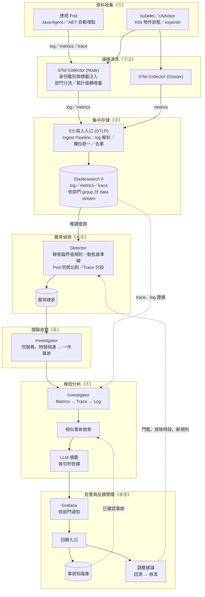

# it-aiops 系統架構規格書：架構、設計決策與現況 (Architecture Specification)

> **類型：原理 Explanation**

本文件定義 it-aiops（IT 系統的 AIOps 平台）的範圍、架構、關鍵決策與模組職責（第 1～5 節，只放既定設計），並記錄各 phase、各模組的現況、驗證、還沒做的與 PDCA 紀錄索引（第 6～14 節，隨實測更新）。目前以 PoC 驗證端到端可行性：從資料打通、異常辨識到 RCA 說明，並以回饋閉環持續校正。狀態依實測結果，不用完成比例；重點是確認每個模組所需的資料、分析方法與輸出結果。模組定義見第 4 節。

**目錄**

<!-- toc -->
- [1. 系統目標與邊界 (System Overview & Scope)](#1-系統目標與邊界-system-overview--scope)
- [2. 全域架構圖 (End-to-End Architecture)](#2-全域架構圖-end-to-end-architecture)
- [3. 關鍵架構決策 (Key Architectural Decisions)](#3-關鍵架構決策-key-architectural-decisions)
  - [3.1 統一觀測儲存 (Unified Observability Storage)](#31-統一觀測儲存-unified-observability-storage)
  - [3.2 零業務侵入埋點 (Zero-code Instrumentation)](#32-零業務侵入埋點-zero-code-instrumentation)
  - [3.3 多租戶隔離 (Multi-tenancy & Isolation)](#33-多租戶隔離-multi-tenancy--isolation)
  - [3.4 其他已定案決策](#34-其他已定案決策)
- [4. 核心處理模組職責 (Core Components ①～⑨)](#4-核心處理模組職責-core-components-①⑨)
  - [4.1 平台層與 AIOps 層的分界](#41-平台層與-aiops-層的分界)
- [5. 資料關聯與根因定位機制 (Correlation & RCA)](#5-資料關聯與根因定位機制-correlation--rca)
- [6. 各 phase 一句話](#6-各-phase-一句話)
- [7. 各模組：程式、驗證、狀態](#7-各模組程式驗證狀態)
- [8. 收斂：很多筆怎麼變成一件](#8-收斂很多筆怎麼變成一件)
- [9. 產品主線 8 步](#9-產品主線-8-步)
- [10. 還沒做、還不足的](#10-還沒做還不足的)
- [11. 哪裡過度設計](#11-哪裡過度設計)
- [12. 想確認什麼、跑哪個](#12-想確認什麼跑哪個)
- [13. 下一步](#13-下一步)
- [14. 各 Phase 的 PDCA 紀錄](#14-各-phase-的-pdca-紀錄)
  - [14.1 Phase 1 收值](#141-phase-1-收值)
  - [14.2 Phase 2 異常分析](#142-phase-2-異常分析)
  - [14.3 Phase 3 定位問題](#143-phase-3-定位問題)
  - [14.4 Phase 4 RCA＋LLM](#144-phase-4-rcallm)
  - [14.5 Phase 5 learning loop](#145-phase-5-learning-loop)
  - [14.6 跨階段](#146-跨階段)
- [附錄 (Appendix)](#附錄-appendix)
  - [術語對照表 (Glossary)](#術語對照表-glossary)
<!-- /toc -->

## 1. 系統目標與邊界 (System Overview & Scope)

**核心目標**

1. **縮短從「發現異常」到「確認根因」的時間**：數百個服務的正常值各不相同且隨時段變化，固定門檻不可行。以動態基準線學習 (Dynamic Baseline Learning) 判斷異常，再沿 Metrics → Trace → Log 定位根因，交給值班可直接行動的事故報告。
2. **既有應用零改動接入、資料出生即帶正確身分**：應用團隊不改程式、不接觸部門歸屬與寫入憑證；平台在邊緣統一注入身分並依部門分流，三種訊號一定對得上。
3. **以專家回饋持續校正**：值班與資深維運專家的判斷回流為事故知識庫與門檻調整（建議 → 回測 → 核准）；以統計＋LLM 為主，不自行訓練模型。

**系統邊界**

| | 範疇 |
|---|---|
| 目前支援 | 一般 IT 服務：Web API、worker、Kafka、DB；執行於 Kubernetes 的 Java 與 .NET（6 以上）應用 |
| 未來規劃 | 工廠（EAP、機台、MES／MCS／AMHS、批號載具）：不在目前範圍 |

對外介面：輸入為各應用 cluster 的 log、metrics、trace 與 K8s 資源狀態；輸出為依部門送出的 Grafana 通知、事故報告與回饋入口。

## 2. 全域架構圖 (End-to-End Architecture)

圖中括號為第 4 節的模組編號。



- **部署拓撲**：每個應用 cluster 一套 Collector（每節點一台 Node Collector、整個 cluster 一台 Cluster Collector）；中央一套 Elasticsearch 9；AIOps engine 以唯讀憑證讀取三種訊號，只寫 `aiops-*` 索引。
- **模組交接**：模組之間只透過 ES 索引交接（`aiops-anomalies`、`aiops-alerts`、`aiops-incidents`、`aiops-feedback`、`aiops-tuning`），任一模組可獨立重跑或替換。

## 3. 關鍵架構決策 (Key Architectural Decisions)

### 3.1 統一觀測儲存 (Unified Observability Storage)

- **決策**：log、metrics、trace 全部寫入中央 Elasticsearch 9，不另建時序資料庫（不採 VictoriaMetrics）。
- **理由**：
  - 三種訊號共用同一套身分欄位與路徑，跨訊號關聯不需翻譯。
  - 單一的查詢、權限與保留模型：都依部門 group 分 data stream，權限、保留天數、告警歸屬用同一套 group。
  - metrics 存為 time series data stream（TSDS），重送不重複；可降解析度長期保留供基準線學習（[retention.md](retention.md)）。
- **取捨**：
  - ES 不儲存 metrics 的 exemplar，metrics 無法直接帶 `trace_id` 到 trace（替代作法見第 5 節）。
  - TSDS 每個 backing index 只收一段時間範圍，範圍外的寫入進 failure store 但仍回應成功；需放寬可寫入時間並監控 failure store。
  - data stream 依「來源 × group」切分，數量隨部門倍增；長期只保留降解析度值與統計值。

### 3.2 零業務侵入埋點 (Zero-code Instrumentation)

- **決策**：既有應用不改程式。Java 掛 OpenTelemetry Java Agent（metrics 由 Collector 以 Prometheus 格式拉取），.NET 掛自動埋點（以 OTLP 推送）；log 一律輸出 stdout，由 Node Collector 讀取。部署規格由共用 Helm chart 產生。
- **理由**：舊專案無法排入改版；自動埋點即可取得 HTTP、DB、連線池、GC 等指標與分散式 trace，並把 `trace_id` 寫入 log 上下文。
- **邊界**：
  - 未輸出 `trace_id` 的純文字 log，需改由 agent 以 OTLP 直送才能對應 trace。
  - .NET Kafka 消費端處理訊息時的呼叫自成獨立 trace，對不回原訊息，只能以服務＋時間關聯。
  - 自動埋點通常沒有建立 TCP／TLS 連線的 span。
  - .NET 8 與 .NET 9 的 runtime 指標名稱不同，規則分兩套；.NET Framework 4.x 不支援，需先移植至 .NET 6 以上。
  - 業務 ID（交易 ID 等）無法自動取得，需在服務層補上，且只放 trace、log，不放 metrics（避免序列數爆炸）。

### 3.3 多租戶隔離 (Multi-tenancy & Isolation)

- **決策**：
  - **歸屬由 Collector 決定**：讀資料所屬 Pod 的 namespace `dept` 標籤，對應成 group（無 dept 歸 `unassigned`），寫進該 group 的 data stream。namespace 名稱不含組織資訊。
  - **邊緣身份鑑別與標籤注入 (Edge Identity Sanitization & Injection)**：應用自帶的 K8s、部門、group 欄位一律先移除，再依連線來源 Pod 注入 namespace、Pod、Deployment、版本與 dept；應用只連同節點的 Collector。
  - **讀取權限依 group 授權**；AIOps 以唯讀憑證讀取全部，只能寫 `aiops-*`。
  - **集中式資料寫入憑證 (Shared Ingest Token)**：所有 group、三種訊號共用一把；先發新、確認後才作廢舊的，輪替不掉資料、不重啟。
- **理由**：應用可任意填寫資源欄位，信任自報身分會造成跨部門冒充；以 Pod 為準，同一 Pod 的三種訊號歸屬必然一致。部門間沒有寫入隔離需求；單一憑證消除「權限漏設 → ES 回成功但默默拒收」的失效模式，被拒文件留在 failure store 由資料品質檢查回報。
- **取捨**：寫入端不再由憑證隔離，Collector 規則設錯時資料寫進錯的 group 而 ES 不擋；憑證失效時所有 group 一起中斷；所有 group 共用一個送出佇列；dept 清單需兩處同步。

### 3.4 其他已定案決策

| 決策 | 理由 | 取捨 |
|---|---|---|
| log 收集用 OTel Collector，取代 Fluent Bit | 三種訊號同一種收集器、同一份分部門規則；重啟不掉 log | 中央 pipeline 仍接受 Fluent Bit 資料，供邊緣 VM 使用（[比較](log/README.md)） |
| trace 100% 收、一個請求合成一筆 | 製造業的事故檢討不能少資料：應用全送、Collector 全寫（raw 每一段一筆、2 天），engine 每分鐘把每個 trace 合成一筆（`traces-merged-*`，7 天；根因分析讀這份） | 量是取樣時的約 7 倍；合成的 `nested` 不省空間；根因分析看到的是 1～2 分鐘前合好的（[trace-merge](pdca/phase1-collect/2026-10-trace-merge.md)；之前的尾端取樣見附錄 A.4） |
| 季節性時間序列基準線為主力 | 星期幾 × 小時的週期（上下班、夜間批次）只有分時段的歷史看得出來 | 需累積 2～4 週；超過一週的週期（月底批次）要另設週期放寬 |
| 統計＋LLM，不自訓模型 | 可解釋、可重現，不需大量標註與 MLOps（[feedback/README.md](feedback/README.md)） | 多指標複雜關聯的能力有限；準確度靠回饋與評測集校正 |
| metrics → trace 用「服務＋路由＋時間窗」，不用 exemplar | ES 不存 exemplar；exemplar 只是單一樣本、不保證是造成異常的那個請求 | 是同時間、同路由的統計關聯，不是同一個請求 |

## 4. 核心處理模組職責 (Core Components ①～⑨)

編號 ①～⑨ 是全專案唯一的模組編號，所有文件、PDCA 紀錄、待辦都沿用。

| 編號 | 層 | 模組 | 職責定義 | 核心技術或演算法 |
|---|---|---|---|---|
| ① | 可觀測性平台 | 收值 | 不改程式收集 log、metrics、trace 與 K8s 資源、物件狀態 | 自動埋點；Node／Cluster Collector；Prometheus 拉取、OTLP 推送（30 秒）；trace 100% 收、合成一個請求一筆；磁碟佇列斷線補送 |
| ② | 可觀測性平台 | 清資料 | 保證每筆資料身分正確、欄位一致、不重複 | 邊緣身份鑑別與標籤注入、dept → group；累計值轉增量；例外事件轉 span 屬性；Java 指標名稱對齊 .NET；中央 pipeline 依 log 格式解析、時區正規化、去重 |
| ③ | 可觀測性平台 | 存 | 依部門 group 分流儲存、控管權限與保留天數 | Elasticsearch 9 data stream、TSDS、降解析度與 ILM；集中式資料寫入憑證；failure store |
| ④ | AIOps | 判斷 | 判斷每條序列是否異常，分 `warning`、`anomaly` 兩級 | 靜態臨界值規則 (Static Threshold Rules)；動態基準線學習（168 時段中位數＋MAD、卜瓦松、借同組）；Pod 同儕橫向比對 (Peer Comparison)；Trace 分段基準、N+1、例外吞噬檢測 (Exception Swallowing Detection)；學習前排除事故時段、行事曆、慢性問題 |
| ⑤ | AIOps | 異常總表 | 所有判斷結果的單一交接點 | `aiops-anomalies`，同序列同時間重跑覆蓋同一筆；寫入時補 `dept`、`group` |
| ⑥ | AIOps | 收斂 | 把大量異常合成值班可處理的「一件」 | 同一服務、30 分鐘內接續的異常合為一件；30 分鐘無新異常即結束；全程程式計算 |
| ⑦ | AIOps | 根因分析 | 對每件事故定位問題段落與證據，產出報告 | Metrics → Trace → Log 關聯（第 5 節）；相似事故檢索（指紋＋欄位比對，只檢索已確認事故）；LLM 摘要 |
| ⑧ | AIOps | 出口 | 把事故送到對的人，並提供回饋入口 | `aiops-alerts` 一件一筆；Grafana 依 dept 每件一則、結束發恢復，無 dept 送平台；告警心跳 |
| ⑨ | AIOps | feedback | 把專家判斷轉成知識與調整 | 確認的事故進知識庫；誤報提放寬、漏報提調降、同根因提規則草稿；回測通過才可核准；量化（件數、回饋率、誤報率） |

**④ 偵測方法的分工**：靜態臨界值規則管「狀態本身就是壞事」（重啟、副本不足、離極限太近；critical 立即觸發，其餘需持續一段時間）；動態基準線學習管有週期的服務整體指標（請求數、錯誤率、p95、log 筆數、CPU、記憶體）；Pod 同儕橫向比對管被服務平均稀釋的單一 Pod 異常（同服務至少 3 個 Pod）；Trace 分段基準管請求內部的變化（每段自身耗時、呼叫次數、錯誤、例外吞噬、Kafka 排隊）。單點偏離記為 `warning`（不觸發根因分析、不通知），同方向連續兩個時間窗或持續 30 分鐘才升為 `anomaly`；指定序列或偏離極大時採單點即判定 (Instant Anomaly)。

### 4.1 平台層與 AIOps 層的分界

| 層 | 模組 | 職責 |
|---|---|---|
| 可觀測性平台 | ①②③ | 把資料收齊收對、身分一致、依部門存好；不做判斷 |
| AIOps | ④～⑨ | 只讀 ES 做判斷、收斂、根因、通知與回饋；不碰收值 |

**灰色地帶**

| 項目 | 為什麼算灰色 |
|---|---|
| 資料品質檢查 | 在 AIOps engine 跑，但檢查的是平台的輸出；告警送平台團隊 |
| 靜態臨界值規則 | 固定門檻屬傳統監控；放 engine 是為了跟其他異常走同一套收斂與通知 |
| 餵給基準線之前的清理（排除時段、行事曆、慢性病清單） | 決定基準線學哪些資料，屬 AIOps；不同於平台進來時的清理 ② |

## 5. 資料關聯與根因定位機制 (Correlation & RCA)

**原則**：Metrics 回答「有沒有出事、何時開始」，Trace 回答「哪個服務的哪一段造成」，Log 回答「那一段裡發生了什麼」。三者靠共同鑰匙（服務、路由、Pod、namespace、時間窗、`trace_id`）串接；`dept`、`group` 是歸屬標籤，只決定資料屬於誰，不用於串接。

1. **Metrics 發現異常**：異常帶出服務、路由與時間窗，並經 ⑥ 收斂為一件事故。
2. **Trace 鎖定慢呼叫／錯誤段**：以「服務＋路由＋時間窗」撈出事時段最慢與出錯的請求，與平常（一週前同時段；沒有則用出事前同樣長的一段）比較。**只算每段自身耗時**（扣除子呼叫），增加最多的段排第一，否則鏈上每一層都顯得一樣慢；**錯誤源頭**是自己標記錯誤、子呼叫都沒錯的那一段。
3. **Log 擷取關鍵錯誤**：以樣本請求的 `trace_id` 撈同一請求在各服務的 log；可疑服務該時段的 warn／error 歸納成樣式與平常比較，找出**新出現的 log 樣式**。
4. **LLM 生成摘要**：程式把事故整理成結構化輸入（異常、主要 trace 段、log 樣式、相似的已確認事故），LLM 只寫報告開頭三到五句。**每句須附依據 id**，由程式檢查引用，引用不存在的 id 整段不顯示；模型不可用時退回固定句型。LLM 只加註，不決定是否告警。

**精度差異**：Metrics → Trace 是同服務、同路由、同時間窗的統計對應，不保證是造成指標變差的同一批請求；Trace → Log 以 `trace_id` 對應，是同一個請求。完整鑰匙清單、限制與實例見 [rca/README.md「metrics 異常怎麼串到 trace、log」](rca/README.md)。

## 6. 各 phase 一句話

| Phase | 層 | 現況 |
|---|---|---|
| 1 收值 | 平台 | ✅ 三種資料收進 ES、分部門、鑰匙對得上；k3s、k3d 跑過 |
| 2 異常分析 | AIOps | ✅ 靜態臨界值規則、動態基準線、Pod 同儕橫向比對、trace 段都有；門檻是估的 |
| 3 定位問題 | AIOps | ✅ K8s 上整條線跑通；engine 的排程（一隻 pod）在 K8s 上跑過 |
| 4 RCA＋LLM | AIOps | ✅ 相似事故、LLM 摘要（真的模型跑過）；沒有評測集 |
| 5 learning loop | AIOps | ✅ 回饋 → 回測 → 核准用模擬資料跑通；真實數字等試點 |

## 7. 各模組：程式、驗證、狀態

K8s 排程頻率見 [aiops-engine/README.md](../aiops-engine/README.md)。

| # | 層 | Phase | 程式／設定 | 多久跑一次 | 怎麼驗過 | 狀態 |
|---|---|---|---|---|---|---|
| ① 收值 | 平台 | 1 | `sdk/`（[app-common chart](../sdk/charts/app-common)、[tracing.md](../sdk/standards/tracing.md)）、`collector/code/*.yaml` | 常駐；metrics 30 秒 | k3s `run-e2e.sh`、`run-dotnet-e2e.sh`、`run-trace-e2e.sh`；[trace-durability](pdca/phase1-collect/2026-10-trace-durability.md)、[es-startup-401](pdca/phase1-collect/2026-10-es-startup-401.md) | ✅ |
| ② 清資料 | 平台 | 1 | `collector/code/common.yaml`、`elasticsearch/code/storage/` | 進來就做 | `e2e/pipeline/`；[field-unify](pdca/phase1-collect/2026-10-field-unify.md)、[time-alignment](pdca/phase1-collect/2026-10-time-alignment.md) | ✅ |
| ③ 存 | 平台 | 1 | `elasticsearch/code/scripts/elasticsearch-setup.sh`、`retention.conf` | — | `run-key-rotation.sh`、`run-es-2node.sh` | ✅ |
| ④ 判斷 | AIOps | 2 | `aiops-engine/code/detector/`、`aiops-engine/code/configs/baseline/*.yaml` | 每 1 分鐘（train 每天） | 單元測試；`synth_e2e`、`adaptive_e2e`、`fine_e2e`；k3s `run-rules-e2e.sh`、`run-peer-e2e.sh`、`run-trace-baseline-e2e.sh` | ✅；K8s CronJob 沒跑過 |
| ⑤ 異常總表 | AIOps | 2 | `aiops-anomalies` | — | — | ✅ |
| ⑥ 收斂 | AIOps | 3 | `aiops-engine/code/investigator/alerts.py`、`cmd_alert.py`；`rca.yaml` 的 `alerts:` | 每 1 分鐘 | `test_alerts.py`；[alert-exit](pdca/phase3-locate/2026-10-alert-exit.md) | ✅ 同服務合成一件；沿呼叫關係 📝 |
| ⑦ 根因分析 | AIOps | 3、4 | `aiops-engine/code/investigator/`（`__main__.py`、`similar.py`）、`aiops-engine/code/core/llm.py` | 跟 ⑥ 同一次 | k3s `run-rca-e2e.sh`；`loop_e2e`；`test_similar.py`、`test_llm.py` | ✅；沒有評測集 |
| ⑧ 出口 | AIOps | 3 | `grafana/code/*.yaml` | Grafana 每 1 分鐘查 | Grafana 12.2、13.0.7 實測；[rca-demo](pdca/phase3-locate/2026-10-rca-demo.md) | ✅；K8s CronJob 沒跑過 |
| ⑨ feedback | AIOps | 5 | `aiops-engine/code/feedback_web/`、`cmd_feedback.py`、`cmd_backtest.py`、`cmd_metrics.py` | 網頁常駐；suggest、backtest 人跑 | `loop_e2e`；`test_feedback_web.py`、`test_feedback.py`、`test_metrics.py` | ✅（模擬資料） |

- ⑤ 欄位見 [baseline README「異常帶的欄位」](../aiops-engine/code/configs/baseline/reference.md#異常帶的欄位)；⑥ 哪些異常會開一件、怎麼不重複開見 [rca README「事件整合」](../aiops-engine/code/configs/rca/README.md#事件整合alert)。
- ⑧ `aiops-alerts` 帶 `status`、`service`、`dept`、`group`、`severity`、`summary`、`report`、`feedback_url`；`summary` 是 Grafana 的 label，不放會變的字；心跳「AIOps 停了」docker 實測過。
- ⑨ 回饋表單定案用 Grafana Business Forms 外掛，回饋服務的小網頁當備案（[grafana-form](pdca/phase5-learning-loop/2026-10-grafana-form.md)）。
- 排程是一隻常駐 pod 裡的排程器（`aiops-engine/code/scheduler`，照 `configs/schedule/schedule.yaml`）；第一階段只開 rules、detect、alert、train 四個工作，其他 6 個在第二階段。

## 8. 收斂：很多筆怎麼變成一件

設計見 [rca/README.md「雜訊壓制」](rca/README.md)。

| 層 | 狀態 |
|---|---|
| ① 同一條序列連續 → 一段 | ✅ `status`、`streak`（升級規則見 [第 4 節 ④](#4-核心處理模組職責-core-components-①⑨)）；📝 一段記成一筆 |
| ② 同一個服務、時間重疊 → 一件 | ✅ `investigator alert`；同 dept 的兩個服務是兩件 |
| ③ 沿呼叫關係 → 找源頭 | 📝 呼叫關係已有（根因分析的 `topology`） |
| ④ 排優先、靜音、限頻 | 📝 |

## 9. 產品主線 8 步

產品的說法是 8 步（賣點：learning loop、資深維運專家（老師傅）回饋、RCA 結合 RAG）；編號仍以 ①～⑨ 為準。**一列一個模組**，同一步跨模組的拆成多列；依 Phase、模組編號排序。

| Phase | 模組 | 步 | 內容 | 現況 |
|---|---|---|---|---|
| 1 收值 | ① 收值 | 1 | 收值，三種資料共用同一套鑰匙 | ✅ |
| 1 收值 | ② 清資料 | 1 | 鑰匙名字統一 | ✅ |
| 1 收值 | ② 清資料 | 2 | 清資料（進來時）：欄位統一、時間對齊 | ✅ |
| 2 異常分析 | ② 清資料 | 2 | 清資料（餵 baseline 前）：`quality`、`adjust`、`chronic`、行事曆（見 4.1 灰色地帶） | ✅ 程式；⚠️ 沒排程 |
| 2 異常分析 | ④ 判斷 | 3 | 異常分析：動態基準線、trace 每一段＋靜態臨界值規則、Pod 同儕橫向比對 | ✅ 程式；門檻是估的 |
| 2 異常分析 | ⑤ 異常總表 | 3 | 異常結果寫進 `aiops-anomalies` | ✅ |
| 3 定位問題 | ⑥ 收斂 | 6 | 整合事件：很多筆異常合成一件 | ⚠️ 只有同服務合成一件 |
| 3 定位問題 | ⑦ 根因分析 | 4 | 串 metrics → trace → log，抓出問題在哪 | ✅ |
| 3 定位問題 | ⑦ 根因分析 | 5 | 輔助工具：呼叫關係、瀑布圖、log 樣式、業務 ID 查交易、LLM 查詢工具 | ⚠️ 前三樣有 |
| 3 定位問題 | ⑧ 出口 | 6、8 | 把一件事送出去（Grafana 通知）；回饋入口 | ✅ |
| 4 RCA＋LLM | ⑦ 根因分析 | 7 | 根因＋RAG：附相似事故；LLM 摘要 | ✅ 模擬資料 |
| 5 learning loop | ⑨ feedback | 7 | 相似事故裡老師傅當時怎麼判斷與處置（知識庫來自回饋） | ✅ 模擬資料 |
| 5 learning loop | ⑨ feedback | 8 | learning loop：知識庫更新、門檻調整（建議 → 回測 → 核准） | ✅ 模擬資料 |

- 8 步沒寫到、但一定要的是 ⑧ 出口：沒有它，第 6 步之後沒人看到，第 8 步也沒有回饋可學。
- 定案：不再加新的偵測機制，先把這一圈在真實環境跑起來。

整合驗證（`tests/loop_e2e.py`，docker 的 ES 9.5.5、模擬資料 `aiops-synth`：3 個服務 4 週歷史＋2 天，37 項全過）：

| 故事 | 結果 |
|---|---|
| 第 1 次 mes-api 變慢 → 一件＋報告 → 老師傅回饋 | `aiops-incidents` 先 `auto` 再 `confirmed`；每筆異常一筆回饋 |
| 第 2 次同樣症狀 | 報告最前面附第 1 件；LLM 摘要（template）每句附依據 |
| 第 3 次 → 同根因 3 次 | 附 2 件相似；`similar-eval` recall@3 = 3/3；提規則草稿 |
| 月底批次誤報 3 次 | 建議 z 5 → 7；沒回測不能核准；`backtest` 告警 3 → 1；核准後不再報 |
| 漏報 | 一筆降 z 的建議 |
| 量化（`metrics`） | 6 件、有回饋 100%、誤報率 50%、確認的事故 3 |

一件事從頭到尾（`loop_e2e` 跑出來的）：

```
10:00  mes-api 延遲 120ms → 480ms（4 個 5 分鐘）
10:01  detect：synth.latency z 45，第 1 點 warning、第 2 點 anomaly → aiops-anomalies
10:02  alert：開一件 a-20261005-0205-mes-api（D3120／it）
       → 根因分析（有 trace 時：慢在 wip-worker › Oracle SELECT lots）
       → 相似事故：知識庫空的，不附
       → aiops-alerts status open、summary「[warning] mes-api：synth.latency 526（平常 121.3）…」
       → aiops-incidents 一筆 status auto（帶指紋）
       → 心跳
10:02  Grafana：status:open 查到 → it-oncall 收到一則，附摘要、報告連結、回饋連結
10:10  老師傅點連結：真的、db、「Oracle 統計資訊過期」、處置「重跑 analyze」、
       怎麼看出來的「只有 lots 那張表的查詢慢，AWR 看到執行計畫變了」
       → aiops-feedback 3 筆、aiops-incidents 變 confirmed
10:35  30 分鐘沒新異常 → resolved → Grafana 發恢復
隔天   同樣症狀 → 新的一件，報告最前面：
       「跟 10-05 的事故相似（同服務；同樣的指標異常）；當時根因 [db] …；處置 …」
       「建議先照上次的方式確認：只有 lots 那張表的查詢慢… [I1]」
```

## 10. 還沒做、還不足的

會影響能不能用、能不能賣的：

1. **全部是模擬資料**：門檻（z 5、`instant_z` 15、相似分數 4、誤報 3 次、權重）全是估的，要 2～4 週真實資料。
2. **真實資料上還沒跑過**：排程在測試 cluster 連測試 ES 跑過（[single-pod-scheduler](pdca/phase3-locate/2026-10-single-pod-scheduler.md)），真實資料、真的 LLM 要等試點。
3. **沒有評測集**：真的 LLM 跑過（OpenAI 12 次、rca-demo 一次），相似事故在沒有 trace 時只靠「同服務＋同指標」剛好壓在門檻上。
4. **回饋沒有身分**：回饋表單、小網頁都沒登入；回饋 3 次可以是同一個人（沒有第二人確認）。
5. 漏報的回報：Grafana 回饋儀表板的第二個表單面板（`/api/missed`），或 `feedback` 指令（已合入 master，[PDCA](pdca/phase5-learning-loop/2026-11-open-issues-batch.md)）。
6. 月底批次只會提「放寬 z」，不會提排除時段。
7. 舊事故單匯入 `aiops-incidents` 的格式沒寫。
8. code-review 的 10 項都已處理（最後三項：metrics 回饋跨段、回測重複查 ES、相似事故候選 20 → 200，已合入 master，[PDCA](pdca/phase5-learning-loop/2026-11-open-issues-batch.md)）。

各模組還沒做的：

| 模組 | 還沒做 |
|---|---|
| ① 收值 | .NET SQL Server、Serilog／NLog 驗證 |
| ③ 存 | 副本、正式環境容量 |
| ④ 判斷 | p99、慢請求比例、往外呼叫耗時；趨勢；`groups` 依公司命名；移動式／變化點偵測當輔助（新服務前幾天、跳一階後停在新位置） |
| ⑥ 收斂 | 沿呼叫關係合併、排優先；一段記成一筆；靜音、限頻 |
| ⑦ 串接 | 單一 Pod 異常 → 拿它的 trace 逐段比；撈 log 帶 `span.id` |
| ⑨ feedback | 版本、評測集、第二人確認、排除時段的建議 |

## 11. 哪裡過度設計

以「維運可靠度、AIOps 基本盤」來看：

| 東西 | 為什麼算過度 | 建議 |
|---|---|---|
| 動態基準線三個自動機制同時存在：自選粒度、卜瓦松、借同組 | 沒有真實資料就先做三種退路，設定、文件、測試都變厚 | 留著但不再擴；真實資料跑過再決定砍哪個 |
| trace 每一段的 baseline＋N+1、例外吞噬檢測規則 | raw 只留 2 天，學長期要靠 `aiops-trace-segments` 的統計 | 先只跑根因分析那條；trace baseline 等真資料 |
| 回饋表單 10 個「查了哪裡」、6 種誤報原因、9 類根因 | 選項是估的，沒人填過 | 第一週看真的填了什麼再縮 |
| `metrics` 的「最吵的服務」、依 dept | Grafana 讀 `aiops-alerts` 畫更合適 | 留表格，不再加欄 |

**不是過度、一定要的**：Collector 的邊緣身份鑑別與標籤注入、分部門，可輪替的集中式資料寫入憑證、failure store、靜態臨界值規則的保底門檻、連續才算、心跳、「已確認不覆蓋」、每句附依據的檢查、沒回測不能核准。這些是可靠度，不是功能。

## 12. 想確認什麼、跑哪個

| 想確認什麼 | 跑哪個 | 需要 |
|---|---|---|
| 程式邏輯對（不連 ES） | `cd aiops-engine/code && python3 -m pytest -q`（318 個） | 無 |
| 收值線通（Collector → ES → 分部門） | `e2e/k8s/run-e2e.sh` | k3s |
| 根因分析找到那一段、那行 log | `e2e/k8s/run-rca-e2e.sh` | k3s，約 14 分鐘 |
| 整條線在 K8s 上：送資料 → 規則偵測 → 一件 → 根因＋LLM → Grafana | `e2e/k8s/rca-demo/run-rca-demo.sh`（up → loop → incident）；約 15 分鐘看到根因，恢復通知再等 30 分鐘 | k3s、`run-e2e.sh` 跑過；真的 LLM 要 `LLM_ENV_FILE` |
| 動態基準線抓得到造的異常、誤報多少 | `cd aiops-engine/code && python3 -m tests.synth_e2e` | 一個 ES |
| 整個 learning loop 的故事 | `cd aiops-engine/code && python3 -m tests.loop_e2e` | 一個 ES，約 2 分鐘 |
| Grafana 一件一則、依 dept | 照 [configs/grafana/README.md](../grafana/README.md) | Grafana 12～13 |
| 上 K8s 排程 | `helm install aiops aiops-engine/helmchart`（[aiops-engine/README.md](../aiops-engine/README.md)） | `run-schedule-e2e.sh` 跑過 30 分鐘 |

## 13. 下一步

1. ④⑥⑧ 上 K8s 排程，試點產線先只寫入、不通知 2～4 週。
2. ④ 用真實資料校正門檻。
3. ⑦⑨ 用有 trace 的事故驗相似事故與 LLM；建評測集（20～30 件過去事故）。
4. ⑥ 沿呼叫關係合併、排優先。

## 14. 各 Phase 的 PDCA 紀錄

每份紀錄一句結論；細節見各紀錄。

### 14.1 Phase 1 收值

| 紀錄 | 結論 |
|---|---|
| [es-startup-401](pdca/phase1-collect/2026-10-es-startup-401.md) | ES 剛起來的 401 窗口約 1 秒；健康檢查改用 API key，掉 0 |
| [field-unify](pdca/phase1-collect/2026-10-field-unify.md) | 在 ingestion 統一：log 加 alias、Java 指標在 Collector 改名 |
| [ingest-keys-check](pdca/phase1-collect/2026-10-ingest-keys-check.md) | 鑰匙圈交叉查得到；純文字 log 要開 OTLP 才帶 trace_id |
| [ingest-simplify](pdca/phase1-collect/2026-10-ingest-simplify.md) | 集中式資料寫入憑證 (Shared Ingest Token)；`k8s-*` 開 failure store；錯誤率、p95 靜態臨界值規則 |
| [k3d-e2e](pdca/phase1-collect/2026-10-k3d-e2e.md) | k3d 上 initContainer、邊緣身份鑑別與標籤注入 (Edge Identity Sanitization & Injection)、OTLP log 帶 trace_id 都跑過 |
| [retention](pdca/phase1-collect/2026-10-retention.md) | 保留天數已套用（trace 的保留在 2026-10-31 改成 raw 2 天、merged 7 天） |
| [time-alignment](pdca/phase1-collect/2026-10-time-alignment.md) | 沒帶時區差 8 小時已修；時鐘偏差抓得到；`NTP_SERVER` 要填 |
| [trace-durability](pdca/phase1-collect/2026-10-trace-durability.md) | 不用 Kafka；兩段佇列改寫磁碟；當掉仍掉約 20% |

### 14.2 Phase 2 異常分析

| 紀錄 | 結論 |
|---|---|
| [anomaly-owner](pdca/phase2-anomaly/2026-10-anomaly-owner.md) | 異常寫回時補 `dept`、`group`；對不到歸 unassigned |
| [chronic-calendar](pdca/phase2-anomaly/2026-10-chronic-calendar.md) | 慢性病清單、行事曆已合；清單沒送到負責人；沒排程 |
| [data-quality-check](pdca/phase2-anomaly/2026-10-data-quality-check.md) | 資料品質檢查已合；門檻是估的；沒排程 |
| [data-sources](pdca/phase2-anomaly/2026-10-data-sources.md) | 資料來源改接口＋假資料分開；負責人的真來源還沒有 |
| [exclude-adjust](pdca/phase2-anomaly/2026-10-exclude-adjust.md) | 排除時段、重置點、週期放寬已合；只放寬不變嚴；沒排程 |
| [instant-anomaly](pdca/phase2-anomaly/2026-10-instant-anomaly.md) | 偏太多（`instant_z` 15）單點即判定 (Instant Anomaly)；z 5.2 的誤報仍是 warning |
| [split-detector-cli](pdca/phase2-anomaly/2026-10-split-detector-cli.md) | `__main__.py` 1,100 行 → 160 行＋10 個檔，只搬不改 |

### 14.3 Phase 3 定位問題

| 紀錄 | 結論 |
|---|---|
| [alert-exit](pdca/phase3-locate/2026-10-alert-exit.md) | 同服務合成一件寫 `aiops-alerts`；Grafana 12.2 依 dept 一件一則 |
| [alert-flap](pdca/phase3-locate/2026-10-alert-flap.md) | 假恢復來自每輪覆蓋；engine 寫 `@timestamp` 往前 1 分鐘 |
| [rca-demo](pdca/phase3-locate/2026-10-rca-demo.md) | K8s 上整條線跑通：3 分半開件、根因指到 Oracle、通知送到 |
| [schedule](pdca/phase3-locate/2026-10-schedule.md) | Dockerfile、CronJob、心跳規則完成（CronJob 之後改成一隻 pod：[single-pod-scheduler](pdca/phase3-locate/2026-10-single-pod-scheduler.md)） |

### 14.4 Phase 4 RCA＋LLM

| 紀錄 | 結論 |
|---|---|
| [llm-summary](pdca/phase4-rca-llm/2026-10-llm-summary.md) | 每句附依據＋template 退路；捏造 id 整段不顯示；沒評測集 |
| [similar-incidents](pdca/phase4-rca-llm/2026-10-similar-incidents.md) | 指紋＋欄位比對、只檢索已確認；門檻權重是估的 |

### 14.5 Phase 5 learning loop

| 紀錄 | 結論 |
|---|---|
| [check-feedback](pdca/phase5-learning-loop/2026-10-check-feedback.md) | 事故紀錄、值班回饋的指令與 index 已合 |
| [expert-feedback](pdca/phase5-learning-loop/2026-10-expert-feedback.md) | 回饋小網頁：預填、一鍵判斷、事故變 confirmed；沒登入 |
| [fix-critical](pdca/phase5-learning-loop/2026-10-fix-critical.md) | 四個會讓整輪失敗或蓋掉資料的問題已修，各有測試 |
| [fix-feedback-ux](pdca/phase5-learning-loop/2026-10-fix-feedback-ux.md) | 三個操作問題已修；真的 LLM 實跑，修後 6/6 每句附依據 |
| [grafana-form](pdca/phase5-learning-loop/2026-10-grafana-form.md) | 定案用 Grafana Business Forms 外掛；身分還是自己填 |
| [grafana-plugin-init](pdca/phase5-learning-loop/2026-10-grafana-plugin-init.md) | initContainer 從 Nexus 裝外掛、核對 SHA-256；k3d 跑過 |
| [loop-update](pdca/phase5-learning-loop/2026-10-loop-update.md) | 誤報 3 次 → 回測 → 核准 → 不再報實測過；放寬 z 是治標 |
| [metrics-kpi](pdca/phase5-learning-loop/2026-10-metrics-kpi.md) | `metrics` 指令學之前、學之後並排；真實數字等試點 |
| [rule-threshold](pdca/phase5-learning-loop/2026-10-rule-threshold.md) | 規則門檻自動算、核准即載入；4 個定期工作見第 7 節 |

### 14.6 跨階段

| 紀錄 | 結論 |
|---|---|
| [docs-vs-code](pdca/meta/2026-10-docs-vs-code.md) | 只改文件；6 處對不上改 5 處；code-review 4 項要修 |
| [restructure](pdca/meta/2026-10-restructure.md) | 目錄改名（telemetry、engine、sdk、e2e），行為不變 |

## 附錄 (Appendix)

<details>
<summary>A.1 直方圖累計值轉增量 (Cumulative → Delta)</summary>

Prometheus 直方圖從應用啟動一直累加，直接存入時任一段時間的請求數、p95 要頭尾相減，在 ES 中無法聚合。Node Collector 把直方圖換成每 30 秒的增量，任一段時間可直接加總；計數器維持累加值。詳見 [metrics/README.md](metrics/README.md)。
</details>

<details>
<summary>A.2 Java OOM 後 Pod 不重啟</summary>

JVM 發生 OutOfMemoryError 後不會自行結束：Pod 顯示正常、K8s 不重開、metrics 也抓不到，只剩「抓不到 metrics」看得出來。加上 `-XX:+ExitOnOutOfMemoryError` 可讓 JVM 結束、由 K8s 重開，重啟規則即可偵測；代價是原本勉強撐著的服務會直接重開。詳見 [metrics/README.md](metrics/README.md)。
</details>

<details>
<summary>A.3 告警心跳與 ES 斷線時的行為</summary>

- 每輪收斂寫一筆心跳；Grafana 10 分鐘收不到即通知平台「AIOps 停了」，避免排程停擺被誤判為事故全部恢復。
- 開著的事故與心跳的時間戳往前 1 分鐘，避免 Grafana 查詢窗與覆寫錯開造成假恢復。
- ES 連不上時，Grafana 發的是自己的資料來源錯誤，不是「AIOps 停了」。
- Collector 端：送 ES 的資料先寫節點磁碟、恢復後補送；ES 剛啟動時 API key 短暫被拒，入口健康檢查需以 API key 判斷。

詳見 [troubleshooting.md](troubleshooting.md#grafana-告警)。
</details>

<details>
<summary>A.4 尾端取樣的取捨（已拆掉，留作紀錄）</summary>

2026-10-31 起不取樣、100% 收，每個請求由 engine 合成一筆（[trace-merge](pdca/phase1-collect/2026-10-trace-merge.md)）。當時的設計：Trace Sampler 依 `trace_id` 分配，同一 trace 的所有段落到同一台；等 30 秒讓 trace 到齊後依序比對：隨機 5% → 有錯誤 → HTTP 5xx → 有例外 → 超過 1 秒，符合即保留，總量約剩 15%。代價：等待期間的 trace 在記憶體，Sampler 異常終止時會遺失；比 1 秒快的變慢（例如 200ms → 800ms）只剩隨機樣本；有問題的 trace 與隨機 trace 分開保留。詳見 [trace/README.md](trace/README.md)、[retention.md](retention.md)。
</details>

### 術語對照表 (Glossary)

正式術語與舊說法的對照表只留一份，放在 [CLAUDE.md](../CLAUDE.md#術語對照表)（每次開工都會被讀到）；`python3 tools/check-docs.py` 會檢查活的文件沒有再用舊說法。
