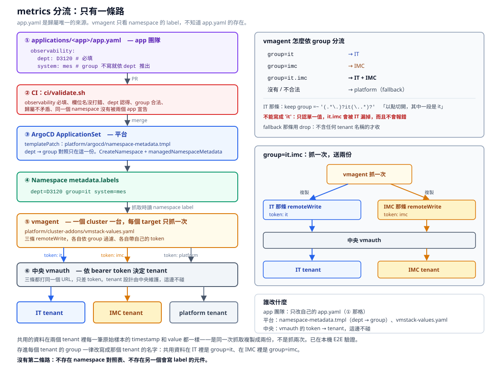

# 架構：metrics 怎麼分流到各個 tenant

只有一條路。**app.yaml 是歸屬唯一的來源**，vmagent 只看 namespace 的 label。



```
Developer
  → applications/<app>/app.yaml        ① 宣告歸屬
  → CI（ci/validate.sh）               ② 寫錯的在 merge 前擋掉
  → ArgoCD ApplicationSet              ③ 把歸屬轉成 namespace label
  → Namespace metadata.labels          ④ dept / group / system
  → vmagent                            ⑤ 依 group 分三條 remoteWrite
  → 中央 vmauth                        ⑥ 依 token 決定 tenant
  → IT / IMC / platform tenant
```

不存在 namespace 對照表，不存在第二個會寫 label 的元件。

## ① app.yaml：每個 app 自己宣告

每個 app 一個資料夾 `applications/<app>/`，裡面的 `app.yaml` 除了 ArgoCD 本來就要的欄位，多一個 `observability`：

```yaml
namespace: mes-dispatch-prod
# ... project / environment / owner / criticality / sync / helm ...

observability:
  dept: D3120        # 必填：這份資料是誰的
  system: mes        # 選填：業務系統，分析用
  # group: it.imc    # 選填：只有要「多送」給別的 tenant 時才寫
```

| 欄位 | 必填 | 意思 |
|---|---|---|
| `dept` | 是 | 歸屬，只有一個值。log 依它分流，所以不能省 |
| `group` | 否 | 要送到哪些 tenant，用點隔開。**不寫就依 dept 推出來** |
| `system` | 否 | 業務系統。不寫的話 namespace 上就沒有這個 label |

`group` 只有一個用途：**多送**。例如 IT 維護、IMC 也要看的服務寫 `group: it.imc`。它一定要包含 dept 所屬的那個 tenant，不能把資料從擁有者那邊拿走。

## ② CI：寫錯的在 merge 前擋掉

這些值寫錯的話，**執行時不會有任何錯誤**：vmagent 照樣收、照樣送，只是送進錯的地方或全掉進 fallback。所以要在 merge 前擋。

| 寫法 | 結果 | 不擋會怎樣 |
|---|---|---|
| 沒有 `observability` | 擋 | 資料全進 fallback |
| 欄位名打錯（`grop:`） | 擋 | **被默默忽略**，看起來有設其實沒有 |
| `dept: D9999`（不在對照表） | 擋 | group 查不到是空的，全進 fallback |
| `group: it.imcc`（打錯字） | 擋 | 只進 IT，IMC 看不到，沒人發現 |
| `group: it.platform` | 擋 | platform 其實收不到，見 ⑤ |
| `dept: D1110` + `group: it` | 擋 | 歸屬矛盾：IMC 看不到自己的資料 |
| `system: MES System`（有空白） | 擋 | 不是合法的 label 值，ArgoCD sync 會失敗 |
| 兩個 app.yaml 寫同一個 namespace | 擋 | 兩個 Application 輪流覆蓋對方的 label |

```bash
./ci/validate.sh     # 同時跑 app.yaml 本身的規則、observability、chart 渲染
```

## ③ ArgoCD：把歸屬轉成 namespace label

[../platform/argocd/namespace-metadata.tmpl](../platform/argocd/namespace-metadata.tmpl) 併進 ApplicationSet 的 `templatePatch`，用 `CreateNamespace=true` + `managedNamespaceMetadata` 把 label 貼到這個 app 的 namespace 上。

**ownership 規則全部在這一份**：

- dept → group 的對照就寫在這份 template 的 `$groups` 裡，改組只改這裡
- CI 的驗證器直接讀這個 `$groups`，兩邊用的是同一份，不會各說各話

```
group 有寫   → 用寫的
group 沒寫   → 用 $groups[dept]
system 沒寫  → 不產生 system label（不是產生空字串）
```

## ④ namespace 最後拿到的 label

| app.yaml | namespace 的 label |
|---|---|
| `dept: D3120, system: yms` | `dept=D3120  group=it  system=yms` |
| `dept: D1110, system: wip` | `dept=D1110  group=imc  system=wip` |
| `dept: D3120, group: it.imc` | `dept=D3120  group=it.imc`（沒有 system） |

這三種都在 [../tests/app-yaml/](../tests/app-yaml) 裡驗過渲染結果。

## ⑤ vmagent：只讀 namespace label，依 group 分流

一個 cluster 一台 vmagent，由 cluster-addons 部署，設定在 [../platform/cluster-addons/vmstack-values.yaml](../platform/cluster-addons/vmstack-values.yaml)。

**vmagent 不知道 app.yaml 的存在，也不維護任何 app 或 namespace 清單。** 它只做兩件事：

**抓取時**，`scrapeClasses` 把 namespace 的 label 貼到每一筆 metrics 上：

```yaml
scrapeClasses:
  - name: default
    default: true
    attachMetadata: {namespace: true}
    relabelConfigs:
      - {source_labels: [__meta_kubernetes_namespace_label_group], target_label: group}
      - {source_labels: [__meta_kubernetes_namespace_label_dept],  target_label: dept}
      - {source_labels: [__meta_kubernetes_namespace_label_system], target_label: system}
```

**送出時**，資料複製成三份，每一條 remoteWrite 各自過濾：

| 那一條 | 過濾 | 帶的 token |
|---|---|---|
| IT | keep `group =~ '(.*\.)?it(\..*)?'` | `it` |
| IMC | keep `group =~ '(.*\.)?imc(\..*)?'` | `imc` |
| platform | drop `group =~ '(.*\.)?(it\|imc)(\..*)?'` | `platform` |

regex 的意思是「group 以點切開，其中一段是 it」：

| group | IT | IMC | platform |
|---|---|---|---|
| `it` | ✓ | | |
| `imc` | | ✓ | |
| `it.imc` | ✓ | ✓ | |
| 沒有 / `platform` / 不合法的值 | | | ✓ |
| `itx`、`split`（剛好含字母） | | | ✓ |

**regex 不能偷懶**，兩種直覺的寫法都會錯，而且都不會報錯：

- `'it'`：只認單一值，`it.imc` 會被 IT 漏掉。E2E 實測過，測試會抓到
- `'.*it.*'`：名字裡剛好含 `it` 的 group 也會被算進 IT

YAML 用**單引號、一個反斜線**。從雙引號的範例複製過來時要把反斜線減半，不然會變成比對字面上的反斜線，`it.imc` 又被漏掉。

**platform 為什麼不能拿來組合**：platform 那條是用 drop 認「不屬於任何 tenant」的，所以 `it.platform` 含有 `it` 就被 drop 掉，platform 收不到。CI 會擋這種寫法。

### group=it.imc：抓一次，送兩份

共用的資料不是被抓兩次。vmagent 每個 target 只抓一次，送出時複製給 IT 和 IMC 兩條 remoteWrite。E2E 直接匯出兩個 tenant 裡的原始樣本比對：**每一筆的 timestamp 精確到毫秒都一樣**。如果是抓兩次，timestamp 會不同。

存進 tenant 時 `group` 一律改寫成那個 tenant 的名字：同一份資料在 IT 裡是 `group=it`、在 IMC 裡是 `group=imc`。

## ⑥ 中央 vmauth：依 token 決定 tenant

三條 remoteWrite 打的是**同一個 URL**，唯一的差別是 bearer token。vmauth 依 token 決定寫進哪個 tenant。

**tenant 設計由中央維護，這邊不碰。** 我們只決定「哪一份資料帶哪一把 token」。token 放在 vmagent 那個 namespace 的 `vmauth-token` Secret，三個 key：`it`、`imc`、`platform`。上線步驟見 [vmagent.md](vmagent.md)。

## 要改東西時改哪裡

| 情況 | 改哪 |
|---|---|
| 新增一個 app | 新增 `applications/<app>/`，`app.yaml` 寫好 `observability` |
| app 要多送給另一個 tenant | 那個 app 的 `app.yaml` 加 `group` |
| 改組（部門搬到別的 group） | `namespace-metadata.tmpl` 的 `$groups` |
| 新增一個 tenant | 中央先發 token → `$groups` 加部門 → `vmstack-values.yaml` 加一條 remoteWrite、把名字加進 platform 那條的 drop regex → Secret 加 key |

**改組只要改一個地方**。vmagent 的設定裡沒有部門清單，部門進出都不用動它。

⚠ production 依你們的規則不可自動同步。改組後 **production 的 namespace 要等手動 sync 才會換 label**，這段期間資料照舊進原本的 tenant。

## 測試環境

```
正式    vmagent → 中央 vmauth → IT / IMC / platform tenant
本機    vmagent → 本機 vmauth → VMSingle it / imc / platform
```

本機的 vmagent 是**從正式的 `vmstack-values.yaml` 產生的**，只換掉 URL。三條 remoteWrite 打同一個本機 vmauth、只差 token，所以三個 VMSingle 收到不同的資料，就代表「依 token 分 tenant」跟正式環境同樣在運作。

| 測試 | 驗什麼 | 需要 cluster |
|---|---|---|
| [tests/app-yaml](../tests/app-yaml) | A. app.yaml 驗證　B. app.yaml → namespace label | 不用 |
| [tests/routing](../tests/routing) | C. namespace label → tenant 的 E2E | 要（k3d） |

## 沒有 E2E 驗證的部分

整條路只有 ③ 沒有實機跑過，因為本機沒有 ArgoCD：

1. **template 是用 helm 渲染的**，不是 ArgoCD。兩者都是 Go template + sprig，用到的 `dict` / `dig` / `get` / `default` 行為一樣，但這不是 ArgoCD 本身。
2. **E2E 裡把 label 貼到 namespace 的是 `kubectl label`**，貼的內容是 template 渲染的結果，但動作不是 ArgoCD 做的。
3. **`managedNamespaceMetadata` 對已經存在的 namespace 會不會套用**，沒驗證。你們的 namespace 如果是 `scripts/deploy.sh` 先建好的，要特別確認。
4. **label 是不是在 app 的 pod 起來之前就貼好**，沒驗證。如果不是，第一次部署時最開始的幾筆資料會進 fallback。

①②④⑤⑥ 都有測試，而且確認過「故意改壞時會 exit 1」。
