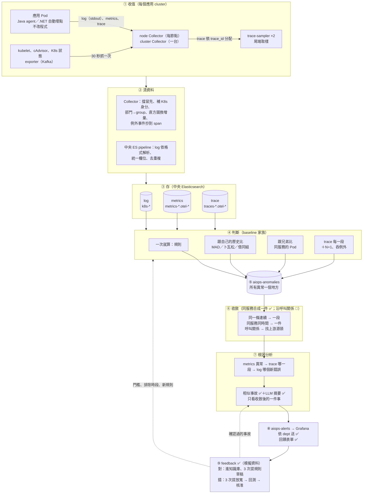
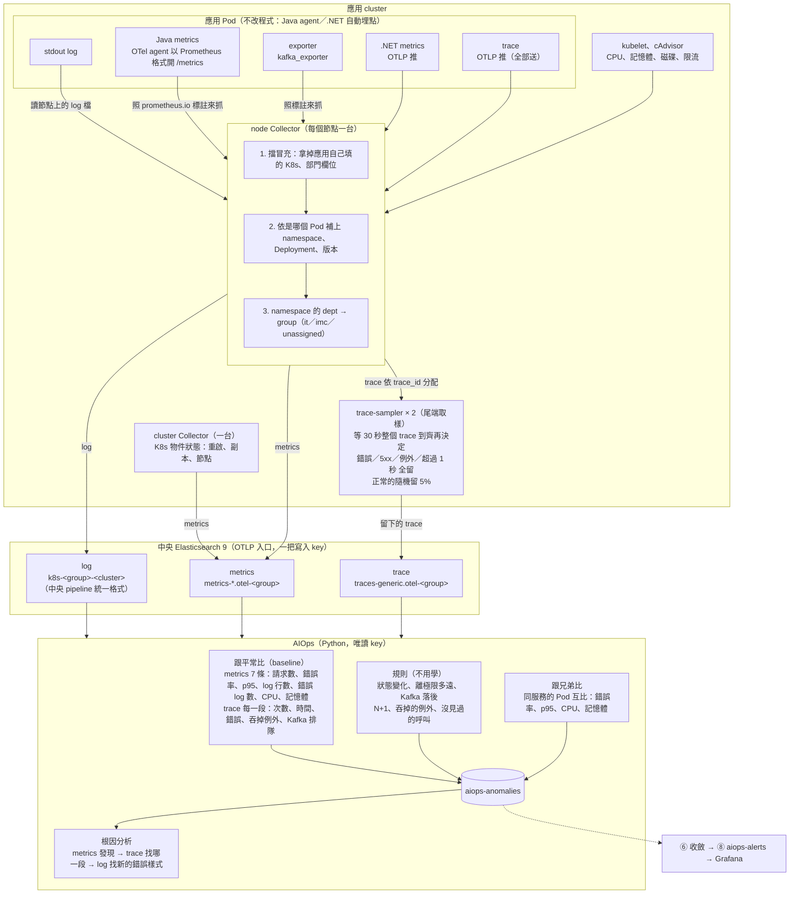
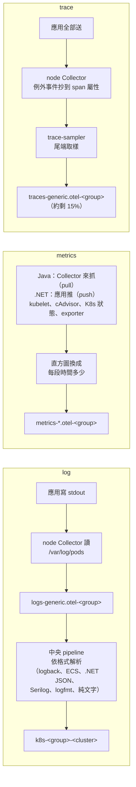
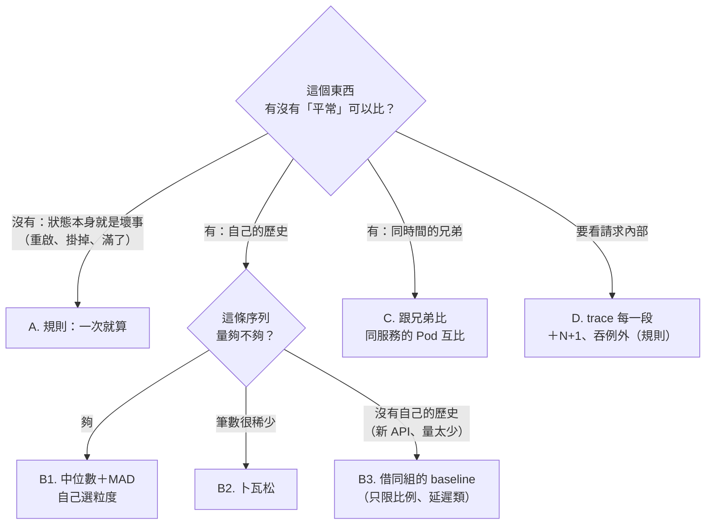
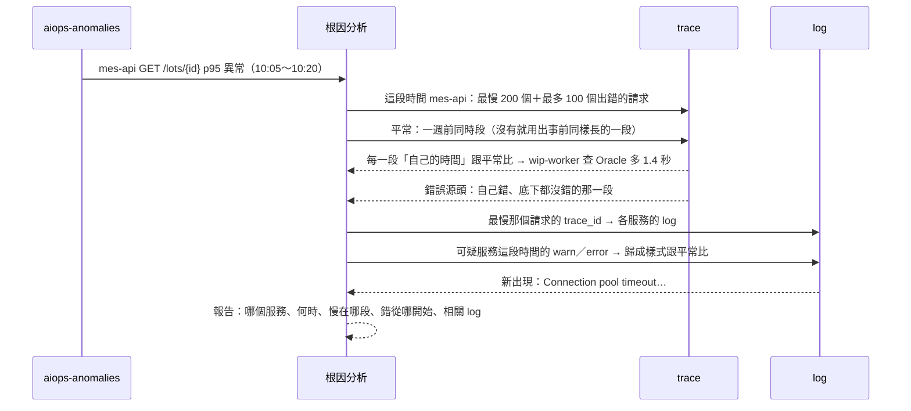

# 架構與整條線

一句話：**每個應用 cluster 一套 OpenTelemetry Collector，把 log、metrics、trace 依 namespace 的部門分流，寫進中央 Elasticsearch 9；AIOps 用唯讀 key 讀出來，學「平常的樣子」、跑規則、Pod 互比，異常寫進 `aiops-anomalies`；同一個服務合成一件、附根因報告、相似事故、LLM 摘要，寫進 `aiops-alerts`；Grafana 依部門發通知；老師傅的回饋回來改門檻、進知識庫。** 舊專案不改程式（Java agent、.NET 自動埋點）。

- 範圍：一般服務（Web API、worker、Kafka、DB）；工廠（EAP、機台、MES…）不在目前範圍。
- 各 phase 的狀態：[poc-status.md](poc-status.md)；現況與待辦（依 PDCA 分）：[pdca/](pdca/README.md)。
- 狀態符號：✅ 已做、實測過 ／ ⚠️ 做了一部分 ／ 📝 設計好、還沒做。

## 一張圖看全部



## 九個模組

**編號只有這一套（①～⑨）**：整個專案的文件、PDCA 紀錄、待辦都用它，不另外編「階段」。

| # | 模組 | 做什麼 | 在哪裡 | 狀態 |
|---|---|---|---|---|
| ① | 收值 | log、metrics、trace，舊專案不改程式；尾端取樣 | `telemetry/collectors/` | ✅ |
| ② | 清資料 | Collector 補身分、擋冒充；中央 pipeline 統一格式、去重複 | 同上、`telemetry/storage/` | ✅ |
| ③ | 存 | 中央 ES，依部門 group 分 data stream、一把寫入 key；failure store；保留天數 | `telemetry/scripts/` | ✅ |
| ④ | 判斷 | 規則、跟歷史比、跟兄弟比、trace 每一段 | `engine/detector/`、`engine/configs/baseline/` | ✅（K8s CronJob 沒跑過） |
| ⑤ | 異常總表 | 所有判斷結果寫同一個 index | `aiops-anomalies` | ✅ |
| ⑥ | 收斂 | 同一個服務、30 分鐘內的異常合成一件 | `engine/investigator/alerts.py` | ✅（沿呼叫關係 📝） |
| ⑦ | 根因分析 | metrics → trace → log；相似事故；LLM 摘要 | `engine/investigator/`、`engine/core/llm.py` | ✅（沒有評測集） |
| ⑧ | 出口 | `aiops-alerts` 一件一筆、Grafana 依 dept 通知、回饋表單 | `engine/configs/grafana/`、`engine/feedback_web/` | ✅（K8s CronJob 沒跑過） |
| ⑨ | feedback | 回饋 → 建議 → 回測 → 核准；事故進知識庫；量化 | `engine/detector/` | ✅（模擬資料） |

## 一個 cluster 裡資料怎麼走



## 三種資料怎麼收



| 資料 | 多久一次 | 細節 |
|---|---|---|
| log | 0.2 秒掃一次檔案（幾乎即時） | [log/README.md](log/README.md) |
| metrics：應用、資源、K8s 狀態 | 30 秒 | [metrics/README.md](metrics/README.md)、[metrics/dotnet.md](metrics/dotnet.md) |
| metrics：外部（kafka_exporter） | 30 秒 | [metrics/cases.md](metrics/cases.md) |
| trace | 即時；sampler 等 30 秒讓 trace 到齊 | [trace/README.md](trace/README.md) |

- trace 尾端取樣依序比對、符合第一條就留：隨機 5% → 有錯誤 → HTTP 5xx → 有例外 → 超過 1 秒。
- 斷線時，送 ES 的資料先寫在節點磁碟（`file_storage`），恢復後補送；trace-sampler 的佇列也寫磁碟。

## 清資料

Collector（在廠內）管「這筆是誰的」；中央 ES pipeline 管「格式統一、不重複」。

| 問題 | 怎麼處理 | 為什麼 |
|---|---|---|
| 應用亂填服務名、部門 | Collector 先刪應用自填的 K8s、部門欄位，再依 Pod 補 | 三種資料的服務、Pod、namespace 才對得上 |
| 同一筆重送 | log 用內容指紋當 `_id`；trace 用 `trace_id + span_id`；metrics 靠 TSDB 去重 | 斷線補送、Collector 重啟不會多一份 |
| log 格式五花八門 | 依 `log.format` 分派解析規則；沒對應的退回預設 | 哪種格式都拿得到 level、trace.id、訊息 |
| 直方圖是累加值 | Collector 換成「每 30 秒多少」 | 任一段時間直接加總 |
| 沒資料 ≠ 0 | 服務出現後沒資料補 0；上線前、收集系統停機當「不知道」 | 停機時段不會被學成「平常掉到 0」 |

餵給 baseline 之前的檢查（資料品質、排除時段、慢性病、行事曆）見 [baseline README「餵給 baseline 之前」](../engine/configs/baseline/README.md#餵給-baseline-之前擋了什麼還缺什麼)。

## log、metrics、trace 共用什麼

| 共用的東西 | 說明 | 在哪 |
|---|---|---|
| 同一種收集器 | OTel Collector：每節點一台（node）、K8s 狀態一台（cluster）、trace-sampler 兩台 | `telemetry/collectors/` |
| 同一份分部門規則 | 擋冒充、讀 namespace 的 `dept`、對應成 group；同一 Pod 三種資料同一個 group | `common.yaml` 的 `transform/group` |
| 同一把寫入 key | 所有 group、三種資料共用；group 由 Collector 依 Pod 決定，不靠 key 擋 | `es-writer-keys`、`telemetry/scripts/elasticsearch-setup.sh` |
| 同一套身分欄位 | `service.name`、namespace、Pod 是共同鑰匙；`dept`、`group` 是歸屬 | Collector、`engine/detector/owner.py` |
| 串接鑰匙 | trace 的 `trace_id` ↔ log 的 `trace.id`；metrics 沒有，用服務＋時間 | — |
| 同一把 AIOps 唯讀 key | 讀三種資料；只寫 `aiops-*` | `elasticsearch-setup.sh` |

- 為什麼一把寫入 key：沒有部門間寫入隔離的要求，也少了「key 權限漏了 → ES 回 200 默默拒收」的機會（[pdca/phase1-collect/2026-10-ingest-simplify.md](pdca/phase1-collect/2026-10-ingest-simplify.md)）。
- 歸屬與共同鑰匙的差別、完整鑰匙清單：[rca/README.md「歸屬 label 和共同鑰匙是兩種東西」](rca/README.md#歸屬-label-和共同鑰匙是兩種東西)。
- 代價：`dept` 清單要手動同步兩處（`telemetry/groups.yaml`、`common.yaml`）。
- 歸屬方式（讀 namespace label 或改成 app → group 清單）一改，三條線要一起改（[README「還沒定案的」](../README.md#還沒定案的)）。

## 整條線：每一步做什麼、程式在哪、怎麼驗

| 步 | 做什麼 | 程式／設定 | 多久跑一次 | 怎麼驗過 |
|---|---|---|---|---|
| ① 應用 | 用 [sdk/charts/app-common](../sdk/charts/app-common) 部署；log 印 stdout、metrics 給抓、trace 用 OTLP 送 | `sdk/`、[sdk/standards/tracing.md](../sdk/standards/tracing.md) | 常駐 | k3s `run-e2e.sh`、`run-dotnet-e2e.sh`、`run-trace-e2e.sh` |
| ① 收值 | node Collector 收 log、metrics、trace；cluster Collector 收 K8s 狀態；sampler 尾端取樣 | `telemetry/collectors/*.yaml` | 常駐；metrics 30 秒 | 同上；[trace-durability](pdca/phase1-collect/2026-10-trace-durability.md)、[es-startup-401](pdca/phase1-collect/2026-10-es-startup-401.md) |
| ② 清資料 | Collector 擋冒充、分部門、換增量、Java 指標改名同 .NET；pipeline 解析、時區、去重 | `telemetry/collectors/common.yaml`、`telemetry/storage/` | 進來就做 | `e2e/pipeline/`；[field-unify](pdca/phase1-collect/2026-10-field-unify.md)、[time-alignment](pdca/phase1-collect/2026-10-time-alignment.md) |
| ③ 存 | 依 group 進 `k8s-<group>-<cluster>`、`metrics-*.otel-<group>`、`traces-*.otel-<group>` | `elasticsearch-setup.sh`、`retention.conf` | — | `run-key-rotation.sh`、`run-es-2node.sh` |
| ④ 判斷 | 規則、baseline、跟兄弟比、trace 每一段；資料品質；排除時段 | `engine/detector/`、`engine/configs/baseline/*.yaml` | 見下一節 | 單元測試；`synth_e2e`、`adaptive_e2e`、`fine_e2e`；k3s `run-rules-e2e.sh`、`run-peer-e2e.sh`、`run-trace-baseline-e2e.sh` |
| ⑤ 異常總表 | 所有判斷結果一個 index | `aiops-anomalies` | — | — |
| ⑥ 收斂 | 同服務、30 分鐘內接著來的異常 = 一件；30 分鐘沒新的 → resolved；每輪寫心跳 | `investigator/alerts.py`、`cmd_alert.py`；`rca.yaml` 的 `alerts:` | 每 1 分鐘 | `test_alerts.py`；[alert-exit](pdca/phase3-locate/2026-10-alert-exit.md) |
| ⑦ 根因分析 | 新的一件跑 metrics → trace → log；附相似事故、LLM 摘要 | `investigator/__main__.py`、`similar.py`、`core/llm.py` | 跟 ⑥ 同一次 | k3s `run-rca-e2e.sh`；`loop_e2e`；`test_similar.py`、`test_llm.py` |
| ⑧ 出口 | 一件一筆寫 `aiops-alerts`；Grafana 每件一則、依 dept 送、結束發恢復 | `engine/configs/grafana/*.yaml` | Grafana 每 1 分鐘查 | Grafana 12.2 實測；[rca-demo](pdca/phase3-locate/2026-10-rca-demo.md) |
| ⑨ 回饋 | 通知連結 → 回饋表單；寫 `aiops-feedback`、`aiops-incidents`；建議 → 回測 → 核准 | `feedback_web/`、`cmd_feedback.py`、`cmd_backtest.py`、`cmd_metrics.py` | 網頁常駐；suggest、backtest 人跑 | `loop_e2e`；`test_feedback_web.py`、`test_feedback.py`、`test_metrics.py` |

各步的細節：

- ⑤ 欄位（`series`、`keys`、`value`、`median`、`z`、`status`、`dept`、`group`…）見 [baseline README「異常帶的欄位」](../engine/configs/baseline/README.md#異常帶的欄位)；同一條、同一時間重跑覆蓋同一筆。
- ⑥ 哪些異常會開一件、怎麼不重複開：[engine/configs/rca/README.md「事件整合」](../engine/configs/rca/README.md#事件整合alert)。
- ⑧ `aiops-alerts` 帶 `status`、`service`、`dept`、`group`、`severity`、`summary`、`report`、`feedback_url`。
- ⑧ 沒 dept 的送平台；心跳 10 分鐘沒寫 → 「AIOps 停了」（docker 實測過）。
- ⑧ `summary` 是 Grafana 的 label，不放會變的字；engine 寫 `@timestamp` 往前 1 分鐘，避免假恢復（[alert-flap](pdca/phase3-locate/2026-10-alert-flap.md)）。
- ⑨ 回饋表單定案用 Grafana Business Forms 外掛，回饋服務的小網頁當備案（[grafana-form](pdca/phase5-learning-loop/2026-10-grafana-form.md)）。
- ⑨ 回來的路：確認的事故 → 下次相似事故查得到；誤報 3 次 → `feedback suggest` 放寬 → `backtest` → `adjust approve`；漏報 → 降 z；同根因 3 次 → 規則（門檻算好，核准後 `rules` 自動載入）。

## 時間顆粒與排程

| 層 | 顆粒、看多久 | 排程（`engine/deploy/`） |
|---|---|---|
| 原始資料 | metrics 30 秒一筆；log、trace 每筆有自己的時間 | 持續 |
| baseline 的點 | 預設 30 秒，每條序列依事件數往粗調到 1 小時 | — |
| 「平常」的時段 | 星期幾 × 小時 = 168 個時段（台北時間） | — |
| train | 最近 4 週；30 秒、1 分鐘的只學 14 天 | 每天 02:00 |
| detect | 最近 10 分鐘，只看已收齊的時間窗 | 每 1 分鐘 |
| rules | 最近 10 分鐘；同規則同對象 1 分鐘只記一筆 | 每 1 分鐘 |
| alert（⑥⑦⑧） | 最近的異常 | 每 1 分鐘 |
| peer、trace、quality、chronic | peer 10 分鐘一個值；trace 每 5 分鐘每支 API 抽 20 個 | 第二階段（`cronjobs-stage2.yaml`） |

- 第一階段只開 rules、detect、alert、train 四個 CronJob；其他 6 個在 `cronjobs-stage2.yaml`，kustomization 預設註解。
- 最快多久開始判斷：約 4 小時（50 個點，「不分時段」層）；3 天後有「每天同一小時」；2 週後有「同星期幾 × 同小時」。
- 歷史不夠時寧可不報。
- 粒度怎麼選、細節：[baseline README「自動調整」](../engine/configs/baseline/README.md#自動調整粒度低頻事件借用-baseline)。

## 怎麼判斷正常、異常

四種判斷各管不同的事，結果都寫進 `aiops-anomalies`。



| 方法 | 一句話 | 細節 |
|---|---|---|
| A. 規則 | 狀態變化、離極限多遠、JVM／.NET、連線池、Kafka、trace 規則；30 多條 | [baseline README「規則」](../engine/configs/baseline/README.md#規則狀態變化離極限多遠) |
| B1. 中位數＋MAD | 同時段 4 週的中位數；\|z\| ≥ 5 且差距 ≥ `min_abs` | [「MAD 一步一步算」](../engine/configs/baseline/README.md#mad-一步一步算) |
| B2. 卜瓦松 | 很稀少的筆數；機率 < 0.001 才算 | [「很稀少的事件」](../engine/configs/baseline/README.md#2-很稀少的事件卜瓦松) |
| B3. 借同組 | 新 API、量太少；借成員中位數，z ≥ 7、可信度 low | [「借同類的」](../engine/configs/baseline/README.md#3-自己沒有-baseline借同類的) |
| C. 跟兄弟比 | 同服務的 Pod 同時間互比；至少 3 個 Pod | [「跟兄弟比」](../engine/configs/baseline/README.md#跟兄弟比同一個服務的-pod-互相比) |
| D. trace 每一段 | 每段自己的時間、次數、錯誤、吞例外、Kafka 排隊 | [「trace 每一段的 baseline」](../engine/configs/baseline/README.md#trace-每一段的-baseline) |

| 情況 | 用哪種 | 為什麼 |
|---|---|---|
| Pod 重啟、副本不足、磁碟 95% | A 規則 | 一次就是壞事，不用等歷史 |
| 整個服務錯誤率變高、變慢 | B 歷史 | 要知道「平常」多少才知道算不算高 |
| 半夜突然出現白天的流量 | B 歷史 | 只有分時段的歷史看得出來 |
| 只有一個 Pod 慢 | C 兄弟 | 服務平均被其他 Pod 拉平了 |
| 換版後每個請求多查 30 次 DB | D trace | metrics 只看到稍慢，trace 看到哪一段、幾次 |
| 新 API 上線第一天 | B3 借同組 | 沒有自己的歷史 |
| 平常幾乎不失敗的排程一小時失敗 8 次 | B2 卜瓦松 | 平常大多是 0，中位數和 MAD 都是 0 |

- 跳一次是 `warning`（不觸發根因分析、不通知）；同方向連續 2 個時間窗、或連續滿 30 分鐘才是 `anomaly`（[「跳一次是 warning」](../engine/configs/baseline/README.md#跳一次是-warning連續才是-anomaly)）。
- 偏太多（`instant_z: 15`）或設了 `confirm_points: 1` 的序列一次就算（[instant-anomaly](pdca/phase2-anomaly/2026-10-instant-anomaly.md)）。
- critical 規則一次就算；其他規則用 `for` 要持續一段時間。

### 為什麼用時間序列 baseline 當主力

| | 移動式（moving） | 時間序列（季節性） | ML |
|---|---|---|---|
| 「平常」是什麼 | 剛剛：最近 1 小時或 N 個點 | 過去同一個時段 | 模型自己學 |
| 常見做法 | 移動平均 ± k 倍標準差、EWMA、變化點 | 同時段中位數＋MAD、STL、Holt-Winters | Isolation Forest、Autoencoder、Elastic ML |
| 擅長 | 突然跳一階；新服務；最便宜 | 有週期的：上下班、換班、夜間批次 | 很多指標一起看、規律複雜 |
| 弱點 | 看不懂週期；慢慢變壞抓不到 | 要累積 2～4 週；沒見過的日子會誤報 | 要大量資料和標註、難解釋、要 MLOps |

| 我們的東西 | 屬於 |
|---|---|
| 主力 baseline（星期幾 × 小時的中位數＋MAD）、卜瓦松 | 時間序列：不做預測，每天用最近 4 週重算 |
| 根因分析的「平常」：一週前同時段 | 時間序列 |
| 根因分析在一週前沒資料時：出事前同樣長的一段 | 移動式 |
| 跟兄弟比 | 都不是：同一時間的橫向比較 |
| 規則 | 都不是：固定門檻 |
| ML | 不用（[feedback/llm-mlops.md](feedback/llm-mlops.md)） |

- 結論：時間序列當主力；移動式當週期明顯的主力會一直誤報。
- 移動式當輔助（📝），補兩個洞：新服務的前幾天（現在靠借同組）；突然跳一階後停在新位置（變化點偵測能標出「10:32 變了」，可跟換版時間對）。

## metrics、trace、log 怎麼串



- metrics → trace 是「服務＋API＋時間窗」的統計對應，不是 trace_id（ES 9.5.5 不存 exemplar）。
- trace → log 用 `trace_id`，是同一個請求。
- 接不起來的、共同鑰匙清單：[rca/README.md「metrics 異常怎麼串到 trace、log」](rca/README.md#metrics-異常怎麼串到-tracelog)。
- 報告的段落與範例：[engine/configs/rca/README.md「報告長什麼樣子」](../engine/configs/rca/README.md#報告長什麼樣子)。

模組之間的交接（程式結構）：

| 共用的東西 | 誰用 | 作用 |
|---|---|---|
| `core/es.py` | baseline、根因分析 | 同一套連線、查詢、寫入（唯讀＋只寫 `aiops-*` 的 key） |
| `core/traces.py` | trace baseline、根因分析 | 同一套「每段自己的時間、錯誤源頭」算法 |
| `aiops-anomalies` | 所有判斷 → 收斂、根因、LLM、feedback | 模組之間只透過這個 index 交接 |
| `aiops-baseline` | train 寫、detect 讀 | 每條序列每個時段的平常值 |
| `*.yaml` 設定 | 各模組 | 加序列、加規則、調門檻不用改程式 |

## 收斂：很多筆怎麼變成一件

全部用程式算（不用 LLM）；設計見 [rca/README.md「雜訊壓制」](rca/README.md#雜訊壓制)。

| 層 | 狀態 |
|---|---|
| ① 同一條序列連續 → 一段 | ✅ `status`、`streak`（跳一次 warning、連續才 anomaly）；📝 一段記成一筆 |
| ② 同一個服務、時間重疊 → 一件 | ✅ `investigator alert`；同 dept 的兩個服務是兩件 |
| ③ 沿呼叫關係 → 找源頭 | 📝 呼叫關係已有（根因分析的 `topology`） |
| ④ 排優先、靜音、限頻 | 📝 |

- 收斂後一件一筆寫 `aiops-alerts`（給 Grafana）和 `aiops-incidents`（`status: auto`，老師傅確認後變知識庫）。
- 根因分析、相似事故、LLM、feedback 都以「件」為單位。
- LLM 只看收斂後的一件事，約 4,000 token 輸入（[feedback/README.md「什麼時候叫 LLM」](feedback/README.md#什麼時候叫-llmtoken-怎麼省)）。
- 回饋怎麼回到系統：[feedback/README.md「對了怎麼強化、錯了怎麼 feedback」](feedback/README.md#對了怎麼強化錯了怎麼-feedback)。

## 產品主線 8 步

產品的說法是 8 步（賣點：learning loop、老師傅 feedback、RCA 結合 RAG）；編號仍以 ①～⑨ 為準。

| 步 | 內容 | 模組 | 現況 |
|---|---|---|---|
| 1 | 收值，三種資料共用同一套鑰匙 | ①（鑰匙名字統一屬 ②） | ✅ |
| 2 | 清資料：進來時＋餵 baseline 前（`quality`、`adjust`、`chronic`、行事曆） | ② | ✅ 程式；⚠️ 後者沒排程 |
| 3 | 異常分析：基本樣式（baseline、trace 每一段）＋單次異常（規則、兄弟） | ④（結果寫 ⑤） | ✅ 程式；門檻是估的 |
| 4 | 串 metrics → trace → log，抓出問題在哪 | ⑦ | ✅ |
| 5 | 輔助工具：呼叫關係、瀑布圖、log 樣式、業務 ID 查交易、LLM 查詢工具 | ⑦ | ⚠️ 前三樣有 |
| 6 | 整合事件：很多筆異常合成一件 | ⑥（送出去屬 ⑧） | ⚠️ 只有同服務合成一件 |
| 7 | 根因＋RAG：附相似事故、老師傅當時怎麼判斷與處置；LLM 摘要 | ⑦＋⑨ | ✅ 模擬資料 |
| 8 | learning loop：知識庫更新、門檻調整（建議 → 回測 → 核准） | ⑨（回饋入口屬 ⑧） | ✅ 模擬資料 |

- 8 步沒寫到、但一定要的是 ⑧ 出口：沒有它，第 6 步之後沒人看到，第 8 步也沒有回饋可學。
- 定案：不再加新的偵測機制，先把這一圈在真實環境跑起來。

整合驗證（`tests/loop_e2e.py`，docker 的 ES 9.5.5、模擬資料 `aiops-synth`：3 個服務 4 週歷史＋2 天，37 項全過）：

| 故事 | 結果 |
|---|---|
| 第 1 次 mes-api 變慢 → 一件＋報告 → 老師傅回饋 | `aiops-incidents` 先 `auto` 再 `confirmed`；每筆異常一筆回饋 |
| 第 2 次同樣症狀 | 報告最前面附第 1 件；LLM 摘要（template）每句附依據 |
| 第 3 次 → 同根因 3 次 | 附 2 件相似；`similar-eval` recall@3 = 3/3；提規則草稿 |
| 月底批次誤報 3 次 | 建議 z 5 → 7；沒回測不能核准；`backtest` 告警 3 → 1；核准後不再報 |
| 漏報 | 一筆降 z 的建議 |
| 量化（`metrics`） | 6 件、有回饋 100%、誤報率 50%、確認的事故 3 |

一件事從頭到尾（`loop_e2e` 跑出來的）：

```
10:00  mes-api 延遲 120ms → 480ms（4 個 5 分鐘）
10:01  detect：synth.latency z 45，第 1 點 warning、第 2 點 anomaly → aiops-anomalies
10:02  alert：開一件 a-20261005-0205-mes-api（D3120／it）
       → 根因分析（有 trace 時：慢在 wip-worker › Oracle SELECT lots）
       → 相似事故：知識庫空的，不附
       → aiops-alerts status open、summary「[warning] mes-api：synth.latency 526（平常 121.3）…」
       → aiops-incidents 一筆 status auto（帶指紋）
       → 心跳
10:02  Grafana：status:open 查到 → it-oncall 收到一則，附摘要、報告連結、回饋連結
10:10  老師傅點連結：真的、db、「Oracle 統計資訊過期」、處置「重跑 analyze」、
       怎麼看出來的「只有 lots 那張表的查詢慢，AWR 看到執行計畫變了」
       → aiops-feedback 3 筆、aiops-incidents 變 confirmed
10:35  30 分鐘沒新異常 → resolved → Grafana 發恢復
隔天   同樣症狀 → 新的一件，報告最前面：
       「跟 10-05 的事故相似（同服務；同樣的指標異常）；當時根因 [db] …；處置 …」
       「建議先照上次的方式確認：只有 lots 那張表的查詢慢… [I1]」
```

## 想確認什麼、跑哪個

| 想確認什麼 | 跑哪個 | 需要 |
|---|---|---|
| 程式邏輯對（不連 ES） | `cd engine && python3 -m pytest -q`（318 個） | 無 |
| 收值線通（Collector → ES → 分部門） | `e2e/local-k3s/run-e2e.sh` | k3s |
| K8s 上補身分、OTLP log、Grafana initContainer | [e2e/local-k3d/](../e2e/local-k3d/README.md) | k3d |
| 根因分析找到那一段、那行 log | `e2e/local-k3s/run-rca-e2e.sh` | k3s，約 14 分鐘 |
| 整條線在 K8s 上：送資料 → 規則偵測 → 一件 → 根因＋LLM → Grafana | `e2e/local-k3s/rca-demo/run-rca-demo.sh`（up → loop → incident） | k3s、`run-e2e.sh` 跑過；真的 LLM 要 `LLM_ENV_FILE` |
| baseline 抓得到造的異常、誤報多少 | `cd engine && python3 -m tests.synth_e2e` | 一個 ES |
| 整個 learning loop 的故事 | `cd engine && python3 -m tests.loop_e2e` | 一個 ES，約 2 分鐘 |
| Grafana 一件一則、依 dept | 照 [configs/grafana/README.md](../engine/configs/grafana/README.md) | Grafana 12 |
| 上 K8s 排程 | `kubectl apply -k engine/deploy/` | 還沒跑過 |

- rca-demo 約 15 分鐘看到根因；恢復通知要再等 30 分鐘。

## 還沒做、還不足的

會影響能不能用、能不能賣的：

1. **全部是模擬資料**：門檻（z 5、`instant_z` 15、相似分數 4、誤報 3 次、權重）全是估的，要 2～4 週真實資料。
2. **K8s 排程沒跑過**：rca-demo 在 K8s 上用 `loop` 跑整條線，engine 的 CronJob 還沒跑過。
3. **沒有評測集**：真的 LLM 跑過（OpenAI 12 次、rca-demo 一次），相似事故在沒有 trace 時只靠「同服務＋同指標」剛好壓在門檻上。
4. **回饋沒有身分**：回饋表單、小網頁都沒登入；回饋 3 次可以是同一個人（沒有第二人確認）。
5. **漏報沒有網頁入口**，仍靠 `feedback` 指令。
6. 月底批次只會提「放寬 z」，不會提排除時段。
7. 舊事故單匯入 `aiops-incidents` 的格式沒寫。
8. code-review 剩三項沒動：metrics 回饋跨段、回測重複查 ES、相似事故 ES 前 20 筆截斷。

各模組還沒做的：

| 模組 | 還沒做 |
|---|---|
| ① 收值 | .NET SQL Server、Serilog／NLog 驗證 |
| ③ 存 | 副本、正式環境容量 |
| ④ 判斷 | p99、慢請求比例、往外呼叫耗時；趨勢；`groups` 依公司命名；移動式／變化點偵測 |
| ⑦ 串接 | 單一 Pod 異常 → 拿它的 trace 逐段比；撈 log 帶 `span.id` |
| ⑥ 收斂 | 沿呼叫關係合併、排優先 |
| ⑨ feedback | 版本、評測集、第二人確認、排除時段的建議 |

## 哪裡過度設計

以「工廠維運可靠度、AIOps 基本盤」來看：

| 東西 | 為什麼算過度 | 建議 |
|---|---|---|
| baseline 三個自動機制同時存在：自選粒度、卜瓦松、借同組 | 沒有真實資料就先做三種退路，設定、文件、測試都變厚 | 留著但不再擴；真實資料跑過再決定砍哪個 |
| trace 每一段的 baseline＋N+1、吞例外規則 | trace 有取樣、只留 7 天，學出來的「平常」本來就偏 | 先只跑根因分析那條；trace baseline 等真資料 |
| 回饋表單 10 個「查了哪裡」、6 種誤報原因、9 類根因 | 選項是估的，沒人填過 | 第一週看真的填了什麼再縮 |
| `metrics` 的「最吵的服務」、依 dept | Grafana 讀 `aiops-alerts` 畫更合適 | 留表格，不再加欄 |

**不是過度、一定要的**：Collector 的擋冒充與分部門、一把 key 可換、failure store、規則的保底門檻、連續才算、心跳、「已確認不覆蓋」、每句附依據的檢查、沒回測不能核准。這些是可靠度，不是功能。
