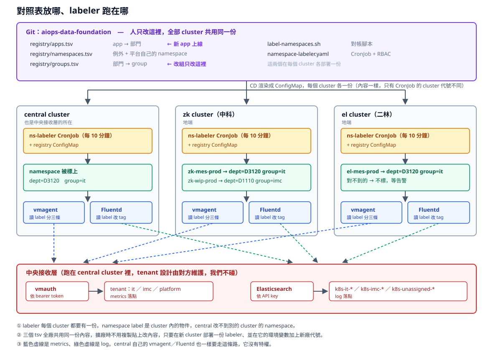
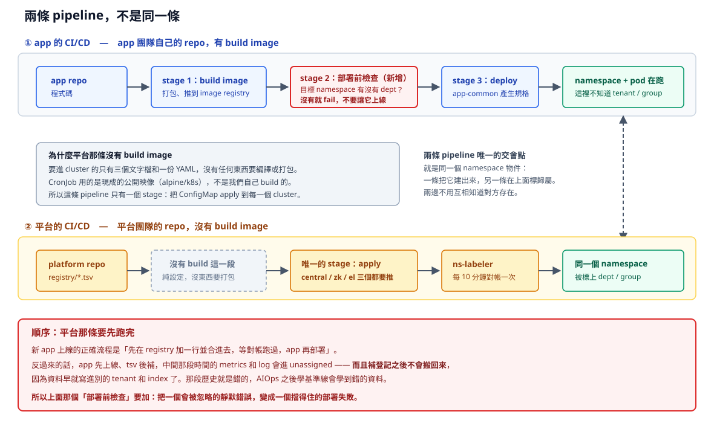

# 歸屬：資料怎麼知道自己是哪一組的

一句話：**中央維護一份對照表，由 CronJob 自動把 `dept` / `group` 標到 namespace 上，收集端照舊只讀 label。**

設定在 [../platform/attribution/](../platform/attribution)，已經在本機 k3d 實測通過。

## 為什麼需要這一層

vmagent 過濾時只看得到 label，Fluentd 改 tag 時只看得到欄位。但 namespace 名稱是 `{cluster}-{app}-{env}` 或 `{app}-{env}`，**看不出是哪個組織的**。所以歸屬必須額外生出來。

兩種生法各有致命傷：

| 做法 | 致命傷 |
|---|---|
| 每個 namespace 自己標 label | 別人有權限就能改掉，改組要去改幾十個 namespace |
| 平台維護一份中央清單，收集端查表 | 每上一個新 app 就要改設定、重啟收集器，跟「擴廠不能全人工」衝突 |

所以兩個都用：**清單當來源，label 當機制。**



**對照表一份在 git，labeler 每個 cluster 各跑一份。** 這點是整張圖的重點：namespace label 是 cluster 內的物件，central 改不到 zk 或 el 的 namespace，所以不可能有一台中央的機器統一去標。central 自己也要跑一份，它沒有特權。

擴廠時要做的只有兩件事：在新 cluster 部署一份 labeler、在它的環境變數加上新廠代號。三個 tsv 的內容不用動。

好處是收集端設定不動、人只改一個地方、別人手動改 label 會被對帳蓋回去。代價是多一個 CronJob，而且它要有改 namespace label 的權限。

## 三個對照表

| 檔案 | 內容 | 什麼時候改 |
|---|---|---|
| `registry/apps.tsv` | app → 部門 | 新 app 上線 |
| `registry/namespaces.tsv` | namespace → 部門（例外、平台自己的 namespace） | namespace 名稱不照命名規則時 |
| `registry/groups.tsv` | 部門 → group | **改組**。大多數情況只改這一份 |

`apps.tsv` 的 key 是**「namespace 名稱去掉 cluster 前綴和 env 後綴之後剩下的那一段」，不是 Deployment 的名字**：

```
zk-mes-prod    → 去掉 zk- 和 -prod → mes
wip-staging    → 去掉 -staging     → wip
```

cluster 代號和 env 的清單寫在 CronJob 的環境變數，擴廠時在那裡加新廠代號。

`namespaces.tsv` 的優先順序高於 `apps.tsv`，所以名稱亂掉的 namespace 可以直接指定，不用為了它去改命名規則。

## 這跟 app 的 CI/CD 是兩條，不要混在一起



app 的 pipeline 是 build image → deploy。**平台這條沒有 build image 這一段**：要進 cluster 的只有三個文字檔和一份 YAML，CronJob 用的還是現成的公開映像，沒有任何東西要打包。所以它只有一個 stage——把 ConfigMap apply 到每一個 cluster。

兩條 pipeline 唯一的交會點是同一個 namespace 物件：一條把它建出來，另一條在上面標歸屬。**兩邊不需要互相知道對方存在**，這也是 app 團隊不必知道 tenant / group 的原因。

### 順序：平台那條要先跑完

新 app 上線的正確順序是：**先在 `apps.tsv` 加一行合進去 → 等對帳跑過 → app 再部署**。

反過來的話，app 先上線、tsv 後補，中間那段時間的 metrics 和 log 會進 unassigned。**補登記之後不會搬回來**——資料早就寫進別的 tenant 和 index 了，那段歷史就是錯的。之後 AIOps 學基準線會學到錯的資料。

所以 app 的 pipeline 要多一個部署前檢查，把這個會被忽略的靜默錯誤變成擋得住的部署失敗：

```bash
# 放在 deploy 之前。app 團隊不用知道 group 是什麼，只要知道「還沒登記就先去找平台」。
dept=$(kubectl get ns "$TARGET_NS" -o jsonpath='{.metadata.labels.dept}' 2>/dev/null || true)
if [ -z "$dept" ]; then
  echo "namespace $TARGET_NS 還沒有歸屬，資料會進 unassigned 而且事後救不回來。"
  echo "請平台團隊在 platform/attribution/registry/apps.tsv 補一行後再部署。"
  exit 1
fi
```

## 部署：掛在 cluster-addons 底下，不要另外做一條管道

ns-labeler 要進每一個 cluster，而 **cluster-addons 的 ApplicationSet 已經是現成的分發管道**（list generator 跑 central / zk / el）。把它當成 cluster-addons 的一個元件，不用另外做。

這樣一來，新廠開起來時 list 加一行 `- cluster: <新廠>`，那個 cluster 同時拿到 vmagent 分流設定、ns-labeler、Fluentd、KSM allowlist，**一行全部到位**。

CronJob 的 `CLUSTERS` 環境變數也用同樣的 `helm.parameters` 注入，跟 `externalLabels.cluster` 一模一樣的機制，不用手動維護每廠一份。

### 所以它應該是一個 chart，不是散的 YAML

現在 repo 裡是三個 tsv 加一份 manifest，要靠兩道 `kubectl create configmap --from-file` 才裝得起來——**那是指令式的**，ArgoCD 管不到、沒辦法 diff、出事也不能 rollback。

包成 chart 之後，三個 tsv 用 `.Files.Glob` 直接渲染進 ConfigMap：

```
ns-labeler/
  Chart.yaml
  values.yaml
  registry/*.tsv           被 .Files.Glob 讀進 ConfigMap
  templates/
    configmap-registry.yaml
    configmap-script.yaml
    cronjob.yaml
    rbac.yaml
```

還沒做，因為要先確認兩件事，見下面的待確認。

### 本機手動安裝（驗證用）

正式環境走上面那條，這裡只是要在本機快速試的時候用：

```bash
kubectl -n vm-monitoring create configmap ns-labeler-script   --from-file=label-namespaces.sh=platform/attribution/label-namespaces.sh   --dry-run=client -o yaml | kubectl apply -f -

kubectl -n vm-monitoring create configmap ns-labeler-registry   --from-file=platform/attribution/registry/   --dry-run=client -o yaml | kubectl apply -f -

kubectl apply -f platform/attribution/namespace-labeler.yaml
```

**第一次上線先把 `DRY_RUN` 設成 `true`**，跑幾輪看它想動什麼，確認都是預期內的再改 `false`。

手動跑一次不用等排程：

```bash
kubectl create job --from=cronjob/ns-labeler ns-labeler-now -n vm-monitoring
kubectl -n vm-monitoring logs job/ns-labeler-now
```

## 本機實測結果

**環境**：k3d 單節點、`alpine/k8s:1.30.0`、CronJob 跑在 `vm-monitoring`。

**結果**

| namespace | 來源 | 標上的 label |
|---|---|---|
| `zk-mes-prod` | `apps.tsv` 的 `mes` | `dept=D3120` `group=it` |
| `zk-wip-prod` | `apps.tsv` 的 `wip` | `dept=D1110` `group=imc` |
| `kube-system`、`vm-monitoring` 等 | `namespaces.tsv` | `dept=PLATFORM` `group=platform` |
| `zk-unknownapp-prod` | 對不到 | **故意不標**，落到 unassigned 並列在報告裡 |

**確認了三件事**

1. **名稱解析正確。** `zk-mes-prod` 去掉 cluster 前綴和 env 後綴後對到 `mes`，即使 app 名稱本身含有 `-` 也不會被切壞。
2. **重跑不會亂動。** 第二次執行報「已正確 8 個，本次調整 0 個」，只在值不同時才送 patch。
3. **改組只改一行。** 把 `groups.tsv` 裡 `D1110` 從 `imc` 改成 `it`，下一次執行只動 `zk-wip-prod` 一個 namespace，其他七個不受影響。

## 對不到歸屬要有告警，不然就是靜默出錯

**這是整套設計唯一的失效模式**：新 app 沒加進 `apps.tsv`，資料就安安靜靜進 unassigned，不會有任何錯誤。

CronJob 的 log 會列出對不到的 namespace，但沒人會每十分鐘去看。要變成告警，靠 kube-state-metrics 的 `kube_namespace_labels`（`vmstack-values.yaml` 已經把 `dept`、`group` 放進 allowlist）：

```yaml
- alert: NamespaceMissingAttribution
  expr: kube_namespace_labels{label_dept=""} == 1
  for: 30m
  annotations:
    summary: "{{ $labels.namespace }} 沒有歸屬，資料正在進 unassigned"
    description: "在 platform/attribution/registry/apps.tsv 補一行，或在 namespaces.tsv 標成例外。"
```

`for: 30m` 是為了跳過新建 namespace 到下一輪對帳之間的空窗（排程是 10 分鐘）。

**已實測。** 本機裝了 kube-state-metrics 2.20.0，這條查詢精準回傳唯一那個沒有歸屬的 `zk-unknownapp-prod`，其他八個都不在結果裡。沒有歸屬的 namespace 在 `kube_namespace_labels` 上是**整個 `label_dept` 欄位不存在**（不是空字串），`label_dept=""` 在 PromQL 語意上同時涵蓋這兩種情況，所以寫法是對的。

### 但踩到一個會讓告警指錯對象的坑

第一次查出來長這樣：

```
kube_namespace_labels{namespace="vm-monitoring", exported_namespace="zk-unknownapp-prod", ...}
```

`namespace` 變成 **kube-state-metrics 自己所在的 namespace**，KSM 回報的那個被改名成 `exported_namespace`。原因是抓取時 vmagent 會蓋上 target 自己的 `namespace`，跟 KSM 指標裡本來就有的 `namespace` 撞名，撞到的那個就被加上 `exported_` 前綴。

**後果是告警訊息會指著 `vm-monitoring`**，也就是監控自己的 namespace，而不是真正出問題的那個——告警會響，但寫的是錯的，排查時會被帶去完全錯誤的方向。

解法是 KSM 的 scrape 要開 `honorLabels`，讓指標自己帶的 label 贏：

```yaml
endpoints:
  - port: http
    honorLabels: true    # 沒有這行，namespace 會被換成 KSM 自己的
```

開完重查，`namespace` 就是 `zk-unknownapp-prod` 了。**上線前先確認你們現有的 KSM scrape 物件有沒有開這個**；`victoria-metrics-k8s-stack` 裝出來的通常有，但值得查一次：

```bash
kubectl get vmservicescrape -A -o yaml | grep -B3 honorLabels
```

另外，這個指標上會同時出現 `dept` 和 `label_dept` 兩個欄位，意思完全不同：`dept` 是抓取時蓋上的「KSM 這個 pod 屬於誰」（永遠是 platform），`label_dept` 才是「這一列講的那個 namespace 屬於誰」。**告警條件一定要用 `label_dept`。**

## 坑

- **映像必須有 shell。** `rancher/kubectl` 裡面只有 `kubectl` 一個執行檔，掛腳本進去會 `StartError: exec "sh": executable file not found`，而且訊息不會告訴你原因是映像太精簡。
- **根檔案系統唯讀時要給 `HOME`。** kubectl 會想寫 `~/.kube/cache`，沒有可寫的 HOME 會出警告。manifest 裡設了 `HOME=/tmp` 並掛了一個 emptyDir。
- **`dept` 和 `group` 是很通用的 label 名稱**，別的團隊可能已經拿來用在別的地方。上線前先查一次：`kubectl get ns -L dept,group`。要保險就改成 `observability.spil.com.tw/dept` 這種有命名空間的 key，但收集端的設定要跟著改。
- **這個 CronJob 有改全 cluster namespace label 的權限。** 權限只有 `get`/`list`/`patch` namespace，碰不到 namespace 裡面的東西，但對帳邏輯寫錯就會把整廠的歸屬標錯，所以對照表要走 code review。
- **app 名稱必須在同一個 cluster 內唯一。** 跨廠不用唯一（各廠各自一份 ConfigMap），但同一廠內兩個不同組織的 app 撞名就會標錯。
- **從清單移除的 app，舊 label 不會被清掉。** 對帳只補不刪，避免誤刪。下線的 namespace 要手動處理。

## 之後可以再簡化：讓收集端直接讀 `group`

現在 namespace 上已經有 `group` label，但收集端還是照舊用部門 regex 在算 group，等於「部門 → group」這份對照在三個地方各有一份（`groups.tsv`、vmagent values、`fluent.conf`）。

改成直接讀 `group` 之後，**新增部門就完全不用碰收集端設定**：

vmagent 的 scrapeClass 多帶一個 label，remoteWrite 的條件換掉：

```yaml
relabelConfigs:
  - source_labels: [__meta_kubernetes_namespace_label_group]
    target_label: group
# remoteWrite 的過濾條件
  - action: keep
    source_labels: [group]
    regex: it          # 原本是 dept 的 "D3120|D3130"
```

Fluentd 的 `rewrite_tag_filter` 同理，`key dept` 換成 `key group`、pattern 換成 `/^it$/`。

沒有現在就做，是因為現有設定已經實測過，換掉要重測一輪。想做的時候這是兩邊各兩行的改動。

## 待確認

1. **`dept` / `group` 這兩個 label 名稱在正式環境有沒有被別人用掉。**
2. **映像要能從 Nexus 拉得到。** 現在寫的是 Docker Hub 的 `alpine/k8s:1.30.0`，你們環境拉不到，要先鏡像進 `nexus.aillm.spil.com.tw/docker`，或換成內部已有、含 shell 和 kubectl 的映像。**這一條會直接擋住落地。**
3. **`apps.tsv` 由誰維護、走什麼流程。** 建議跟著 app 上線的 PR 一起改，不要另外開一個流程，否則一定會有人忘記。
4. **cluster 代號和 env 的清單寫死在 CronJob 環境變數**，擴廠時要記得加。要不要改成從對照表讀還沒決定。
