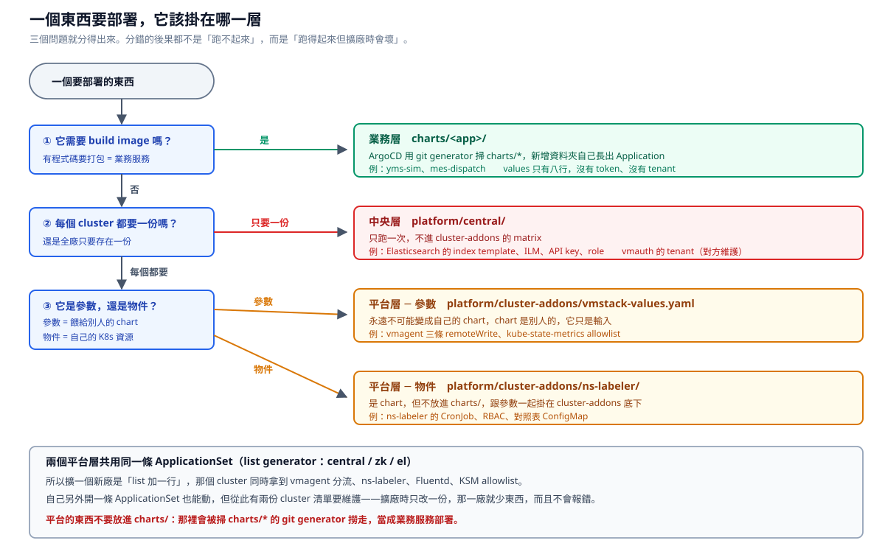

# 東西該掛在哪一層

這份把「為什麼 ns-labeler 要掛進 cluster-addons」這類問題一次講完。**分錯層的後果都不是「跑不起來」，而是「現在跑得起來，擴廠時壞掉」**，所以值得先講清楚。



## 三個問題分得出四層

| 問題 | 答案 | 去哪 |
|---|---|---|
| ① 需要 build image 嗎 | 是 | **業務層** `applications/<app>/`，ApplicationSet 掃 `applications/**/app.yaml` |
| ② 每個 cluster 都要嗎 | 只要一份 | **中央層** `platform/central/`，跑一次 |
| ③ 是參數還是物件 | 參數 | **平台層** `platform/cluster-addons/vmstack-values.yaml` |
| | 物件 | **平台層** `platform/cluster-addons/ns-labeler/`（是 chart） |

第三題的「參數」指的是**餵給別人 chart 的輸入**。`vmstack-values.yaml` 永遠不可能變成我們自己的 chart，因為 chart 是 VictoriaMetrics 的，我們只是填值。

## 為什麼 ns-labeler 掛 cluster-addons

一句話：**因為 cluster-addons 已經是現成的「送到每個 cluster」管道，而 ns-labeler 的需求剛好一模一樣。**

你們的 cluster-addons ApplicationSet 用 list generator 跑 central / zk / el。ns-labeler 要做的事也是「每個 cluster 都要有一份」。共用同一條的結果是：

**擴一個新廠 = list 加一行 `- cluster: <新廠>`**，那個 cluster 同時拿到 vmagent 分流設定、ns-labeler、Fluentd、kube-state-metrics allowlist。一行，全部到位。

## 不掛會怎樣：四種替代做法

### 一、手動 `kubectl apply`（原本的做法）

| 會發生什麼 | 嚴重性 |
|---|---|
| 每開一個新廠都要人進去裝一次 | **跟「擴廠不能全人工」直接衝突** |
| ArgoCD 不知道它存在，看不到也 diff 不出來 | 沒人知道某個 cluster 的版本比別人舊 |
| 有人手動改了 namespace 的 label，不會被修正回來 | 除非有人記得再跑一次 |
| 出事不能 rollback | 只能自己記得上一版長什麼樣 |

### 二、放進每個 app 的 chart

**這個最糟，整套設計會垮掉。**

- 50 個 app 各有一份，改組要通知 50 個團隊
- 每個 app team 都拿到三把 token
- 有人改錯 regex，那個 app 的資料同時進兩個 tenant，沒有錯誤訊息
- 而且會變成 **50 台 vmagent**，同一份資料被抓 50 次

我們一開始定案的「應用團隊不需要知道 tenant、group、token」，講的就是不能這樣做。

### 三、放進 `applications/` 底下

看起來合理——它確實是個 chart，放進去也會被 ArgoCD 部署。但 `applications/` 是**給 devops 那個 ApplicationSet 掃的**，一個 app.yaml 部署成一個 Application，**不是每個場區叢集都有一份**。平台元件要進每一個叢集，那是 cluster-addons 的 matrix generator 在做的事。

而且 app.yaml 的規則（environment、sync、owner）是為業務服務設計的，套在平台元件上都不對。

**`applications/` 是「業務服務」的意思，不是「所有會被 ArgoCD 部署的東西」的意思。**

### 四、自己另外開一條 ApplicationSet

這個**會動**，是四種裡唯一不會立刻出事的。問題在於維護：

從此有**兩份 cluster 清單**。擴廠時要改兩個地方，遲早有人只改一個——那個新廠就會有 vmagent 分流但沒有 ns-labeler，結果是所有 namespace 都沒有 `dept` label，**資料全部落到兜底那條進 platform tenant**。

而這個失效**完全不會報錯**：vmagent 正常跑、資料正常送、兜底規則正常運作，只是全廠的資料都歸錯人。等到有人問「為什麼 IT 的圖表是空的」才會發現。

**一份清單只會錯一次，兩份清單會一直錯。**

## 判斷準則

遇到新東西不確定放哪，照這個順序問：

1. **誰會改它？** app 團隊 → 業務層；平台團隊 → 平台層或中央層
2. **它要存在幾份？** 每個 cluster 一份 → cluster-addons；全廠一份 → 中央層
3. **它是我們的物件，還是別人 chart 的輸入？** 輸入永遠不能變成自己的 chart

**不要按「是什麼技術」分。** 「chart 的放一個資料夾、YAML 的放另一個」看起來整齊，實際上會把不同生效方式、不同負責人的東西混在一起，然後有人對 values 檔 `kubectl apply`。

## 目前的落點

```
applications/<app>/                    業務服務      ApplicationSet 掃 applications/**/app.yaml
platform/cluster-addons/
  vmstack-values.yaml                  平台，參數    ┐ 同一條 ApplicationSet
  ns-labeler/                          平台，物件    │ list generator
  （fluentd 待定，看現在怎麼裝的）        平台         ┘ central / zk / el
platform/central/                      中央          跑一次
```

相關文件：

- [repo-layout.md](repo-layout.md)：`applications/` 為什麼跟 devops repo 同格式、程式碼和部署設定為什麼分開、映像 tag 怎麼流
- [attribution.md](attribution.md)：ns-labeler 在做什麼、對照表怎麼維護
- [vmagent.md](vmagent.md)：分流本身怎麼運作
- [架構圖](architecture)：宏觀落點圖、兩條 pipeline 圖
