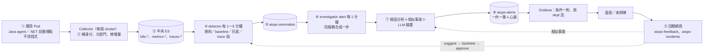

# 從一個應用到 AIOps 到 Grafana 告警：整條線一次看完

一句話：**應用 Pod 什麼都不改，log、metrics、trace 由每個 cluster 的 Collector 收進中央 ES；AIOps 每分鐘讀出來學「平常的樣子」、抓異常、同一個服務合成一件、附根因報告和過去相似的事故，寫進 `aiops-alerts`；Grafana 讀它依部門發通知；老師傅從通知點進回饋網頁，回饋回來改門檻、進知識庫。**

這一份是「流程」：每一步**做什麼、程式在哪、設定在哪、多久跑一次、怎麼驗**。架構圖在 [architecture.md](architecture.md)，每一步的方法在 [system-stages.md](system-stages.md)，做過什麼在 [pdca/](pdca/README.md)。

## 整條線



| 步 | 做什麼 | 程式／設定 | 多久跑一次 | 怎麼驗過 |
|---|---|---|---|---|
| ① 應用 | 用 [sdk/charts/app-common](../sdk/charts/app-common) 部署：Java 掛 agent、.NET 自動埋點；log 印 stdout、metrics 給 Collector 抓、trace 用 OTLP 送 | `sdk/`、[sdk/standards/tracing.md](../sdk/standards/tracing.md) | 常駐 | k3s：`e2e/local-k3s/run-e2e.sh`、`run-dotnet-e2e.sh`、`run-trace-e2e.sh` |
| ① 收值 | node Collector 收 log、抓 metrics、收 trace；cluster Collector 收 K8s 狀態；trace-sampler 尾端取樣（錯的慢的全留、正常留 5%） | `telemetry/collectors/*.yaml` | 常駐；metrics 30 秒抓一次 | 同上；斷線、ES 401 的情況（[pdca/trace-durability](pdca/2026-10-trace-durability.md)、[es-startup-401](pdca/2026-10-es-startup-401.md)） |
| ② 清資料 | Collector：擋應用自帶的 dept/group、讀 namespace label 分部門、Prometheus 累加值換成每 30 秒的增量、Java 指標改名跟 .NET 一樣；ES pipeline：log 依格式解析、時區、去重複 | `telemetry/collectors/common.yaml`、`telemetry/storage/` | 進來就做 | `e2e/pipeline/`（時間、格式案例）；[pdca/field-unify](pdca/2026-10-field-unify.md)、[time-alignment](pdca/2026-10-time-alignment.md) |
| ③ 存 | 一把寫入 key，資料依 group 進 `k8s-<group>-<cluster>`、`metrics-*.otel-<group>`、`traces-*.otel-<group>`；被拒的進 failure store；保留天數 | `telemetry/scripts/elasticsearch-setup.sh`、`retention.conf` | — | `run-key-rotation.sh`、`run-es-2node.sh` |
| ④ 判斷 | **規則**（容器重啟、錯誤率 ≥ 5%、p95 ≥ 2 秒等，一次就算）、**baseline**（每條序列 × 星期幾 × 小時的中位數＋MAD，連續 2 點才 anomaly、偏太多一點就算）、**跟兄弟比**（同服務的 Pod）、**trace 每一段**；資料品質（資料停了、欄位缺）；排除時段、行事曆 | `engine/detector/`、`engine/configs/baseline/*.yaml` | rules／detect 每 1 分鐘、peer／trace 每 5 分鐘、quality 每 10 分鐘、train 每天 02:00（[deploy/](../engine/deploy/README.md)） | 單元測試；`tests/synth_e2e.py`、`adaptive_e2e.py`、`fine_e2e.py`；k3s `run-rules-e2e.sh`、`run-peer-e2e.sh`、`run-trace-baseline-e2e.sh` |
| ⑤ 異常總表 | 所有判斷結果一個 index：`series`、`keys`（服務、API…）、`value`、`median`、`z`、`status`（warning／anomaly）、`dept`、`group` | `aiops-anomalies` | — | — |
| ⑥ 收斂 | **同一個服務、30 分鐘內接著來的異常 = 一件**（同 dept 的兩個服務是兩件）；30 分鐘沒新的 → resolved；每次跑寫一筆心跳 | `engine/investigator/alerts.py`、`cmd_alert.py`；`configs/rca/rca.yaml` 的 `alerts:` | 每 1 分鐘 | `tests/test_alerts.py`；[pdca/alert-exit](pdca/2026-10-alert-exit.md)（Grafana 12.2 實測） |
| ⑦ 根因分析 | 新的一件：從異常拿服務＋API＋時間 → 出事時最慢 200 個 trace 跟一週前比 → **慢在哪一段**（扣掉下游）、**錯從哪開始** → 用 trace_id 撈 log、**新出現的 log 樣式** → Markdown 報告；再用這件的**指紋**去 `aiops-incidents` 找老師傅確認過的**相似事故**（為什麼像、當時根因、處置、怎麼看出來的）；**LLM 摘要**三到五句、每句附依據 | `engine/investigator/__main__.py`、`similar.py`、`engine/core/llm.py` | 跟 ⑥ 同一次 | k3s `run-rca-e2e.sh`（有 trace）；`tests/loop_e2e.py`（相似事故、LLM template）；`test_similar.py`、`test_llm.py` |
| ⑧ 出口 | 一件一筆寫 `aiops-alerts`：`status`、`service`、`dept`、`group`、`severity`、`summary`（通知帶這個）、`report`、`feedback_url`。**通知交給 Grafana**：每件一則（`group_by: alert_id`）、依 `dept` 送各部門、沒 dept 送平台、結束發恢復；**心跳 10 分鐘沒寫 → 「AIOps 停了」** | `engine/configs/grafana/*.yaml`（provisioning 範例） | Grafana 每 1 分鐘查 | Grafana 12.2 實測一件一則、依 dept、恢復（心跳規則只到 yaml 能讀） |
| ⑨ 回饋 | 通知裡的連結 → 回饋網頁：一鍵真的／誤報／根因錯，真的時填根因分類、根因、處置、**怎麼看出來的**、查了哪裡；寫 `aiops-feedback`（每筆異常一筆）、`aiops-incidents`（confirmed）。回來：確認的事故 → 下次相似事故查得到；誤報 3 次 → `feedback suggest` 放寬 → `backtest` → `adjust approve`；漏報 → 降 z；同根因 3 次 → 規則草稿；`metrics` 算學之前／之後 | `engine/feedback_web/`、`detector/cmd_feedback.py`、`cmd_backtest.py`、`cmd_metrics.py` | 網頁常駐；suggest／backtest 人跑 | `tests/loop_e2e.py` 整個故事 37 項；`test_feedback_web.py`、`test_feedback.py`、`test_metrics.py` |

## 一件事從頭到尾長什麼樣（loop_e2e 跑出來的）

```
10:00  mes-api 延遲 120ms → 480ms（4 個 5 分鐘）
10:01  detect：synth.latency z 45，第 1 點 warning、第 2 點 anomaly → aiops-anomalies
10:02  alert：開一件 a-20261005-0205-mes-api（D3120／it）
       → 根因分析（有 trace 時：慢在 wip-worker › Oracle SELECT lots）
       → 相似事故：知識庫空的，不附
       → aiops-alerts status open、summary「[warning] mes-api：synth.latency 526（平常 121.3）…」
       → aiops-incidents 一筆 status auto（帶指紋）
       → 心跳
10:02  Grafana：status:open 查到 → it-oncall 收到一則，附摘要、報告連結、回饋連結
10:10  老師傅點連結：真的、db、「Oracle 統計資訊過期」、處置「重跑 analyze」、
       怎麼看出來的「只有 lots 那張表的查詢慢，AWR 看到執行計畫變了」
       → aiops-feedback 3 筆、aiops-incidents 變 confirmed
10:35  30 分鐘沒新異常 → resolved → Grafana 發恢復
隔天   同樣症狀 → 新的一件，報告最前面：
       「跟 10-05 的事故相似（同服務；同樣的指標異常）；當時根因 [db] …；處置 …」
       「建議先照上次的方式確認：只有 lots 那張表的查詢慢… [I1]」
```

## 使用目的、測試目的

| 想確認什麼 | 跑哪個 | 需要 |
|---|---|---|
| 程式邏輯對（不連 ES） | `cd engine && python3 -m pytest -q`（276 個） | 無 |
| 收值線通（Collector → ES → 分部門） | `e2e/local-k3s/run-e2e.sh` | k3s |
| 根因分析從異常找到那一段、那行 log | `e2e/local-k3s/run-rca-e2e.sh` | k3s，約 14 分鐘 |
| baseline 抓得到造的異常、誤報多少 | `cd engine && python3 -m tests.synth_e2e` | 一個 ES |
| 整個 learning loop 的故事 | `cd engine && python3 -m tests.loop_e2e` | 一個 ES，約 2 分鐘 |
| Grafana 一件一則、依 dept | 手動照 [configs/grafana/README.md](../engine/configs/grafana/README.md) | Grafana 12 |
| 上 K8s 排程 | `kubectl apply -k engine/deploy/` | 還沒跑過 |

## 文件跟程式對不上的（2026-10-25 對過）

| 文件說 | 程式實際 | 處理 |
|---|---|---|
| `architecture.md`、`system-stages.md` 第 7、8、10、11 節、根目錄 README「最大缺口是 Check」：⑥⑧⑨ 和 LLM 都是 📝 | ⑥ 同服務合成一件、⑧ Grafana 出口與回饋網頁、⑨ 建議／回測／核准、LLM 摘要都有程式，模擬資料跑通 | 這次改掉狀態，指到各 PDCA |
| `configs/baseline/README.md`「怎麼跑」：detect 每 30 秒、crontab 兩行 | `deploy/` 是每 1 分鐘 `--window 10m` | 改 README：K8s 用 deploy/，crontab 例子留作單機 |
| `system-stages.md` 第 7 節：四層收斂（連續合段、服務合併、拓撲合併、排序） | 只做了「服務合併」；連續合段靠 `status`、拓撲合併、排序沒有 | 標清楚哪層有 |
| `docs/feedback/README.md`「一定要有的紀律」：版本、評測集、第二個人確認 | 都沒有；回饋 3 次可以是同一個人 | 已在各 PDCA 的 Act，文件標「還沒」 |
| `rca.yaml` 註解「新的一件跑一次根因分析」 | 還會跑相似事故、LLM，失敗不擋 | 註解補上 |
| `similar-incidents` Plan：舊事故單匯入格式 | 沒寫 | Act 已記 |

## 哪裡不足（會影響能不能用、能不能賣）

1. **全部是模擬資料**。相似事故在沒有 trace 時只靠「同服務＋同指標」剛好壓在門檻上；LLM 真的模型沒跑過（閘道 401）；K8s 沒跑過。這三件事排在所有新功能前面。
2. **程式有幾個會讓整輪失敗的點**（`/code-review` 2026-10-25 的 10 項，對過程式，前 4 項是真的要修）：
   - `cmd_alert.py`：LLM 那段沒有 try/except，輸入包裡一個 NaN 就讓整輪 alert 掛掉，連心跳都不寫，Grafana 會誤報「AIOps 停了」（違反自己的「只加註不擋告警」）。
   - `cmd_backtest.py`：`incident add` 存的時間沒有時區，回測比較 tz-aware 的異常時間會丟 TypeError，從此所有建議都要 `--force`。
   - `cmd_alert.py`：事故「已確認不覆蓋」是先讀再寫，老師傅剛好在中間送出就被蓋掉（要用 `_update` 加條件、或 `if_seq_no`）。
   - `deploy/gen-cronjobs.py`：alert 的 `activeDeadlineSeconds: 110`，叫真的 LLM 一件 60 秒逾時，兩件就被砍，下一分鐘重來一樣被砍。
   - 其餘（metrics 回饋跨段、漏報建議被既有 override 擋住沒印、回測重複查 ES、網頁 ES 錯誤沒回應、template 空句、相似事故 ES 前 20 截斷）是對的但影響小，排在後面。
3. **回饋網頁沒登入、漏報沒網頁入口**；月底批次只會提「放寬 z」不會提排除時段。
4. **門檻全是估的**：z 5、instant_z 15、相似分數 4、誤報 3 次、權重；要 2～4 週真實資料。

## 哪裡過度設計（以「工廠維運可靠度、AIOps 基本盤」來看）

| 東西 | 為什麼算過度 | 建議 |
|---|---|---|
| baseline 的三個自動機制同時存在：自選粒度（6 階）、卜瓦松、借同組 | 沒有真實資料就先做了三種退路；設定、文件、測試都跟著變厚 | 留著但不再擴；真實資料跑過再決定砍哪個 |
| 行事曆自動變成幾十筆 `exclude_window`（`adjust list` 一整頁假日） | 一年的假日每天一筆，蓋掉真正要看的調整 | 行事曆改成一筆規則（kind calendar），list 預設摺疊 |
| trace 每一段的 baseline（`trace-train`／`trace-detect`）＋ N+1、吞例外規則 | trace 有取樣、只留 7 天，學出來的「平常」本來就偏；根因分析已經會比「慢在哪一段」 | 先只跑根因分析那條；trace baseline 等有真資料 |
| 規則草稿 `rule_suggestion` 的門檻留 `<填：…>` | 做了一半：提了草稿但人還是要自己查數字、改 yaml | 要嘛從那幾件事故的 p95 直接算門檻，要嘛先不提草稿只提「同根因 3 次」的提醒 |
| 回饋表單 10 個「查了哪裡」、6 種誤報原因、9 類根因 | 選項是估的，沒人填過 | 第一週看真的填了什麼再縮 |
| `metrics` 的「最吵的服務」、依 dept | Grafana 讀 `aiops-alerts` 畫更合適 | 留表格，不再加欄 |
| 四個 5～10 分鐘的 CronJob（peer、trace-collect、trace-detect、quality） | 正式環境先只要 rules、detect、alert、train 四個就能跑通故事 | deploy 加註「第一階段只開這四個」 |

**不是過度、一定要的**：Collector 的擋冒充與分部門、一把 key 可換、failure store、規則的保底門檻、連續才算、心跳、「已確認不覆蓋」、每句附依據的檢查、沒回測不能核准。這些是可靠度，不是功能。
