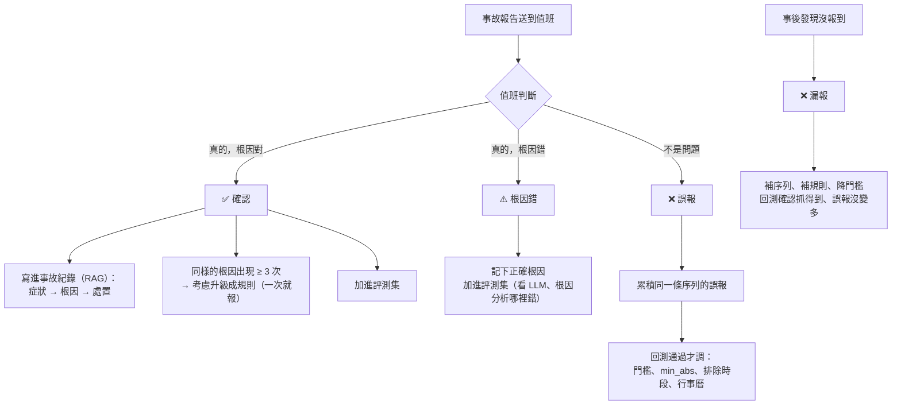
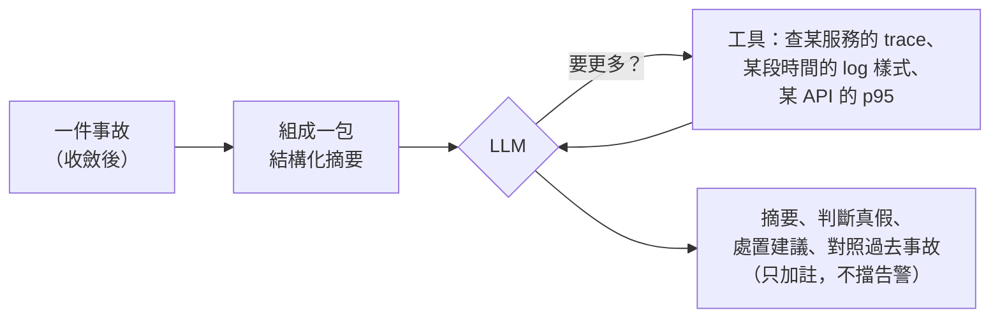

# Feedback：告警出口、事故紀錄、回饋、調整、LLM

異常偵測、根因分析之後的事：結果送到人手上 → 人判斷對錯 → 對了強化、錯了修正。**依 [llm-mlops.md](llm-mlops.md) 的定案，以 LLMOps 為主軸、借機器學習的紀律（版本、評測、回測），不自己訓練模型。**

## 現況與待辦

| 項目 | 狀態 | 說明 |
|---|---|---|
| 異常總表 `aiops-anomalies` | ✅ | 所有判斷結果都寫這裡，帶 `status`（warning／anomaly）、可信度、粒度、方法 |
| 使用者、指令調整（粒度、z、min_abs） | ✅ | `series.yaml` 的 `overrides`、`tune` 指令寫進 `aiops-tuning`，記原因、誰、何時（[baseline README「使用者、feedback 調整」](../../aiops/baseline/README.md#使用者feedback-調整)）；之後 feedback 也寫同一處 |
| 告警出口 | ❌ | 現在只寫進 ES，還沒有通知；要接在收斂之後（[rca/README.md「雜訊壓制」](../rca/README.md#雜訊壓制)） |
| 事故紀錄 `aiops-incidents` | ❌ | 每次事故記時間、影響、根因、處置、相關異常 |
| 值班回饋 `aiops-feedback` | ❌ | 真的／誤報／根因錯／漏報 |
| 版本、回測、評測集 | ❌ | 每筆異常記下是哪一版產生的；改門檻前回測；改 prompt 前跑評測集 |
| LLM | ❌ | 從根因報告摘要開始，只加註、不擋告警 |

**建議順序**：告警出口（收斂後）→ 事故紀錄、回饋（先只收集，不自動生效）→ 版本、回測 → LLM 摘要 → 回饋累積夠且回測通過，才自動調門檻。

上線前先記下現況當基準（每天告警幾筆、多少是誤報、從告警到找到原因平均多久），之後才量得出有沒有改善。

## 用 PDCA 看整條線

| PDCA | 對應 | 狀態 |
|---|---|---|
| **Plan** | `series.yaml`、`rules.yaml` 的門檻與粒度；上線前記下現況基準（每天告警幾筆、誤報多少、找到原因要多久） | ⚠️ 設定有了，基準還沒記 |
| **Do** | 收值 → baseline／規則／Pod 互比／trace 每一段 → `aiops-anomalies` → 根因分析 | ✅ 在 k3s 驗過 |
| **Check** | 告警出口、事故紀錄 `aiops-incidents`、值班回饋 `aiops-feedback` | ❌ 還沒做 |
| **Act** | 調門檻、排除時段、補指標、重複根因升級成規則；回測通過才生效，記在 `aiops-tuning` | ⚠️ 手動調整有了，自動回饋沒有 |

目前走到「偵測＋報告」；Check 是最大缺口，補上後才形成閉環。

完整的一輪紀錄（exemplar 實測、方案比較）見 [pdca/2026-10-metrics-to-trace.md](../pdca/2026-10-metrics-to-trace.md)；紀錄格式見 [pdca/TEMPLATE.md](../pdca/TEMPLATE.md)。

## 對了怎麼強化、錯了怎麼 feedback

| 結果 | 寫到哪 | 之後怎麼用 |
|---|---|---|
| **確認（真的、根因對）** | `aiops-incidents`：症狀、根因、處置、相關異常 | ① LLM 的 RAG：下次類似症狀先參考；② 同樣根因反覆出現 → 升級成規則（一次就報，不用等歷史）；③ 加進評測集；④ 事故期間在 baseline 訓練時排除 |
| **根因錯** | 同上，加正確根因 | 評測集：改根因分析或 prompt 時要能答對這題 |
| **誤報** | `aiops-feedback`：哪一筆、為什麼不是問題（例如月底批次） | 同一條序列累積多次才動：調門檻、加 `min_abs`、把那個時段標成特殊時段（行事曆）；**單次回饋不直接生效** |
| **漏報** | `aiops-feedback`：時間、哪個服務、為什麼沒報 | 補序列或規則、降門檻 |

**一定要有的紀律**（不需要 MLOps 平台，見 [llm-mlops.md](llm-mlops.md)）：

1. **版本**：baseline、設定、prompt 都帶版本，每筆異常記下是哪一版產生的。
2. **回測**：改門檻前，用新設定重跑過去 4 週，確認過去的事故還抓得到、誤報變少。
3. **評測集**：20～30 件過去的事故，改根因分析、prompt、換模型前都跑一次。
4. **防污染**：回饋要累積多次、或第二個人確認；確認過的事故紀錄優先於單次回饋。
5. **LLM 只加註、降級，不刪告警**：統計層照常報，LLM 錯了也不會漏。

## 什麼時候叫 LLM、token 怎麼省

**原則：程式負責「算」和「收斂」，LLM 只看收斂後、整理好的一件事。** 不把原始 metrics、log 丟給它。

**一包裡放什麼（估計的 token 數，實際依內容）：**

| 內容 | 怎麼壓 | 約多少 token |
|---|---|---|
| 指示（prompt） | 固定 | ~800 |
| 異常表 | 收斂後最多 10 筆，每筆一行：序列、對象、現在、平常、z、可信度 | ~500 |
| trace 段落 | 差最多的前 5 段、錯誤源頭、最慢請求的瀑布圖摘要 | ~1,000 |
| log 樣式 | 新出現或變多的前 10 種樣式（樣式不是原文） | ~600 |
| 過去事故 | 用 RAG 找最像的 3 件，每件只放結論 | ~900 |
| **輸入合計** | | **~4,000** |
| 輸出 | 摘要、判斷、建議 | ~500 |

**省 token 的做法：**

1. **只送收斂後的事故**：一天幾十件，不是幾千筆異常。粗估一天 50 件 × 4,500 ≈ 22.5 萬 token。
2. **只送樣式和統計，不送原文**：log 歸成樣式、trace 只送差異最大的段。
3. **讓 LLM 自己叫工具**：先給摘要，需要才查。不先塞「可能用得到」的資料。
4. **固定的指示放前面**，用提示快取（prompt caching），每次只算變動的部分。
5. **分級**：低嚴重度、可信度 low 的只做摘要；critical 的才做完整推理和對照過去事故。

## 延伸

- [llm-mlops.md](llm-mlops.md)：為什麼用 LLMOps 不用 MLOps、LLM 能取代機器學習的哪些部分、記憶的風險、成功度與業界趨勢。
