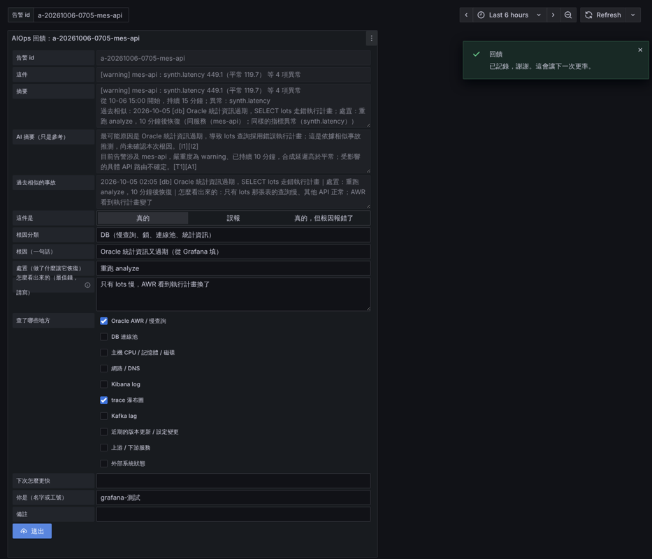

# Feedback：回饋閉環與介面

> **類型：原理 Explanation**

## 閉環步驟

### 怎麼走

| 階段 | 做什麼 | 落在哪 |
|---|---|---|
| 判斷 | ④ 的結果全寫入異常總表，帶 `status`（warning／anomaly）、可信度、粒度、方法 | `aiops-anomalies` |
| 出口 | ⑥ 同服務合成一件，Grafana 依部門分送 | `aiops-alerts` |
| 紀錄 | 告警一開就建一筆 `auto`（帶指紋）；老師傅在回饋網頁確認後改 `confirmed`，存根因分類、處置、怎麼看出來的、查了哪裡 | `aiops-incidents` |
| 回饋 | 回饋網頁 `feedback_web`（通知裡有連結）或指令；記哪一筆、為什麼 | `aiops-feedback` |
| 調整 | `series.yaml` 的 `overrides` 或 `tune` 指令；記原因、誰、何時 | `aiops-tuning` |

### 回饋結果與用法

| 結果 | 用法 |
|---|---|
| 確認（根因對） | 寫進 `aiops-incidents`；相似事故檢索（RAG）只讀 `confirmed` 的；同根因累積 3 次，產生規則草稿供人審閱 |
| 根因錯 | 記正確根因，列入評測集，改根因分析或 prompt 時要能答對 |
| 誤報 | 同一條序列累積 3 次，產生調整建議，經人核准才生效；單次回饋不生效 |
| 漏報 | 降 z，補序列或規則；目前只能用指令回報 |

### 怎麼判斷是同一個根因

同一個根因 = 同一個服務加同一個根因分類。程式不比對 `root_cause` 的文字，也不比對指紋。

- 分類是老師傅在表單選的 `root_cause_category`，九選一：`db`、`network`、`config_change`、`deploy`、`external`、`resource`、`bug`、`data`、`other`。
- 計入的事故：`aiops-incidents` 裡 `status` 是 `confirmed` 或 `corrected`、填了 `root_cause_category`、開始時間在最近 28 天內（`feedback suggest --days`，預設 28）。`auto`（沒人看過）和 `false_positive` 不計。
- 次數是事故件數，不是回饋筆數。一件事故涉及多個服務時，每個服務各算一次。
- 同一個服務與分類累積 3 件（`--min-recurring`，預設 3）就寫一筆 `rule_suggestion`（`aiops-tuning`，`status: proposed`）。同一組已經有建議就不重寫。
- 要看哪幾件被算在一起：建議裡的 `incident_ids`；理由欄寫「<服務> 的「<分類>」被確認 N 次」。
- 分類選得不同就分開算；選 `other` 的會把不同原因混在一起。核准前要看這幾件的 `root_cause` 文字，確認是同一個原因。
- 規則草稿的門檻是這幾件事故各自最低的延遲異常值取最小值；沒有延遲類異常就算不出門檻，不能核准。

建議核准前必須跑 `backtest`：現行設定與「現行＋建議」各重跑過去 N 週，已確認事故少抓一件就不建議；沒回測的建議不能核准。

## feedback 有哪些介面

圖是 Grafana 儀表板 `aiops-feedback` 的回饋表單：告警 id、這件、摘要、AI 摘要、過去相似的事故由系統預填；老師傅選「真的／誤報／真的，但根因報錯了」，填根因分類、根因、處置、怎麼看出來的、查了哪些地方、下次怎麼更快、署名與備註，按送出。

| 介面 | 在哪 | 寫哪個索引 |
|---|---|---|
| Grafana 回饋表單（定案用這個） | 儀表板 `aiops-feedback`，Business Forms 外掛 `volkovlabs-form-panel` 6.3.1；預填呼叫 `GET /api/alert?alert=<alert_id>`，送出呼叫 `POST /api/feedback`；回饋服務要設 `FEEDBACK_CORS_ORIGIN` 為 Grafana 的網址 | `aiops-feedback`、`aiops-incidents` |
| 回饋網頁（備案） | `engine/feedback_web`，`GET /feedback?alert=<alert_id>` 是通知裡的連結，`GET /report` 看報告全文；沒有登入 | 同上 |
| 指令 | `python3 -m detector` 的 `feedback`（`add`、`pending`、`list`、`summary`、`suggest`）、`incident`（`add`、`list`、`resolve`）、`backtest`、`adjust`（`approve`）、`metrics`；漏報只能用指令 | `aiops-feedback`、`aiops-incidents`、`aiops-tuning` |

### 跟 aiops-* 索引的欄位的關係

欄位的型別、誰寫、範例在 [aiops-data-reference.md](../aiops-data-reference.md)；這份只講介面寫到哪。

- 表單送出時，一件事故的每筆異常各寫一筆 `aiops-feedback`，同時更新 `aiops-incidents`：

  | 表單選項 | `aiops-feedback.verdict` | `aiops-incidents.status` |
  |---|---|---|
  | 真的 | `true_positive` | `confirmed` |
  | 誤報 | `false_positive` | `false_positive` |
  | 真的，但根因報錯了 | `wrong_root_cause` | `corrected` |

- 老師傅填的根因分類、根因、處置、怎麼看出來的、查了哪裡，存在 `aiops-incidents`；誤報不填這些，只填 `fp_reason`。
- 相似事故檢索只讀 `confirmed`、`corrected`。
- 建議（誤報累積 3 次、同根因累積 3 次）由 `feedback suggest` 寫進 `aiops-tuning`，`status: proposed`；`backtest` 通過、人用 `adjust approve` 改成 `active` 才生效。
- 漏報沒有 `alert_id`，只能用 `feedback add` 寫進 `aiops-feedback`（`verdict: missed`）。
