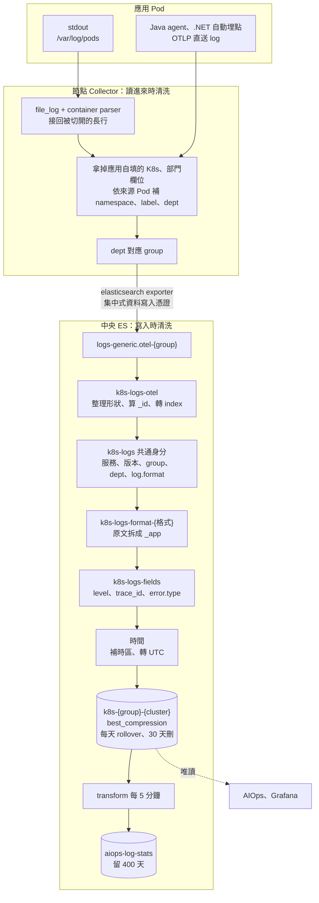

# Log 進 Elasticsearch

> **類型：原理 Explanation**

## 資料怎麼走



解析規則放在中央 ES 的 pipeline：改規則跑一次 `elasticsearch-setup.sh`，各 cluster 的 Collector 不動。任何一步出錯，原文照樣入庫，原因寫在 `error.message`；被拒收的文件進 failure store，出現一筆就告警。

## log 樣式格式有哪些

服務用 pod label `log-format` 宣告格式（app-common chart 的 `logFormat`），沒宣告走 `default`。規則檔在 [telemetry/storage/formats/](../../telemetry/storage/formats/)。

| 格式 | 長怎樣 | 怎麼拆 | 狀態 |
|---|---|---|---|
| `default` | JSON（logback、ECS、.NET JSON console、Serilog compact JSON）或純文字 | 開頭是 `{` 就用 JSON processor 拆；純文字保留原文 | ✅ |
| `logfmt` | `level=info msg="order failed" lot_id=L123`，Go 常見 | kv processor 依空白與 `=` 拆 | ✅ |
| SECS（設備通訊） | 一則訊息跨多行 | 要先在 Collector 多行合併，送到中央就拼不回來 | ❌ 缺一般事件、告警、逾時、多行的真實樣本 |
| REST API（各家） | 各家不同 | 還沒有規則 | ❌ 缺兩三個服務的樣本 |

- 宣告的格式沒有規則時，退回 `default`，原文保留；`log.parser` 與宣告的格式不同，可以據此找缺規則的格式。
- 來源分兩種，`log.source` 記錄：`file`（容器 log 檔）與 `otlp`（應用直送）。服務兩種都開時，同一行有兩份，靠這個欄位分開。
- 純文字 log 沒印 trace_id 時，開 chart 的 `otel.logs.exporter: otlp`，log record 本身帶 trace_id。

### 認得的欄位名稱

`default` 與 `logfmt` 拆出 `_app` 後，`k8s-logs-fields` 依下表取值。各語言的 logger 套件寫法不同，所以每個欄位接受多種名稱。

| 標準欄位 | 認得的名稱 |
|---|---|
| `message` | `message`、`msg`、`Message`、`@m`、`@mt` |
| `log.level` | `level`、`lvl`、`severity`、`log.level`、`LogLevel`、`@l`（Serilog 沒寫 `@l` 是 info） |
| `log.logger` | `logger`、`logger_name`、`log.logger`、`Category`、`SourceContext` |
| `error.stack_trace`、`error.type` | `stack_trace`、`exception`、`error.stack_trace`、`Exception`、`@x` |
| `trace.id`、`span.id` | `trace_id`、`traceId`、`trace.id`、`TraceId`、`@tr`；span 對應 `span_id`、`spanId`、`span.id`、`SpanId`、`@sp`；.NET JSON console 的在 `Scopes` 裡 |
| `@timestamp` | `timestamp`、`@timestamp`、`ts`、`time`、`Timestamp`、`@t`；認得的格式：ISO 8601、`yyyy-MM-dd HH:mm:ss.SSS`、`yyyy-MM-dd HH:mm:ss,SSS`、`yyyy-MM-dd HH:mm:ss`、epoch 毫秒 |

Datadog 的 `dd.trace_id` 是十進位，對不到 OTel 的 trace，不取，留在 `app`。

## 什麼時候清洗、怎麼清洗

| 階段 | 做什麼 |
|---|---|
| 節點 Collector（讀進來） | 接回被切開的長行；移除應用自填的 K8s、部門欄位（邊緣身份鑑別與標籤注入），依來源 Pod 補回；dept 對應 group，決定寫進哪個 index |
| `k8s-logs-otel`（寫入 `logs-generic.otel-{group}`） | 整理成 Fluent Bit 的形狀；`_id` 用 Pod、容器、stream、時間、內容的 SHA-256 算出，重送回 409，不重複；轉到 `k8s-{group}-{cluster}`，ES 再驗一次 key 權限 |
| `k8s-logs` 共通身分 | 每筆都有服務、版本、group、dept、cluster、`log.format`；原文先放 `message` |
| `k8s-logs-format-{格式}` | 原文拆成暫存欄位 `_app` |
| `k8s-logs-fields` | 見下 |
| 時間 | `event.created` 留 Collector 讀到的時間；應用自己的時間沒帶時區，依 `LOG_DEFAULT_TIMEZONE`（預設 Asia/Taipei）解讀並記在 `event.timezone`；`@timestamp` 一律存 UTC；格式都不認得就保留 Collector 的時間，`log.timestamp_source` 記來源 |

`k8s-logs-fields` 對應成標準欄位：
- **level**：統一成 trace、debug、info、warn、error、fatal；不認得的值轉小寫保留。沒有 level 時推斷：取行首前綴（`Warning:`、`[warn]`），或前 80 字元內獨立的全大寫關鍵字，並標 `log.level_inferred: true`，AIOps 對這類資料降低權重。
- **trace_id、span_id**：轉小寫；16 位的短 id 前面補零；空字串與全 0 視為沒有；長度不對或非 hex 的不設，原值存在 `app.trace_id_invalid`。只取欄位，不從訊息內文猜。
- **error.type**：取 stack trace 第一行的例外類別，讓例外可以分群。
- 其餘自訂欄位（MDC 等）收進 `app`，型別 flattened，數百個服務共用一個 index 也不會撞到欄位數上限。
- 欄位 alias 讓 baseline、quality、RCA 與 metrics、trace 用同一條路徑查；alias 不在 `_source` 裡，程式要用 `fields` 取值。

### 例

一行 JSON（`default`，Asia/Taipei 的 Pod）：

```
{"timestamp":"2026-10-31 10:00:00.123","level":"ERROR","logger":"OrderService","message":"db timeout","trace_id":"4BF92F3577B34DA6A3CE929D0E0E4736","lot_id":"L123"}
```

清洗後：`message: db timeout`、`log.level: error`、`log.logger: OrderService`、`trace.id: 4bf92f3577b34da6a3ce929d0e0e4736`（轉小寫）、`@timestamp: 2026-10-31T02:00:00.123Z`（沒帶時區，依 Asia/Taipei 解讀再轉 UTC）、`app.lot_id: L123`、`log.parser: default`。

一行純文字：

```
2026-10-08 12:00:00 ERROR [main] connection refused
```

清洗後：`message` 是原文，`log.level: error` 加 `log.level_inferred: true`（前 80 字元內獨立的全大寫關鍵字）；純文字沒拆時間，`@timestamp` 用 Collector 讀到的時間，`log.timestamp_source: collector`。

## 多久壓縮

| 時間點 | 做什麼 |
|---|---|
| 寫入時 | index 設定 `best_compression`，沒有延後壓縮的階段 |
| 每天，或主分片到 30GB | ILM `k8s-logs` rollover，換一個新 index |
| 30 天 | 原文刪除（`retention.conf` 的 `LOGS_DELETE_AFTER`），沒有降解析度 |
| 每 5 分鐘 | transform 把 group、cluster、namespace、服務、level、`error.type` 的筆數寫進 `aiops-log-stats` |
| 400 天 | `aiops-log-stats` 刪除；每 30 天換一個 index |

長期要看的趨勢靠統計，不靠原文。天數與容量見 [retention.md](../retention.md)，排錯見 [troubleshooting.md](../troubleshooting.md)。
