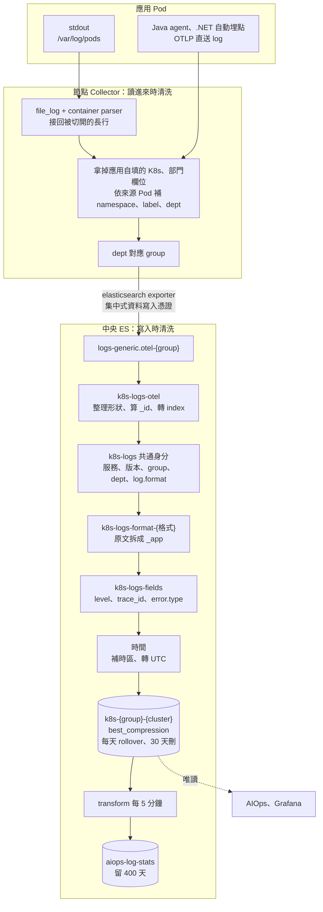

# Log 進 Elasticsearch

> **類型：原理 Explanation**

## 資料怎麼走



解析規則放在中央 ES 的 pipeline：改規則跑一次 `elasticsearch-setup.sh`，各 cluster 的 Collector 不動。任何一步出錯，原文照樣入庫，原因寫在 `error.message`；被拒收的文件進 failure store，出現一筆就告警。

## log 樣式格式有哪些

服務用 pod label `log-format` 宣告格式（app-common chart 的 `logFormat`），沒宣告走 `default`。規則檔在 [elasticsearch/code/storage/formats/](../../elasticsearch/code/storage/formats/)。

| 格式 | 長怎樣 | 怎麼拆 | 狀態 |
|---|---|---|---|
| `default` | JSON（logback、ECS、.NET JSON console、Serilog compact JSON）或純文字 | 開頭是 `{` 就用 JSON processor 拆；純文字保留原文 | ✅ |
| `logfmt` | `level=info msg="order failed" lot_id=L123`，Go 常見 | kv processor 依空白與 `=` 拆 | ✅ |
| SECS（設備通訊） | 一則訊息跨多行 | 要先在 Collector 多行合併，送到中央就拼不回來 | ❌ 缺一般事件、告警、逾時、多行的真實樣本 |
| REST API（各家） | 各家不同 | 還沒有規則 | ❌ 缺兩三個服務的樣本 |

- 宣告的格式沒有規則時，退回 `default`，原文保留；`log.parser` 與宣告的格式不同，可以據此找缺規則的格式。
- 來源分兩種，`log.source` 記錄：`file`（容器 log 檔）與 `otlp`（應用直送）。服務兩種都開時，同一行有兩份，靠這個欄位分開。
- 純文字 log 沒印 trace_id 時，開 chart 的 `otel.logs.exporter: otlp`，log record 本身帶 trace_id。

### 認得的欄位名稱

`default` 與 `logfmt` 拆出 `_app` 後，`k8s-logs-fields` 依下表取值。各語言的 logger 套件寫法不同，所以每個欄位接受多種名稱。

| 標準欄位 | 認得的名稱 |
|---|---|
| `message` | `message`、`msg`、`Message`、`@m`、`@mt` |
| `log.level` | `level`、`lvl`、`severity`、`log.level`、`LogLevel`、`@l`（Serilog 沒寫 `@l` 是 info） |
| `log.logger` | `logger`、`logger_name`、`log.logger`、`Category`、`SourceContext` |
| `error.stack_trace`、`error.type` | `stack_trace`、`exception`、`error.stack_trace`、`Exception`、`@x` |
| `trace.id`、`span.id` | `trace_id`、`traceId`、`trace.id`、`TraceId`、`@tr`；span 對應 `span_id`、`spanId`、`span.id`、`SpanId`、`@sp`；.NET JSON console 的在 `Scopes` 裡 |
| `@timestamp` | `timestamp`、`@timestamp`、`ts`、`time`、`Timestamp`、`@t`；認得的格式：ISO 8601、`yyyy-MM-dd HH:mm:ss.SSS`、`yyyy-MM-dd HH:mm:ss,SSS`、`yyyy-MM-dd HH:mm:ss`、epoch 毫秒 |

Datadog 的 `dd.trace_id` 是十進位，對不到 OTel 的 trace，不取，留在 `app`。

## 什麼時候清洗、怎麼清洗

| 階段 | 做什麼 |
|---|---|
| 節點 Collector（讀進來） | 接回被切開的長行；移除應用自填的 K8s、部門欄位（邊緣身份鑑別與標籤注入），依來源 Pod 補回；dept 對應 group，決定寫進哪個 index |
| `k8s-logs-otel`（寫入 `logs-generic.otel-{group}`） | 整理成 Fluent Bit 的形狀；`_id` 用 Pod、容器、stream、時間、內容的 SHA-256 算出，重送回 409，不重複；轉到 `k8s-{group}-{cluster}`，ES 再驗一次 key 權限 |
| `k8s-logs` 共通身分 | 每筆都有服務、版本、group、dept、cluster、`log.format`；原文先放 `message` |
| `k8s-logs-format-{格式}` | 原文拆成暫存欄位 `_app` |
| `k8s-logs-fields` | 見下 |
| 時間 | `event.created` 留 Collector 讀到的時間；應用自己的時間沒帶時區，依 `LOG_DEFAULT_TIMEZONE`（預設 Asia/Taipei）解讀並記在 `event.timezone`；`@timestamp` 一律存 UTC；格式都不認得就保留 Collector 的時間，`log.timestamp_source` 記來源 |

`k8s-logs-fields` 對應成標準欄位：
- **level**：統一成 trace、debug、info、warn、error、fatal；不認得的值轉小寫保留。沒有 level 時推斷：取行首前綴（`Warning:`、`[warn]`），或前 80 字元內獨立的全大寫關鍵字，並標 `log.level_inferred: true`，AIOps 對這類資料降低權重。
- **trace_id、span_id**：轉小寫；16 位的短 id 前面補零；空字串與全 0 視為沒有；長度不對或非 hex 的不設，原值存在 `app.trace_id_invalid`。只取欄位，不從訊息內文猜。
- **error.type**：取 stack trace 第一行的例外類別，讓例外可以分群。
- 其餘自訂欄位（MDC 等）收進 `app`，型別 flattened，數百個服務共用一個 index 也不會撞到欄位數上限。
- 欄位 alias 讓 baseline、quality、RCA 與 metrics、trace 用同一條路徑查；alias 不在 `_source` 裡，程式要用 `fields` 取值。

### 例

一行 JSON（`default`，Asia/Taipei 的 Pod）：

```
{"timestamp":"2026-10-31 10:00:00.123","level":"ERROR","logger":"OrderService","message":"db timeout","trace_id":"4BF92F3577B34DA6A3CE929D0E0E4736","lot_id":"L123"}
```

清洗後：`message: db timeout`、`log.level: error`、`log.logger: OrderService`、`trace.id: 4bf92f3577b34da6a3ce929d0e0e4736`（轉小寫）、`@timestamp: 2026-10-31T02:00:00.123Z`（沒帶時區，依 Asia/Taipei 解讀再轉 UTC）、`app.lot_id: L123`、`log.parser: default`。

一行純文字：

```
2026-10-08 12:00:00 ERROR [main] connection refused
```

清洗後：`message` 是原文，`log.level: error` 加 `log.level_inferred: true`（前 80 字元內獨立的全大寫關鍵字）；純文字沒拆時間，`@timestamp` 用 Collector 讀到的時間，`log.timestamp_source: collector`。

## 共同鑰匙圈與 log 自己的欄位

### 共同鑰匙圈

log、metrics、trace 用同一組鑰匙串起來。服務、Pod、namespace、cluster 都是 Collector 依來源 Pod 補的，不是應用自己填，所以三種資料一定對得上。

| 鑰匙 | 三種資料共用的路徑 | log 實際存在哪 | 來源 | 現況 |
|---|---|---|---|---|
| 服務 | `resource.attributes.service.name` | `service.name`，alias 指過去 | Pod label `app.kubernetes.io/name`；沒有就用 Deployment 名稱 | ✅ |
| Pod | `resource.attributes.k8s.pod.name` | `kubernetes.pod.name`，alias | Collector | ✅ |
| namespace | `resource.attributes.k8s.namespace.name` | `kubernetes.namespace`，alias | Collector | ✅ |
| cluster | `resource.attributes.k8s.cluster.name` | `orchestrator.cluster.name`，alias | Collector 的 `CLUSTER_NAME` | ✅ |
| trace_id、span_id | `trace_id`、`span_id` | `trace.id`、`span.id`，alias | 自動埋點寫進 log（Java 在 MDC、.NET 在 scope），或 OTLP 直送 | ✅ |
| 時間窗 | `@timestamp` | `@timestamp` | 應用的時間，轉 UTC | ✅ |
| 路由、方法 | `attributes.http.route`、`attributes.http.request.method` | 沒有 | REST API 的解析規則還沒做 | ❌ |
| 業務 ID（交易 ID） | 名稱未定 | 沒有 | 只放 trace、log，不放 metrics（每個值多一條序列） | ❌ |

alias 不佔空間、不在 `_source` 裡，程式要用 `fields` 取值。

### 歸屬 label 不是鑰匙

| | 歸屬 label | 共同鑰匙 |
|---|---|---|
| 用途 | 這筆資料是誰的：寫進哪個 index、誰看得到、保留幾天、告警送給誰 | 把三種資料接起來 |
| 欄位 | `labels.dept`、`labels.group`（metrics、trace 在 `resource.attributes.dept`、`.group`） | 上表 |
| 來源 | namespace 的 `dept` label，Collector 依 `collector/code/groups.yaml` 對應成 group；應用自帶的先移除 | 上表 |

### log 自己的欄位與 label

有。下面這些只在 log 有，metrics、trace 沒有：

| 類別 | 欄位 | 說明 |
|---|---|---|
| 格式 | `log.format`、`log.parser` | `log.format` 是 pod label `log-format` 宣告的（chart 的 `logFormat`，只能小寫英數與減號），沒宣告是 `default`；`log.parser` 是實際用的規則 |
| 來源 | `log.source`、`agent.type` | `file` 或 `otlp`；`otelcol` 或 `fluent-bit` |
| 內容 | `message`、`log.level`、`log.level_inferred`、`log.logger`、`process.thread.name`、`error.type`、`error.stack_trace` | 見上面的清洗 |
| 時間可信度 | `event.created`、`event.ingested`、`event.timezone`、`log.timestamp_source` | 找出時間不可信、沒帶時區的服務 |
| 應用自帶 | `app.*`、`app.trace_id_invalid`、`app.span_id_invalid` | MDC 的 `lot_id` 這類業務維度；格式錯的 trace_id 原值 |
| K8s | `kubernetes.labels` | 全部 Pod label，flattened |

跟 metrics 共用的 Pod label：`app.kubernetes.io/name` → `service.name`、`app.kubernetes.io/version` → `service.version`、`app.kubernetes.io/part-of` → `service.namespace`。`log-format` 只給 log 用。

## 多久壓縮

| 時間點 | 做什麼 |
|---|---|
| 寫入時 | index 設定 `best_compression`，沒有延後壓縮的階段 |
| 每天，或主分片到 30GB | ILM `k8s-logs` rollover，換一個新 index |
| 30 天 | 原文刪除（`retention.conf` 的 `LOGS_DELETE_AFTER`），沒有降解析度 |
| 每 5 分鐘 | transform 把 group、cluster、namespace、服務、level、`error.type` 的筆數寫進 `aiops-log-stats` |
| 400 天 | `aiops-log-stats` 刪除；每 30 天換一個 index |

### 為什麼這樣定

- log 原文最佔空間。AIOps 看 log 主要是「哪種錯誤突然變多」，留每 5 分鐘的筆數就夠；原文 30 天用來查細節。
- 稽核要用的 log（登入、交易）另有稽核紀錄，依法規另定天數，不跟一般應用 log 一起算。

### 每筆大小

測試環境實測，壓縮後、不含副本；正式環境有一份副本要乘 2。

| 資料 | 實測 | 估算用 | 一筆是什麼 |
|---|---|---|---|
| log | 135 bytes | 250 bytes | 一行 log。測試資料每行很像，壓縮特別好；真實 log 內容較雜，保守用 250 |

### 量太大時怎麼降（依效果排序）

| 做法 | 效果 |
|---|---|
| EAP 不在 INFO 寫完整的 SML 內容，只寫摘要（機台、訊息種類、事件編號、結果），完整內容放 DEBUG 或另外存 | EAP log 可能減到 1/5 以下，最有效 |
| 吵的服務把不必要的 INFO log 降成 DEBUG | 「每個請求印好幾行」可以省一大半 |
| 高流量的原始 log 留短一點（例如 14 天），長期改留統計值 | 依 group 設；資料流本來就依 group 分開 |

### EAP（設備通訊）的容量

量取決於機台數，要另外算：

```
EAP log 每天寫入 = 機台數 × 每台每秒幾則訊息 × 每則 log 壓縮後大小 × 86,400 × 2（副本）
```

例：1,000 台機台、每台每秒 2 則、每則 log 原文 1.5KB（壓縮後約 300 bytes），每天寫入約 100GB，留 30 天同時存著約 3TB。很多 EAP 會把整段 SML 內容寫進 log：機台數、訊息頻率、log 寫了多少內容三個乘起來，可以差到十倍，要先找一台 EAP 量一天實際的 log 量再算。

### 實測

| 測什麼 | 結果 |
|---|---|
| log 統計（transform `aiops-log-stats`） | ✅ 65 萬筆 log 統計成 2,192 筆，約 1/300 |

天數與容量的共用原則見 [retention.md](../retention.md)，排錯見 [troubleshooting.md](../troubleshooting.md)。
