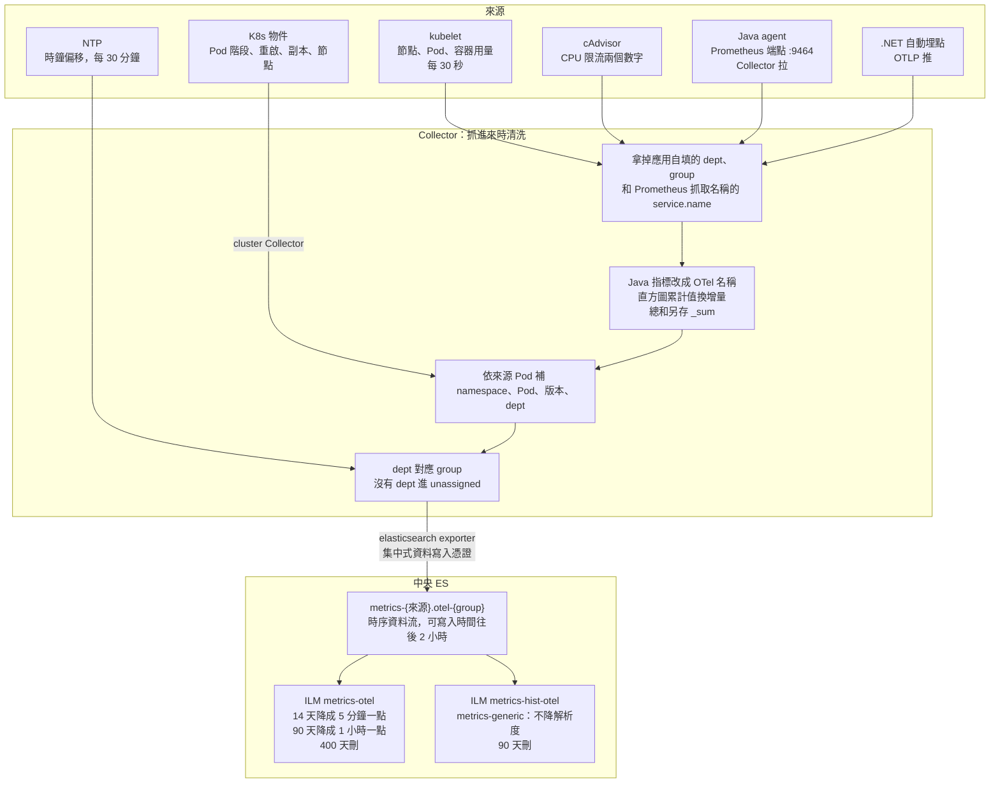

# Metrics 進 Elasticsearch

> **類型：原理 Explanation**

## 資料怎麼走

寫進 ES 的是 Collector 的 elasticsearch exporter，ES 8.19 沒有 OTLP 入口。重試設成一直重試，401 也重試（ES 剛起來約 1 秒內 key 會被拒），逾時不設期限；ES 無回應 90 秒掉 0 筆，ES 的 IP 消失時 exporter 不重試，180 秒停機掉約 3%，所以 ES 前面要有 LB 與帶 API key 的健康檢查。

## 指標種類與來源

資料流名稱是 `metrics-{來源}.otel-{group}`。來源欄位取自資料自帶的 scope：

| 來源 | 資料流 | 收法 | 收什麼 |
|---|---|---|---|
| kubelet | `kubeletstatsreceiver` | 節點 Collector 每 30 秒 | 節點、Pod、容器的 CPU、記憶體、磁碟、網路 |
| K8s 物件 | `k8sclusterreceiver` | cluster Collector | Pod 階段、重啟次數、副本數、節點狀態 |
| 抓取本身、cAdvisor | `prometheusreceiver` | 節點 Collector | CPU 限流（`container_cpu_cfs_*periods_total` 兩個數字） |
| NTP | `ntpreceiver` | 每 30 分鐘 | 節點時鐘偏移 |
| 應用 | `generic` | Java：Collector 依 Pod 註記 `prometheus.io/scrape`、`port`、`path` 拉；.NET：每 30 秒 OTLP 推 | HTTP 延遲直方圖、JVM 記憶體與 GC、連線池、.NET runtime |

.NET 自動埋點的 Prometheus 端點只聽 localhost，Collector 抓不到，所以用推。

| 型別 | 例 | 怎麼存 | 怎麼處理 |
|---|---|---|---|
| gauge（量測值） | CPU、記憶體 | `double`／`long`，`time_series_metric: gauge` | 直接平均 |
| counter（累計值） | CPU 累計時間、網路、重啟次數 | `time_series_metric: counter` | 不換增量；算區間要先算差值 |
| histogram（直方圖） | 請求耗時、GC 時間 | `histogram`：`values` 加 `counts`；沒有 temporality，也不存總和 | Collector 換成每 30 秒的差值，總和另存 `metrics.<名稱>_sum` |

動態基準線學習用 5 條：請求數、錯誤率、p95（依服務、方法、路由切），Pod CPU、Pod 記憶體（依 Deployment 切）。其餘由靜態臨界值規則判斷，見 [baseline 規格](../../engine/configs/baseline/reference.md)。

## 什麼時候清洗、怎麼清洗

清洗全在 Collector，抓進來時做；中央 ES 沒有 ingest pipeline，用內建 `metrics-otel@template`，另由 `metrics-otel@custom` 把可寫入時間往後放寬到 2 小時，ES 停機後補送的資料才收得進。

| 步驟 | 做什麼 | 為什麼 |
|---|---|---|
| 拿掉自填欄位 | 刪 `dept`、`group`、`data_stream.*`；刪 Prometheus 填的 `service.name`（抓取工作名稱） | 應用不能自稱別的部門；`service.name` 留給 Pod label 補 |
| 對回 Pod | Prometheus 抓來的只有 Pod IP，補成 `k8s.pod.ip` | 才知道是哪個 Pod |
| Java 指標改名 | `http_server_request_duration_seconds` → `http.server.request.duration`；label 改 `http.request.method`、`http.route`、`http.response.status_code`（轉整數）、`error.type` 等 | 與 .NET 同名，baseline 不用寫兩套；只改舊名，agent 以後自己用新名也不會改錯 |
| 直方圖換增量 | 累計值換成「這次比上次多多少」；抽出總和存 `_sum` | Prometheus 直方圖從啟動累加，ES 無法頭尾相減；8.19 的 `histogram` 不存總和 |
| 補 Pod 資訊 | `k8s_attributes` 補 namespace、Pod、Deployment、版本、dept | 歸屬看 Pod 的 namespace，不看抓取對象；kubelet 抓的 Pod CPU 也歸到那個 Pod 的部門 |
| 分 group | dept 對應 group；沒有 dept 的（節點本身）進 `unassigned` | 決定寫進哪個資料流 |

增量的代價：Collector 重啟後，每條序列首次抓取沒有前值，該 30 秒遺失；應用重啟歸零視為重新開始，不會算出負數。

## 多久壓縮

| 時間點 | 做什麼 |
|---|---|
| 寫入時 | 時序資料流（TSDS）；一個 Pod 每 30 秒約十餘筆 |
| 每天，或主分片到 50GB | ILM rollover |
| 14 天 | 降成 5 分鐘一點（`METRICS_DOWNSAMPLE_5M_AFTER`） |
| 90 天 | 降成 1 小時一點；量測值只留那一小時的最小、最大、總和、筆數 |
| 400 天 | 刪除 |
| `metrics-generic`（應用的直方圖） | ILM `metrics-hist-otel`：不降解析度，原始 30 秒一點，90 天刪 |

直方圖不降解析度，是因為 ES 8.19 的 `histogram` 欄位降解析度時不合併：1 小時 7,911 個請求降完剩 70 個，p95 從 1.75 秒變 1.13 秒。天數與容量見 [retention.md](../retention.md)。

## 共同鑰匙圈與 metrics 自己的欄位

### 共同鑰匙圈

| 鑰匙 | metrics 的路徑 | 來源 | 現況 |
|---|---|---|---|
| 服務 | `resource.attributes.service.name` | Pod label `app.kubernetes.io/name` | ✅ |
| Pod | `resource.attributes.k8s.pod.name` | Collector | ✅ |
| namespace | `resource.attributes.k8s.namespace.name` | Collector | ✅ |
| cluster | `resource.attributes.k8s.cluster.name` | Collector 的 `CLUSTER_NAME` | ✅ |
| 路由、方法 | `attributes.http.route`、`attributes.http.request.method` | .NET 原生；Java 由 Collector 改名 | ✅ |
| 時間窗 | `@timestamp` | 一筆是 30 秒；`start_timestamp` 是起點 | ✅ |
| trace_id | 沒有 | exemplar 寫進 ES 時被丟（ES 9.5.5、8.19.23 實測） | ❌ 改用服務、路由、時間窗查 trace |
| 業務 ID | 沒有 | 不放 metrics：每個值多一條序列，序列數會爆 | ❌ |

歸屬 label 是 `resource.attributes.dept`、`.group`：決定這筆資料寫進哪個資料流、誰看得到、告警送給誰，不是串接用的鑰匙。

### metrics 自己的欄位與 label

有，只在 metrics：

| 類別 | 欄位 | 說明 |
|---|---|---|
| 數值 | `metrics.<名稱>`、`metrics.<名稱>_sum` | `_sum` 是 Collector 從直方圖抽出的總和 |
| 維度 | `attributes.*` | 每組不同的值就是一條序列 |
| 來源 | `scope.name` | 應用自己的 scope（例如 `io.opentelemetry.tomcat-10.0`），有應用 scope 的進 `generic` |
| 序列 | `start_timestamp`、`_metric_names_hash` | 增量的起點；序列身分的雜湊 |
| Pod 註記 | `prometheus.io/scrape`、`port`、`path` | 只給 Java 用，app-common chart 自動加 |

排錯見 [troubleshooting.md](../troubleshooting.md)。
