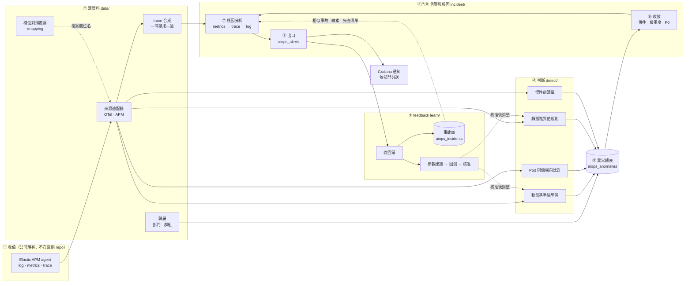
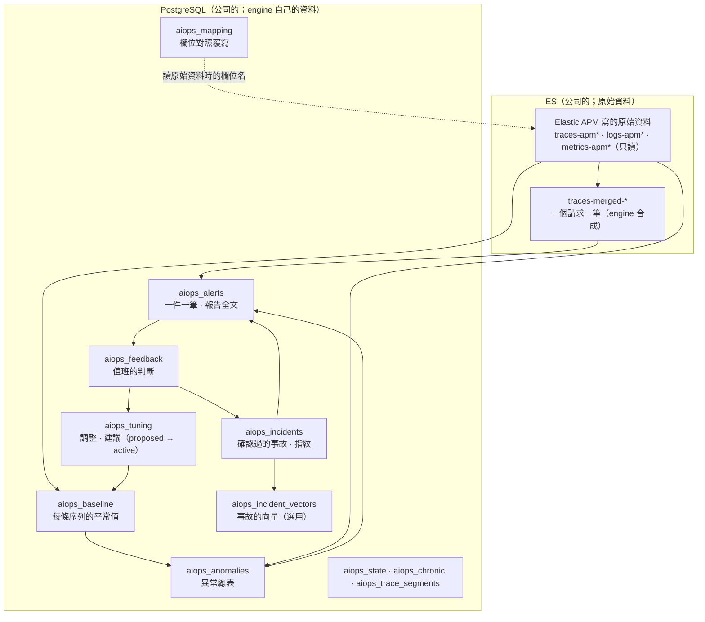

# ①～⑨ 模組功能拆解與流程圖

> **類型：原理 Explanation**

每一階段做什麼、內部拆成哪些功能、程式在哪、現在最弱的地方。架構決策與設計理由見 [architecture.md](architecture.md)，各模組的欄位與參數見各自的規格文件（[docs/README.md](README.md)）。編號只用 ①～⑨：① 收值　② 清資料　③ 存　④ 判斷　⑤ 異常總表　⑥ 收斂　⑦ 根因分析　⑧ 出口　⑨ feedback。

## 1. 整條線

③ 存不是一個步驟，是每一段都把結果寫進 PostgreSQL 的 `aiops_*` 表（原始資料與合成的 trace 在 ES；下一節）。實線是資料往下游走，虛線是「回頭影響」：覆寫欄位名、相似事故補根因分析、核准後的調整改變判斷。

## 2. 資料存在哪（③ 存）

欄位與誰在什麼時候寫見 [aiops-data-reference.md](aiops-data-reference.md)、[data-storage-reference.md](data-storage-reference.md)。

## 3. 每一階段拆開

### ① 收值（不在這個 repo）

- **做什麼**：公司現有的 Elastic APM agent 把 log、metrics、trace 寫進公司的 ES。
- **功能**：log（`logs-apm*`）、metrics（`metrics-apm*`）、trace（`traces-apm*`），三種靠 `trace.id`、`service.name` 串起來。
- **程式**：沒有（2026-11 自建的 Collector 已刪）。
- **限制**：應用要掛 APM agent；沒掛的服務就沒有資料。

### ② 清資料

把各種格式的原始資料變成後面都看得懂的統一格式。

| 功能 | 白話 | 程式 |
|---|---|---|
| 來源適配器 | 一種原始格式配一個轉換器（OTel、APM），是哪一種、欄位怎麼轉只在這裡 | `aiops-engine/src/data/source/` |
| 來源自我檢查 | 宣告的來源跟 ES 裡真的資料對不對；只回報不擋，結果寫進 `aiops_alerts`，Grafana 規則 `aiops-source-mismatch` 叫人 | `aiops-engine/src/data/source/check.py` |
| 兩種來源並存 | `AIOPS_SOURCE=otel,apm`：一個請求跨兩套系統也合得成同一筆 | `aiops-engine/configs/mixed/` |
| trace 合成 | 一個請求的所有 span 合成一筆 `traces-merged-*`，晚到的 span 讓那筆再合一次 | `aiops-engine/src/data/trace/span_merge.py` |
| 歸屬 | 服務屬於哪個部門、群組（異常寫進總表時補上） | `aiops-engine/src/data/store/owner_repo.py` |
| 欄位對照覆寫 | 歸屬、log 的欄位名、trace 讀哪個原始索引：網頁 `/mapping` 提、命令列核准，存 `aiops_mapping`；核准前先對真的資料抽樣試 | `aiops-engine/src/data/mapping_service.py` |

trace 合成時的部門、群組跟著歸屬的欄位名（含核准過的覆寫）。細節見 [data-sources-reference.md](data-sources-reference.md)、[data-sources-how-to.md](data-sources-how-to.md)。

### ③ 存

- **做什麼**：engine 自己的資料（異常、基準線、告警、事故、回饋、調整、對照覆寫）寫進 PostgreSQL，一種一張表（`id`、`ts`、`doc jsonb`）；原始資料與 `traces-merged-*` 在 ES。
- **功能**：每張表一個存取類別（各功能資料夾的 `store/`）；表名、SQL 只能出現在 `store/` 和 `common/`（`tests/test_layers.py` 鎖著）。`detector db init`／`status`／`import-es`（以前存在 ES 的搬過來）。
- **程式**：各功能的 `store/`、`aiops-engine/src/common/infra/pg.py`（PostgreSQL 的基底）、`aiops-engine/src/common/infra/es.py`（原始資料）。

### ④ 判斷：這個值算不算異常

四種方法，各自負責一種情況：

| 方法 | 抓什麼 | 程式 |
|---|---|---|
| 動態基準線學習 (Dynamic Baseline Learning) | 每條指標「平常多少」（星期幾 × 幾點共 168 格，歷史不夠往下退），偏離太多就報 | `aiops-engine/src/detect/strategy/dynamic_baseline.py` |
| Pod 同儕橫向比對 (Peer Comparison) | 同服務的 Pod 裡只有一隻不對勁 | `aiops-engine/src/detect/strategy/peer_compare.py` |
| 靜態臨界值規則 (Static Threshold Rules) | 一定不能超過的線（錯誤率、重啟） | `aiops-engine/src/detect/strategy/threshold_rule.py` |
| 慢性病清單 | 天天噴、沒人修的 | `aiops-engine/src/detect/strategy/chronic_issue.py` |

輔助功能（`aiops-engine/src/detect/series_ops/`）：

| 功能 | 做什麼 |
|---|---|
| 資料品質檢查 `quality_check` | 路由沒參數化、必填欄位缺、資料停了 |
| 一階跳變偵測 `level_shift` | 換版後停在新水準 → 提議「從這裡重新學」（`reset_point`，人核准）。**只判往上的序列（延遲、錯誤）往下掉也看**：另外用「往下」打一次分，不寫異常、不通知，因為中位數要約 2 週才跟上，這段期間退回舊水準會被當正常 |
| 手動調整 `manual_adjust` | 排除時段、重置點、月底放寬、行事曆（假日、維護日） |

其他：粒度依流量自動挑（`pick_resolution`）；連續幾個時間窗才算 anomaly，偏太多不用等（`instant_z`）；trace 每一段的統計與偵測在 `aiops-engine/src/detect/trace/`。

### ⑤ 異常總表

- **做什麼**：所有判斷的結果寫進同一張表 `aiops_anomalies`。
- **功能**：分 warning（跳一次）和 anomaly（連續或偏太多）；帶部門、群組、嚴重度、版本；基準線不見也會告警。
- **程式**：`aiops-engine/src/detect/store/`、`aiops-engine/src/detect/detect_service.py`。
- **延伸**：工廠的 ML／FDC 判好的異常可以推進來（`aiops-engine/src/detect/fab_ingest/`），目前不在範圍。

### ⑥ 收斂：很多筆變一件

| 功能 | 白話 | 程式 |
|---|---|---|
| 併件 | 同一個服務、30 分鐘內接著來的合成一件；一個服務一件 | `aiops-engine/src/incident/alert_grouper.py` |
| 跨服務併件 | 下游出事連帶上游異常，只開一件、留下游（呼叫關係從 trace 算，只併一層） | `aiops-engine/src/incident/strategy/it_topology.py` |
| 嚴重度 | 不看偏離幾倍，看要不要吵人：幾類黃金訊號（延遲、錯誤、下游、飽和）、持續多久、換版後 10 分鐘內上限 warning | `aiops-engine/src/incident/alert_severity.py` |
| P0 升級 | `alerts.p0_services` 列的服務，算完的嚴重度再升一級（warning → high、high → critical）；只改要不要叫人，**門檻不動** | 同上 |

### ⑦ 根因分析：哪裡壞了

沿 metrics → trace → log 往下找。

| 功能 | 做什麼 | 程式 |
|---|---|---|
| 每段變化 | 慢在哪一段（扣掉等下游的時間） | `aiops-engine/src/incident/rca_analyzer.py` |
| 錯誤源頭 | 錯誤最早出現在哪一段 | 同上 |
| 共同點 | 慢的那批請求有什麼共通（同一個 Pod、新版本） | 同上 |
| 新 log 樣式 | 同時間冒出的新錯誤訊息 | 同上 |
| 趨勢 | 慢慢惡化還是突然壞 | 同上 |
| 變更 | 出事前有沒有換版、改設定 | `aiops-engine/src/incident/strategy/` |
| 報告 | 以上組成一份報告 | `aiops-engine/src/incident/rca_report.py` |
| 歷史 case 的線索 | **只列這次資料已經看到變化的段**，過去確認過的事故也是這段的，件數多的排前面；舊答案不取代這次的證據 | `aiops-engine/src/llm/similar.py` |
| 先查什麼清單 | 分類是哪一類就列那一類；老師傅勾過的排前面，不夠用情境資料檔 `domain.checklists` 補 | 同上 |
| 考卷 | 改了根因分析的程式後，拿已確認的事故重跑，看「慢在哪一段、錯從哪開始」還對不對；`--save` 存、`--compare` 比，變差回 1 | `aiops-engine/src/incident/rca_eval.py` |

LLM 摘要（`aiops-engine/src/llm/summary.py`）只加註、每句附依據，不自己下結論。

### ⑧ 出口：通知

- **功能**：告警寫進 `aiops_alerts`，通知交給 Grafana 依部門分送；只通知 critical、high，warning 只進事故清單；事故報告網頁、回饋入口。
- **程式**：`aiops-engine/src/incident/alert_service.py`（主流程）、`aiops-engine/src/interface/web/`、`grafana/`。
- **規則**：告警一個服務一件；通知交給 Grafana；部門決定誰看得到。

### ⑨ feedback：回饋校正

| 功能 | 白話 | 程式 |
|---|---|---|
| 收回饋 | 值班按「真的／誤報／根因錯」；漏報另外填（Grafana 表單、`/missed` 網頁、`feedback add --verdict missed`） | `aiops-engine/src/learn/feedback_service.py` |
| 事故庫 | 資深維運專家（老師傅）確認過的事故，存指紋 | `aiops-engine/src/common/types/incident.py` |
| 歷史匯入 | 把公司事故單匯進事故庫 | `aiops-engine/src/learn/history_importer.py` |
| 相似事故 | 用指紋找最像的 3 件，**只拿來分類**（像 db、network…），不拿舊根因當答案；設了 embedding 時向量輔助（「說法不同但意思一樣」的也找得到、寫出相似度） | `aiops-engine/src/llm/similar.py`、`aiops-engine/src/llm/embedding.py` |
| 參數建議 | 誤報多 → 放寬、漏報 → 降成 0.8 倍、同根因確認 3 次 → 升級成規則；全部 proposed | `aiops-engine/src/learn/param_suggester.py` |
| 回測 | 改門檻前先重跑過去幾週，沒回測不能核准 | `aiops-engine/src/learn/rule_backtester.py` |
| 核准套用 | 人核准才生效 | `aiops-engine/src/learn/tuning_service.py` |
| 評估指標 | 每天幾件、誤報率、根因錯的比例、漏報、從告警到回饋多久 | `aiops-engine/src/learn/evaluation_metrics.py` |

學權重：`similar-eval --learn-weights` 在已確認的事故 ≥ 50 件時才學，只印不寫入。

## 4. 橫向支撐（不屬於哪一階段）

| 項目 | 內容 | 程式 |
|---|---|---|
| 情境 | 用 yaml 切換 IT（OTel、APM）、工廠、只有 metrics 的差異 | `aiops-engine/src/common/scenario/` |
| 設定 | 有型別的設定模型；環境變數只有一個地方讀 | `aiops-engine/src/common/config/` |
| 時間 | 時間只在一個地方解析 | `aiops-engine/src/common/clock/` |
| 入口與排程 | `python3 -m main <detector\|investigator\|scheduler\|tasks\|api>`；排程器每個工作開一個子程序，所以設定每輪重讀 | `aiops-engine/src/interface/` |

依賴方向只能往下走：`interface → learn → incident → llm → detect → data → common`（`aiops-engine/tests/test_layers.py` 鎖著）。

## 5. 現在最弱的地方

| # | 模組 | 弱點 | 說明 |
|---|---|---|---|
| 1 | ④ | 漏報只靠人回報 | 系統自己不知道漏了什麼；沒人回報時漏報數是 0，看起來很好其實只是沒人填。可補的方向：事故單比對告警（那段時間那個服務沒有任何告警）、事故的「怎麼發現的」寫使用者反映、出事前有觀察中卻沒通知的異常，都先列「可能漏報、請確認」，不直接降門檻 |
| 2 | ⑥ | P0 清單要自己維護 | 沒跟服務目錄連；P0 要更早報，還是要逐條寫靜態臨界值規則或設 `confirm_points: 1`（單點即判定 (Instant Anomaly)） |
| 3 | ⑦⑨ | 沒有真實事故單 | 歷史線索、先查清單、學權重都要事故累積才看得出效果；`checked`（查過什麼）沒人勾就只剩預設清單 |
| 4 | ⑦⑨ | 考卷的答案不一定可靠 | 答案是事故存的指紋；自動開的事故，「確認」不一定有看段對不對，只有 `corrected` 才是人改過的。trace 過了保留期的事故考不了 |
| 5 | ⑧ | 回饋網頁、`/mapping` 沒有登入 | 誰都能提，但提了不生效，核准只在命令列；要在網頁核准得先有登入 |
| 6 | ④ | 分不出「好的爆量」 | 活動帶來流量變大但錯誤率、延遲都正常，還是可能報；也沒有「流量大三倍所以延遲高一點算正常」的換算 |
| 7 | ④ | 季節性只有一週 | 月底批次用 `recurring_override` 手動放寬；其他月週期、年週期（年底、季末）、長期趨勢沒有 |
| 8 | ④ | 往下掉的檢查每天一次 | `shift` 每天 04:00 跑，往下掉後最多一天才提；核准前要人確認是真的變好，不是量變少或收資料出問題 |

## 6. 一次事故的走法

1. wip-worker 的 DB 查詢變慢 → ④ 動態基準線學習判出延遲異常（warning，下一個時間窗還超標變 anomaly），⑤ 寫進 `aiops_anomalies`，帶部門、群組。
2. ⑥ 同服務的異常併成一件；上游 mes-api 連帶異常，併進下游這件；算嚴重度（單一類 → warning；若 wip-worker 在 P0 清單就升成 high）。
3. ⑦ 根因分析：這個服務最慢的請求跟平常比，`SELECT LOT_HISTORY → oracle` 那一段每個請求多 1 秒多；去事故庫找過去同一段變慢的確認事故，報告最前面列分類、歷史線索、「先查什麼」。
4. ⑧ 寫進 `aiops_alerts`；Grafana 依部門通知（high 以上）。
5. ⑨ 值班查完按「真的／根因對」，老師傅確認後這件進事故庫；下次同樣的症狀就有線索。若值班覺得吵（誤報），累積後系統提放寬門檻的建議，回測、核准才生效。
