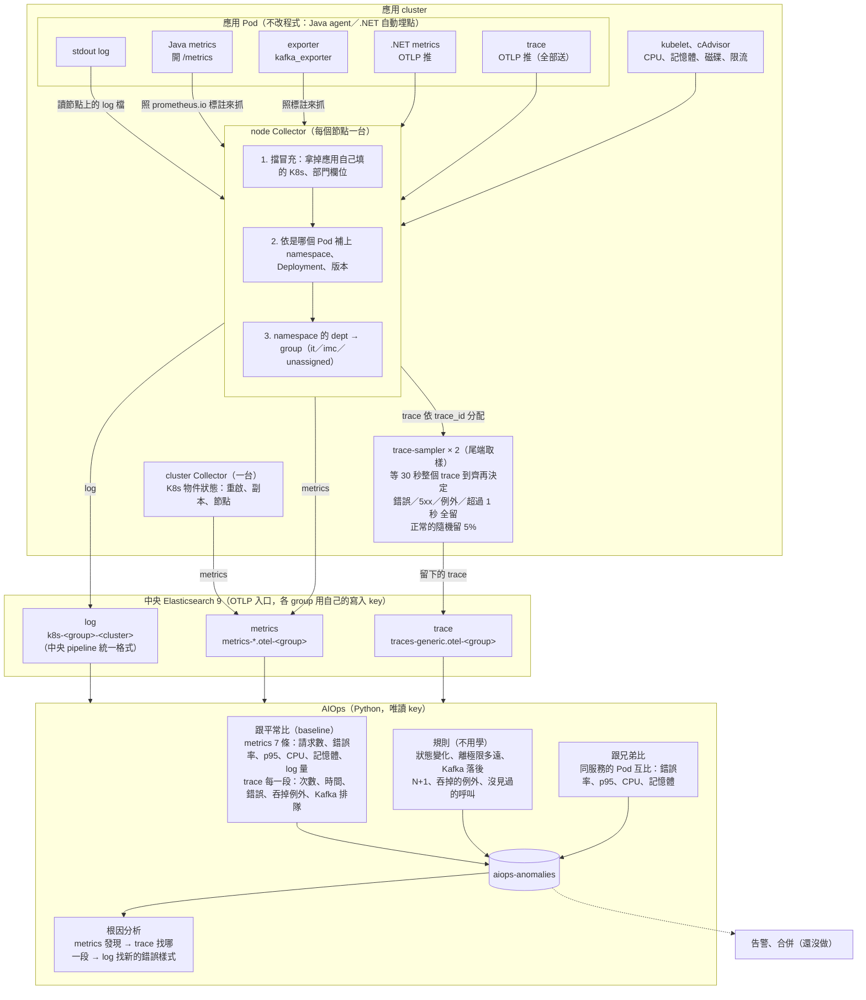
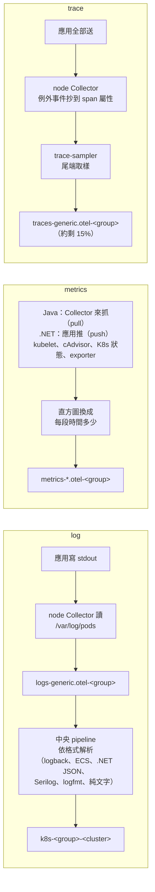

# 系統總覽

一句話：**每個應用 cluster 一套 OpenTelemetry Collector，把 log、metrics、trace 依 namespace 的部門分流、用各部門自己的 key 寫進中央 Elasticsearch；AIOps 用唯讀 key 讀出來，學「平常的樣子」、跑規則、Pod 互比、做根因分析，結果寫進 `aiops-anomalies`。** 舊專案不改程式（Java agent、.NET 自動埋點）。目前範圍是一般服務，工廠之後再做（[factory-later.md](factory-later.md)）。

## 架構圖

## 三種資料怎麼收

## 各部分的文件

| 主題 | 文件 |
|---|---|
| **全部串起來看（收值 → 判斷 → 串接 → 收斂 → LLM → feedback）** | [system-map.md](system-map.md) |
| log 怎麼收、格式解析 | [elasticsearch.md](elasticsearch.md) |
| metrics 怎麼收 | [metrics.md](metrics.md)；收了哪些、能做什麼：[aiops-metrics.md](aiops-metrics.md)、案例 [aiops-metrics-cases.md](aiops-metrics-cases.md) |
| trace 怎麼收、尾端取樣 | [traces.md](traces.md)；能做什麼：[aiops-trace.md](aiops-trace.md) |
| .NET | [dotnet.md](dotnet.md) |
| baseline、規則、跟兄弟比 | [aiops/baseline/README.md](../aiops/baseline/README.md) |
| 根因分析 | [aiops-rca.md](aiops-rca.md)、[aiops/rca/README.md](../aiops/rca/README.md) |
| PoC 現況與下一步（簡報） | [poc-status.md](poc-status.md) |
| 落地五階段：階段一現況、階段二規劃 | [stage2-plan.md](stage2-plan.md) |
| 後期接 LLM 還是 MLOps | [aiops-llm-mlops.md](aiops-llm-mlops.md) |
| 保留天數與容量 | [retention.md](retention.md) |
| 工廠部分（之後再做） | [factory-later.md](factory-later.md) |
| 全部文件、閱讀順序、待辦 | [README](../README.md) |
