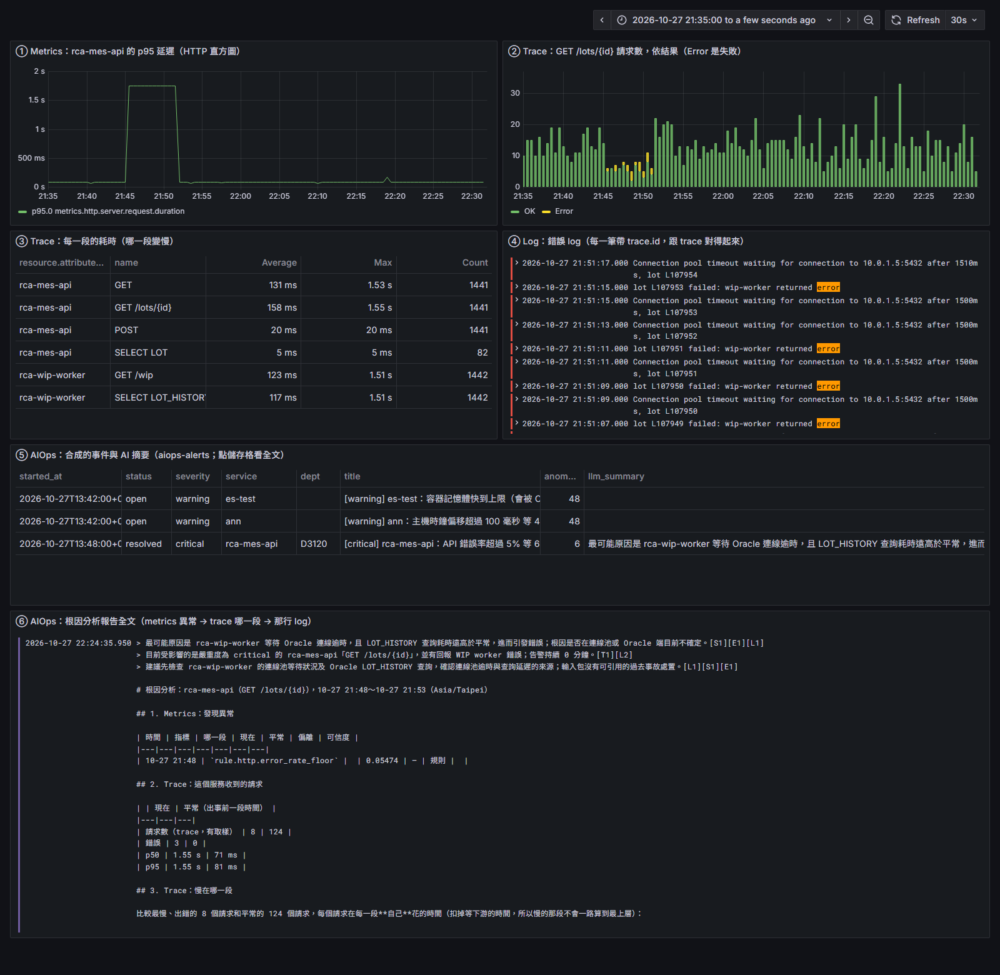

# 整條線在 K8s 上跑：Pod 連續送 metrics、trace、log → 偵測 → 根因＋LLM → Grafana（2026-10）

**狀態**：已完成　　**日期**：2026-10-27　　**相關**：分支 `claude/edge-rca-demo`；告警抖動另見 [alert-flap](2026-10-alert-flap.md)
**模組**：① 收值、④ 判斷、⑥ 收斂、⑦ 根因分析、⑧ 出口

## Plan：這一次要達到什麼

- **需求**：各段都分開驗過，但沒有一次是「應用 Pod 連續送三種資料 → 偵測自己算出異常 → 合成一件 → 根因＋真的 LLM → Grafana 看得到、通知送出去」整條在 K8s 上跑。`run-rca-e2e.sh` 的異常是直接寫進 ES 的。也沒有給人看的儀表板。
- **目的**：一條指令起環境、一條指令製造事故，Grafana 上看得到三種資料、合成的那件、LLM 摘要、根因報告；部門頻道收到通知，事故結束收到恢復。
- **範圍**：邊緣端 = K8s 上的應用 Pod；LLM 用 OpenAI 相容（`gpt-6-luna`）；不做 exemplar；engine 用 `loop` 每分鐘跑一輪（不是 CronJob）。

## Do：改動哪些 code、改了什麼、為何要改

| 檔案 | 改了什麼 | 為何要改 |
|---|---|---|
| `e2e/local-k3s/rca-apps.yaml` | `rca-mes-api` 在 `:9464/metrics` 開 `http_server_request_duration_seconds` 直方圖（依實際耗時、狀態碼累加），Pod 加 `prometheus.io/scrape` | 保底規則（錯誤率 ≥ 5%、p95 ≥ 2 秒）從 metrics 算；沒有 metrics 就偵測不到 |
| `e2e/local-k3s/rca-demo/run-rca-demo.sh`（新） | `up`、`incident`、`heal`、`tick`、`loop <分鐘>` | 整條線一條指令起、一條指令製造事故。key 權限照 `elasticsearch-setup.sh`；LLM 只從 `LLM_ENV_FILE` 載入四個變數，key 不進 repo |
| `e2e/local-k3s/rca-demo/grafana.yaml`、`datasources.yaml`、`dashboard-provider.yaml`、`dashboard.json`、`webhook.py`、`shot.py`（新） | namespace `aiops-demo`：Grafana 12.2（告警設定直接掛 `engine/configs/grafana/` 的檔）、儀表板六格、收通知的假 webhook、截圖工具 | 告警規則用正式的檔，demo 不另外維護。Service 用 `LoadBalancer`（`localhost:3300`） |
| `engine/investigator/alerts.py` | `summary` 不放「持續 N 分鐘」「等 N 項異常」 | `summary` 是 Grafana 的 label，內容一變就是另一則通知 |
| `engine/tests/test_alerts.py` | 改 1 個斷言、加 `test_summary_stable_while_incident_grows` | 固定「件變大、變久，summary 不變」 |
| `engine/configs/grafana/alert-rules.yaml` | 只加註解 | 說明 summary 是 label |
| `.gitignore` | 加 `.env` | LLM key 放在 `e2e/local-k3d/.env` |
| 文件 | `docs/rca/README.md`、`engine/configs/grafana/README.md`、`docs/architecture.md`、`docs/troubleshooting.md` | 敘述跟程式一致；排錯結論集中 |

## metrics、trace、log 怎麼串

| 段 | 靠什麼 | 精度 |
|---|---|---|
| metrics → trace | **服務＋API＋時間窗**：從異常拿 `service.name`、`http.route`、時間，撈同服務、同路由、同時段的 Server span，挑最慢 200 個＋出錯 100 個 | 統計對應：同一群請求裡的樣本。metrics 是聚合的，沒有 trace_id |
| trace 內部 | `span_id`／`parent_span_id` 組成呼叫樹，每段只算自己的時間 | 慢的指到最底層那段，不會一路算到上層 |
| trace → log | **`trace_id`** | 同一個請求。log 也帶 `span.id`，目前沒用 |

## Check：測試的目的與結果

環境：Rancher Desktop（k3s v1.30.14）、測試 ES 9.5.5、Grafana 12.2.0。`rca-mes-api（it-mes-prod／D3120）→ rca-wip-worker（imc-wip-prod／D1110）→ Oracle`，每 0.5 秒一個請求。事故：wip-worker 查 Oracle 從 30 ms 變 1.5 秒、印 connection pool timeout、約 1/4 請求失敗，13:45:17Z～13:51:17Z。

| 測試目的 | 怎麼測 | 結果 |
|---|---|---|
| 三種資料進 ES、分對部門、對得起來 | `up` 後查 ES | metrics 進 `metrics-prometheusreceiver.otel-it`（exponential histogram，`percentiles` 算得出 p95）；trace 進 `traces-generic.otel-it`／`-imc`；log 進 `k8s-it-local`／`k8s-imc-local`，帶 `trace.id`、`span.id`、`labels.dept`。三種的 `service.name` 都是 `rca-mes-api` |
| 異常是偵測算出來的 | `incident` 後每分鐘 `tick` | 13:48:46Z `rule.http.error_rate_floor`（critical）觸發，5.47%，**事故後 3 分 29 秒** |
| 合成一件、歸對部門 | 同上 | 新開 1 件，critical、D3120／it |
| 根因：metrics 異常 → trace 哪一段 → 那行 log | 看報告 | 平常 p95 81 ms、出事 1.55 s；慢在 `rca-wip-worker › SELECT LOT_HISTORY → oracle`，31 ms → 1.50 s；錯誤最早出在同一段；新出現 `Connection pool timeout…` 23 次（平常 0）；最慢那個請求用 trace_id 從兩個服務各撈到 log |
| 真的 LLM 摘要 | `gpt-6-luna` | 三句，每句附依據 id，沒有編數字；「連線池還是 Oracle 端」寫成不確定，跟報告能證明的範圍一致 |
| 通知送到部門頻道、帶根因 | 假 webhook | 13:49:35Z `/it` 收到 firing，內容含根因結論；開件後約 50 秒 |
| 事故結束 → Grafana 發恢復 | `heal` 後繼續 `loop` | 14:24 件結束（`close_after` 30 分鐘），14:26:35Z `/it` 收到 resolved |
| 一件只發一則 | 數 `/it` 收到幾則 | 每分鐘重發不再出現。另有兩次假的 resolved＋firing（13:55、14:18），原因與修正見 [alert-flap](2026-10-alert-flap.md) |
| 儀表板 | `localhost:3300`，不登入 | 六格都有資料，見下圖 |
| 心跳規則 `aiops-heartbeat` | docker：寫一筆 9 分鐘前的心跳、再寫新的、再停掉 ES | 心跳斷 → `/platform` 收到「AIOps 停了」；恢復寫入 → resolved。ES 連不上時收到的是 `DatasourceError`，兩條規則各一則 |

**沒測到**：cluster 外的邊緣 VM 用 OTLP 推；engine 用 K8s CronJob 跑；夜間靜音、限頻；有 trace 的相似事故；從通知點進 Grafana 回饋表單。

## Act：Check 後沒改善的、還沒解決的

| 是什麼 | 在什麼情況下發現的 | 影響 | 打算怎麼處理 |
|---|---|---|---|
| metrics → trace 是統計對應 | 整理串接方式時 | 事故只影響一部分請求時，樣本可能不是讓 metrics 變差的那些 | 要精確就做 exemplar（應用附 trace_id、Collector 保留、ES 收、RCA 優先用）。等有真實案例顯示不夠再做 |
| 撈 log 沒用 `span.id` | 同上 | 報告標不出 log 是哪一段印的 | `investigator/es.py` 撈 log 帶 `span.id` |
| ES 連不上時是 `DatasourceError`，一次兩則 | 心跳規則實測 | 值班看到的不是「AIOps 停了」 | 心跳規則改 `execErrState: Alerting`；事件規則的 DatasourceError 靜音。要跟管 Grafana 的人定 |
| RCA＋LLM 搭配 graph RAG | 討論串接方式時 | 每件各算各的，沒有跨事故的依賴關係 | 只記錄：[rca/graph-rag.md](../../rca/README.md) |
| engine 不是 K8s CronJob | demo 範圍 | 正式排程沒在 K8s 上跑過 | `kubectl apply -k engine/deploy/` |
| 模擬服務的 metrics 是腳本累加的 | 為了讓 demo 有 metrics | 沒有 JVM、連線池指標 | 測那些規則用 `java-app.yaml` |
