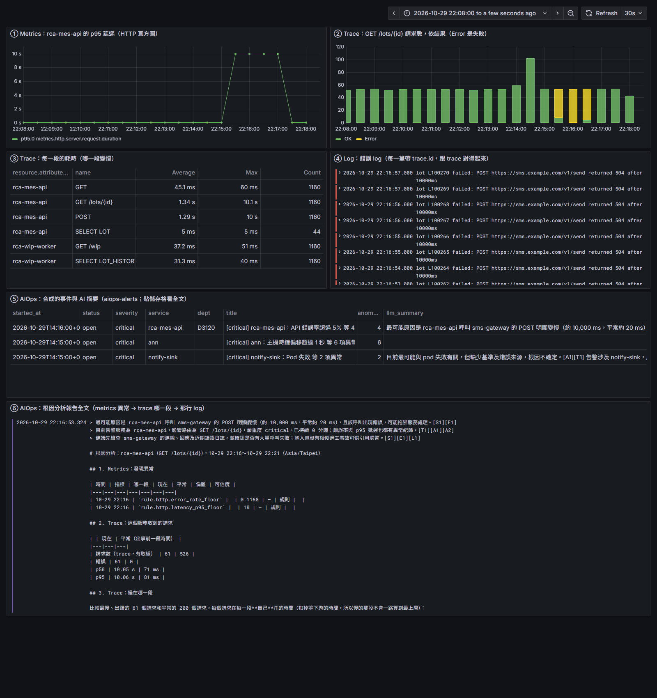

# 情境 4（第三方 API 中斷）注入＋MTTI 量測（2026-10）

**狀態**：已完成　　**日期**：2026-10-30　　**相關**：分支 `claude/poc-acceptance-plan`；[POC 驗收計畫](../meta/2026-10-poc-acceptance.md)的任務 3；demo 環境見 [rca-demo](2026-10-rca-demo.md)
**模組**：④ 判斷、⑥ 收斂、⑦ 根因分析、⑧ 出口

## Plan：這一次要達到什麼

- **需求**：驗收計畫的 4 個故障情境只有情境 1（DB 連線池）真的注入過；情境 4（第三方 API 中斷）只有「demo 裡有 `POST → sms-gateway` 這段」，沒驗過報告會不會歸因到外部端點而不是自己的程式。MTTI（根因初篩時間）只有一次實測 3 分 40 秒，沒有腳本、沒有多次量測，也沒拆開時間花在哪。
- **目的**：
  1. `run-rca-demo.sh incident-external`／`heal-external`：rca-mes-api 呼叫 sms-gateway 那段變成 10 秒延遲＋504。
  2. `measure-mtti.sh <情境>`：記注入時間，印出「異常寫入 → 開件 → 報告可見」每個階段的時間；情境 1、4 各量 ≥ 3 次取中位數。
  3. 量出來後分析時間花在哪，把能縮短的選項列成表；只動 demo 腳本與排程間隔，偵測門檻（規則的時間窗、`for`）不動，寫成建議。
- **範圍**：模擬服務（`rca-apps.yaml`）、demo 腳本、文件；不碰 Collector 設定、不改 `rules.yaml`、不改 engine 程式。

### 先寫預期（跑之前寫的，看到結果不放寬）

情境 4 注入後，報告（`aiops-alerts` 那件的 `report`）要同時有：

| 項 | 預期 |
|---|---|
| 慢在哪一段 | 第 3 節第一列是 `rca-mes-api › POST → sms-gateway`，多了約 +10 s（平常 20 ms） |
| 錯誤最早出在哪 | 同一段 `rca-mes-api › POST → sms-gateway`；不是 `GET /lots/{id}`（上層）、不是 wip-worker、不是 Oracle |
| 外部端點 | span 帶 `server.address: sms.example.com`、`http.response.status_code: 504`（在 ES 的 trace 查得到）；報告第 5 節新出現的 log 樣式含 `sms.example.com` 與 `504`。報告的段名用的是 `peer.service`（`→ sms-gateway`），不會印 `server.address`，端點靠 log 那行和 span 屬性標出 |
| LLM／模板摘要 | 歸因到 sms-gateway／第三方簡訊 API（引用 [S1]／[E1]／[L1]），不說是 rca-mes-api 或 wip-worker 自己的程式 |
| 開件 | `http.error_rate_floor`（critical）開成一件；`http.latency_p95_floor`（warning）併進同一件 |

MTTI 預期：情境 4 每個請求都失敗、吞吐不變（延遲是模擬的，不真的等），5 分鐘窗內錯誤率 15 秒就過 5%，瓶頸只剩「抓取 30 秒 → 每分鐘一次的 tick → 根因分析＋LLM」，預期 1～2 分鐘；情境 1 只有 1/4 失敗、吞吐掉到 1/3，窗內錯誤率要 2 分多鐘才過 5%，預期 3～4 分鐘（上次 3 分 40 秒）。

## Do：改動哪些 code、改了什麼、為何要改

| 檔案 | 改了什麼 | 為何要改 |
|---|---|---|
| `e2e/local-k3s/rca-apps.yaml` | rca-mes-api 的 `run.sh` 加 `/tmp/sms_down`：通知簡訊那段變 10 秒、span 標錯誤、`http.response.status_code` 504，這個請求失敗（log ERROR、metrics 記 500）；log 印 `POST https://sms.example.com/v1/send returned 504 after 10000ms`。sms span 平常也多帶 `server.address: sms.example.com`、`http.request.method`、`http.response.status_code` 202 | 第三方 API 中斷就是「對外那段又慢又錯、自己的程式沒變」。span 帶 `server.address` 跟真的 HTTP client 自動埋點一樣，ES 裡才查得到外部端點。延遲照既有 `sms_hang` 的做法模擬、不真的等：真的等 10 秒，吞吐掉到 1/20，5 分鐘內請求數會低於 `min_events`，規則不判斷 |
| `e2e/local-k3s/rca-demo/run-rca-demo.sh` | 加 `incident-external`／`heal-external`（在 rca-mes-api 的 Pod 碰 `/tmp/sms_down`）；`loop <分鐘> [秒]` 可以改 tick 間隔；`up` 時 ConfigMap 有改才 `rollout restart` 模擬服務；用法說明 | 模擬服務的腳本在 ConfigMap、Pod 起來時才讀進 sh，改了不重啟不生效。間隔參數是為了量「排程間隔」對 MTTI 的影響，規則不動 |
| `e2e/local-k3s/rca-demo/measure-mtti.sh`（新） | 量 MTTI：背景每 `TICK_EVERY` 秒 tick、注入、每 10 秒查 ES、heal；印「異常寫入（`aiops-anomalies.detected_at`）、開件（`aiops-alerts.report_at`）、報告可見（輪詢第一次看到帶 `report`）」三個時間與中位數；量測之間等 5 分鐘窗清掉、把開著的那件強制 resolved | 驗收計畫的量法寫「第一次帶 `report` 的 `@timestamp`」，但 engine 故意把開著的件的 `@timestamp` 往前寫 1 分鐘（[alert-flap](2026-10-alert-flap.md)），用它會少算 1 分鐘，所以用 `report_at`。同一個服務 30 分鐘內的異常會併進開著的那件、不再產報告（`close_after`），連續量要先結束上一件 |
| `docs/pdca/README.md` | 索引加一行 | |

## Check：測試的目的與結果

環境同 [rca-demo](2026-10-rca-demo.md)（Rancher Desktop k3s、測試 ES 9.5.5、Grafana 12.2、LLM `gpt-6-luna`）。tick 每 60 秒（跟正式排程一樣），`measure-mtti.sh` 自己跑 tick、每 10 秒查 ES。沒有一週前的資料，根因分析的「平常」都是「出事前一段時間」。

### 情境 4：報告對照預期（第 1 次，`a-20261029-1416-rca-mes-api`）

| 測試目的（為了確認什麼） | 怎麼測 | 結果 |
|---|---|---|
| span 帶外部端點 | `incident-external` 前後查 `traces-*.otel-*` 的 `POST` span | 平常：`server.address: sms.example.com`、`http.response.status_code: 202`、20 ms；事故：504、`status.code: Error`、10,000 ms |
| 慢在哪一段指到 sms-gateway、不是自己的程式 | 報告第 3 節 | 第一列 `rca-mes-api › POST → sms-gateway`：10.00 s，平常 20 ms，**+9.98 s**；其他段都在 ±2 ms（`SELECT LOT_HISTORY → oracle` +1.4 ms、`GET /lots/{id}` −2.1 ms） |
| 錯誤源頭在那一段 | 同上 | 「錯誤最早出在哪一段」只有 `rca-mes-api › POST → sms-gateway`：61 個請求，平常 0 |
| 外部端點在報告裡看得到 | 第 5 節 | 🆕 `lot L<n> failed: POST https://sms.example.com/v<n>/send returned <n> after <n>ms`，70 次、平常 0；最慢請求的 log：`rca-mes-api error lot L100170 failed: POST https://sms.example.com/v1/send returned 504 after 10000ms` |
| LLM 摘要歸因到第三方 | `llm_summary`（openai） | 「最可能原因是 rca-mes-api 呼叫 sms-gateway 的 POST 明顯變慢（約 10,000 ms，平常約 20 ms），且該呼叫出現錯誤 [S1][E1]」「建議先檢查 sms-gateway 的連線、回應及近期錯誤日誌 [S1][E1][L1]」；沒說是 rca-mes-api、wip-worker 自己的程式 |
| 開件與通知 | `aiops-alerts`、notify-sink | `http.error_rate_floor`（critical，22.4%）開件，`latency_p95_floor`（10 秒）併進同一件；`/it` 14:17:05Z 收到 firing，內容含「主要多在 rca-mes-api › POST → sms-gateway」（報告後 25 秒） |
| 儀表板 | `shot.py` | 六格都有：p95 從 80 ms 跳到 10 s、Error 請求、POST 那段 Max 10 s、錯誤 log 帶 504、AI 摘要、報告全文（下圖） |

預期全部符合。「標出外部端點」的方式是 span 的 `server.address` 與 log 那一行；報告的段名用的是 `peer.service`（`→ sms-gateway`），報告正文不印 `server.address`（見 Act）。

### MTTI（注入 → 報告）

每個階段都是「注入後幾分幾秒」；報告可見含最多 10 秒輪詢誤差。

| 情境 | 次 | 異常寫入（`detected_at`） | 開件（`report_at`） | 報告可見 | 觸發的規則 |
|---|---|---|---|---|---|
| 4 第三方 API | 1 | 1:03 | 1:05 | 1:22 | `http.error_rate_floor` |
| 4 | 2 | 1:15 | 1:16 | 1:32 | 同上 |
| 4 | 3 | 1:17 | 1:18 | 1:33 | 同上 |
| **4 中位數** | | **1:15** | **1:16** | **1:32** | |
| 1 DB 連線池 | 1 | 3:09 | 3:11 | 3:26 | `http.error_rate_floor` |
| 1 | 2 | 2:53 | 2:54 | 3:05 | 同上 |
| 1 | 3 | 3:00 | 3:02 | 3:15 | 同上 |
| **1 中位數** | | **3:00** | **3:02** | **3:15** | |

情境 4 中位數 1 分 32 秒，< 3 分鐘；情境 1 中位數 3 分 15 秒，**沒到**（三次 3:05～3:26；上次 rca-demo 的 3 分 40 秒也是情境 1）。

**量 MTTI 時順便發現：報告出得快，trace 卻還沒到。** 情境 1 三次的報告：第 1 次「慢在 `rca-mes-api › GET → rca-wip-worker`」、錯誤源頭 Oracle 那段（6 個請求）；第 2 次**整份沒有 trace**（「這段時間沒有這個服務的 trace」，LLM 寫「目前無法判定」）；第 3 次慢在 `GET → rca-wip-worker`、錯誤源頭 Oracle（1 個請求）。原因：根因分析的時間範圍從異常的時槽開始（`started_at`，取整到分鐘），alert 在時槽後 10～43 秒就跑，trace 要經過 trace-sampler 的 `decision_wait` 才進 ES，當下窗裡幾乎沒有 span（第 2 次：時槽 23:53:00、alert 23:53:10）；wip-worker 的子 span 比 mes-api 的晚到，自己的時間就被算到 `GET → rca-wip-worker` 那段。情境 4 沒這個問題是因為 sms 那段跟 root span 同一批送。上次 rca-demo 指到 Oracle 那行，是 alert 剛好跑在時槽後較晚。這是 ⑦ 的時間範圍問題，不是這次改出來的，記在 Act。

### 時間花在哪（情境 1 的 3 分多，對照情境 4 的 1 分半）

| 階段 | 情境 4 | 情境 1 | 怎麼算的 |
|---|---|---|---|
| metrics 反映：Collector 每 30 秒抓一次、批次送 ES | 0～30 秒 | 同 | `telemetry/collectors/node.yaml` `scrape_interval: 30s` |
| 規則的 5 分鐘窗內錯誤率過 5% | 約 15 秒 | 約 2 分 15 秒 | 情境 4 每個請求都失敗、吞吐不變（2/秒）：5% × 5 分鐘 ＝ 15 秒。情境 1 只有 1/4 失敗、每個請求多等 1.5 秒吞吐掉到 0.6/秒：錯誤 9t ≥ 5% × (600 − 84t) → t ≥ 2.3 分鐘（推論，跟實測一致） |
| 等下一輪 tick（每 60 秒） | 0～60 秒 | 同 | 三次實測異常寫入落在 1:03～1:17，差 14 秒就是 tick 相位 |
| rules → alert 開件 | 1～2 秒 | 同 | 同一輪連著跑；`report_at` − `detected_at` |
| 根因分析＋LLM＋寫入 | 15～17 秒 | 同 | 報告可見 − 開件（含 ≤10 秒輪詢） |

### 能縮短的選項（只做了 A 的工具；B～E 是建議，使用者決定）

| 選項 | 改什麼 | 縮多少 | 副作用 |
|---|---|---|---|
| A tick 間隔 60 → 30 秒 | demo：`loop <分鐘> 30`、`TICK_EVERY=30`。正式環境：CronJob 最小 1 分鐘，要改成常駐 loop（Deployment）或一個 Job 裡跑兩輪 | 平均 15 秒、最多 30 秒 | rules 每輪掃全部規則、查 ES 一次，負載加倍；`interval: 1m` 的去重不受影響 |
| B 正式環境 rules、alert 連著跑 | `engine/deploy/cronjobs.yaml` 兩個 CronJob 都是 `* * * * *`，同一分鐘誰先跑不保證，alert 先跑就多等 1 分鐘；改成一個 Job 依序跑（demo 的 `tick` 就是這樣） | 平均 30 秒、最多 1 分鐘 | 無；只改 engine/deploy |
| C Collector 抓取 30 → 15 秒 | `node.yaml` prometheus `scrape_interval` | 平均 7～8 秒 | metrics 寫入量加倍；本次不碰 Collector |
| D `http.error_rate_floor` 的窗 5m → 2m（`lookback`） | `rules.yaml` | 情境 1 約 1 分 20 秒（推論：9t ≥ 5% × (240 − 84t) → t ≥ 0.9 分鐘）；情境 4 幾乎不變 | 母體變小、誤報變多：2 分鐘 20 個請求錯 1 個就 5%，`min_events` 要一起調；**偵測門檻，不動** |
| E 錯誤率門檻 5% → 2% | `rules.yaml` `threshold` | 情境 1 約 1 分 10 秒（推論：t ≥ 1.1 分鐘） | 誤報變多；**偵測門檻，不動** |
| F LLM 摘要改成開件先寫、摘要後補 | engine `cmd_alert.py` | 5～8 秒（LLM 一次 5～8 秒） | 第一版通知沒有摘要；engine 改動，不在本次範圍 |

A＋B 一起做，情境 1 可到約 3 分鐘上下、情境 4 約 1 分鐘；要讓情境 1 穩穩 < 3 分鐘得動 D 或 E。

**沒測到**：A（30 秒間隔）的實際數字（工具有了，沒量）；真實 Java／.NET 服務；延遲真的等 10 秒時的吞吐下降（模擬不等）；同時兩個情境。

## Act：Check 後沒改善的、還沒解決的

| 沒改善的 | 在什麼情況下發現的 | 影響 | 後續 |
|---|---|---|---|
| [⑦] 報告正文不印 `server.address` | 對照預期時 | 段名是 `peer.service`（`→ sms-gateway`），外部端點只在 span 屬性和 log 那行；真實服務的 HTTP client 埋點多半只有 `server.address` 沒有 `peer.service`，那時段名會直接是主機名，反而看得到 | `investigator` 的段名或瀑布圖加印 `server.address`；等真實服務跑過再決定 |
| [⑦] 開件當下跑根因分析，trace 還沒進 ES；時間範圍從異常時槽開始，事故其實早 2～3 分鐘就開始 | 情境 1 的 3 次報告（1 次沒有 trace、2 次慢的那段算到 `GET → rca-wip-worker`） | MTTI 快但報告可能空或指錯段；alert 跑在時槽後第幾秒決定報告品質 | 兩個都不花 MTTI：(1) 根因分析的開始時間往前拉到規則的窗開始（異常有 `since`，`rules.yaml` 的 `lookback`）；(2) 沒有 trace、或 span 數少於某個數時下一輪重跑（現在 `report` 非空就不重跑）。engine 改動，使用者決定 |
| [⑦] 連續量測時「平常」被上一次污染 | 情境 4 第 2 次：「平常 4.41 s」、沒有「錯誤最早出在」那行 | 沒有一週前資料時，對照組是出事前 10～15 分鐘；兩次間隔 12 分鐘就把上一次的事故當平常。MTTI 數字不受影響 | `measure-mtti.sh` 兩次之間預設等 15 分鐘（`MTTI_QUIET`）；情境 1 用新的間隔量 |
| [④] 情境 1 的 MTTI 受規則的窗與門檻主導 | 時間拆解 | 排程、抓取加起來最多省 1 分多；要穩穩 < 3 分鐘得動 D／E | 使用者決定要不要調窗或門檻；調了要用 `backtest` 看誤報 |
| [⑧] 驗收計畫的 MTTI 量法寫 `@timestamp` | 寫腳本時 | 開著的件 `@timestamp` 故意往前 1 分鐘，照字面量會少 1 分鐘 | 驗收計畫改成 `report_at`（這份已照 `report_at` 量） |
| [⑧] `up` 重啟 Grafana／notify-sink 會讓 `pod.failed` 報到平台頻道 | 截圖裡 ⑤ 有 `[critical] notify-sink：Pod 失敗` | demo 的雜訊，跟測的事故無關 | 不處理；跑 demo 時知道就好 |
| 模擬的延遲不真的等 | 設計時 | 真的卡 10 秒吞吐會掉到 1/20，5 分鐘內請求數可能低於 `min_events`（20），規則不判斷、只剩 p95 那條（warning，要 2 筆才開件）；真實服務的情境 4 可能比這裡慢 | 真實服務上重跑時看 `min_events` 要不要調 |

- **決定**：情境 4 的注入與量測腳本照這樣進 demo；偵測門檻不動，D／E 留給使用者；驗收計畫的 MTTI 量法改用 `report_at`。
- **下一輪**：在真實 Java／.NET 服務上跑情境 1～4（[POC 驗收計畫](../meta/2026-10-poc-acceptance.md)週 2）；若使用者決定調 D／E，先 `backtest`。
