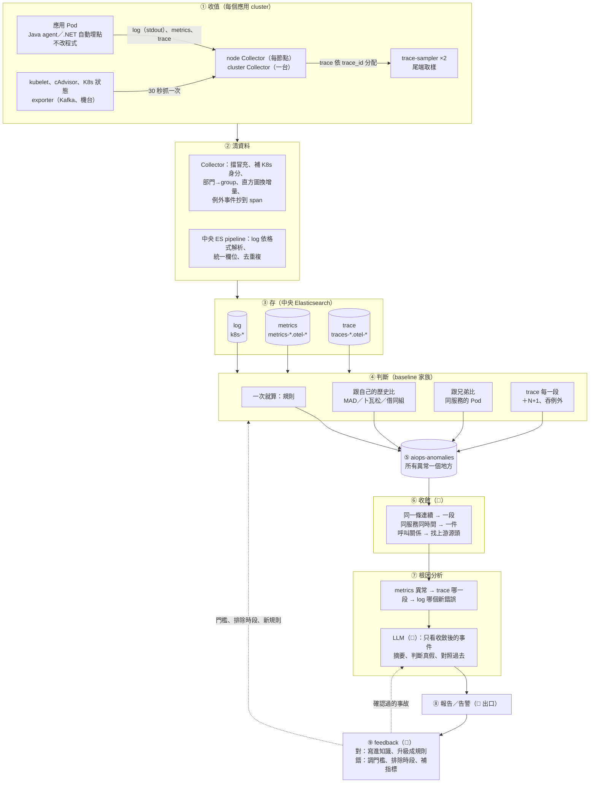
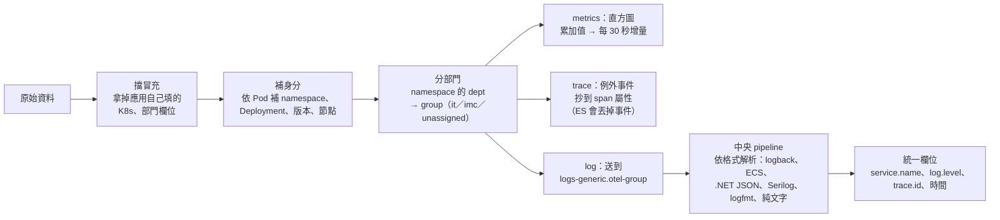
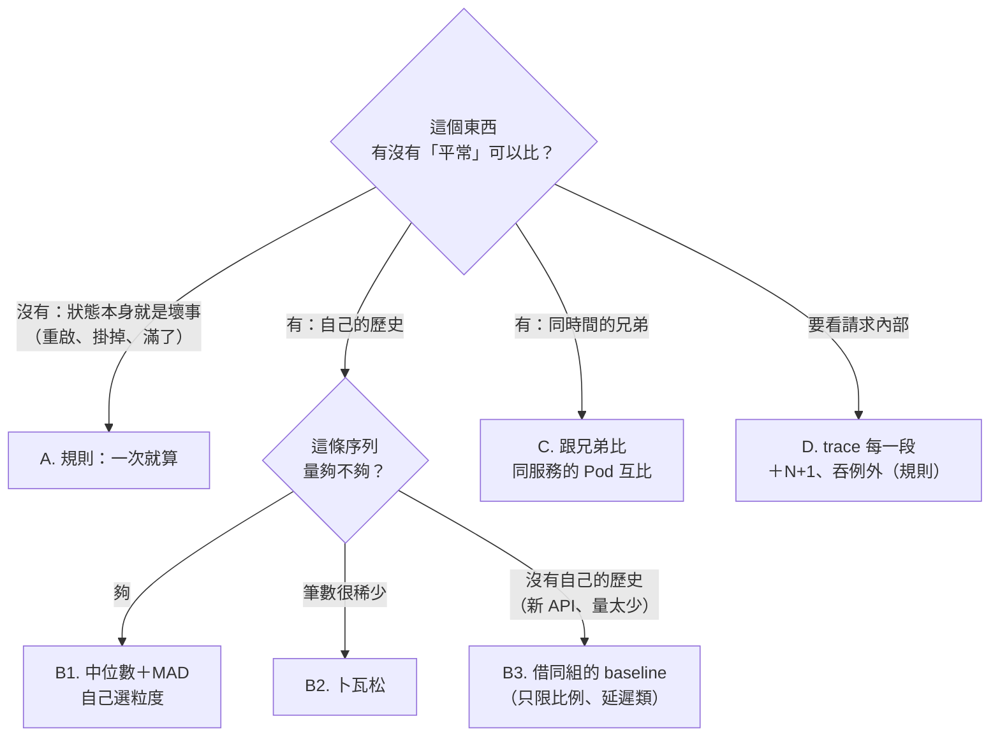
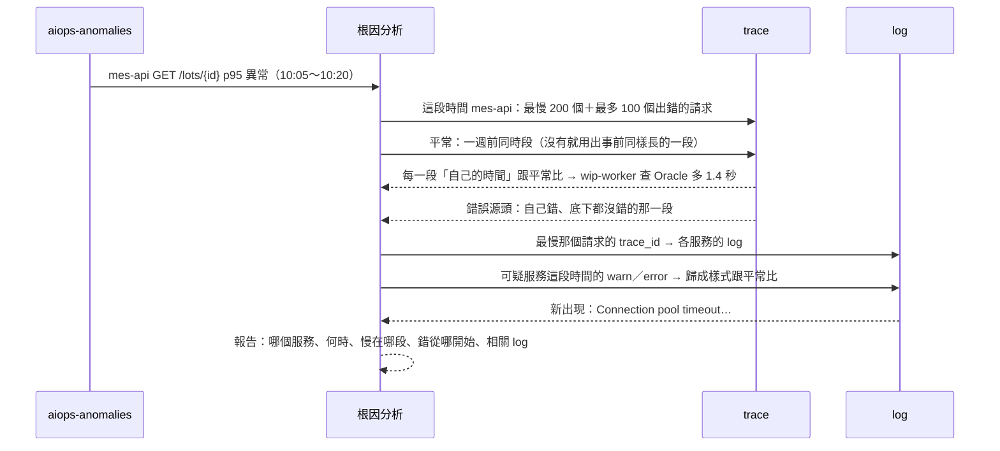
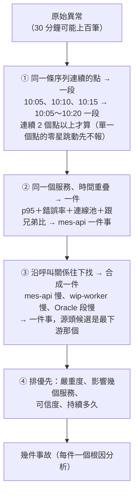
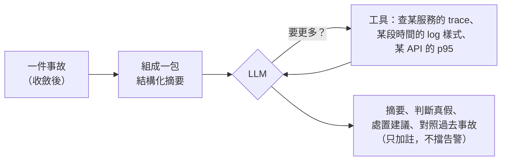
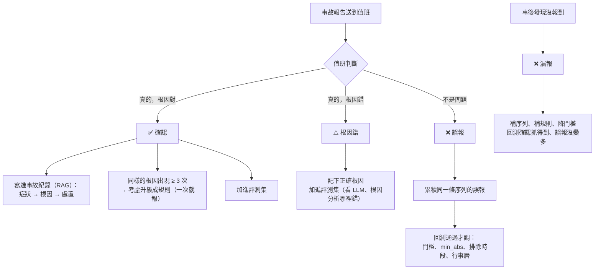

# 系統全貌：從收值到 feedback

一份看完整條線：**怎麼收值 → 怎麼清資料 → 時間顆粒與頻率 → 怎麼判斷正常／異常 → 異常怎麼從 metrics 串到 trace、log → 很多筆怎麼收斂 → 什麼時候叫 LLM、token 怎麼省 → 根因報告 → 對了怎麼強化、錯了怎麼 feedback**。

每一節標狀態：✅ 已做、在 k3s 驗過 ／ ⚠️ 做了一部分 ／ 📝 設計好、還沒做。細節連到各自的文件。

---

## 0. 一張圖看全部



| # | 模組 | 做什麼 | 在哪裡 | 狀態 |
|---|---|---|---|---|
| ① | 收值 | log、metrics、trace 三種資料，舊專案不改程式 | `platform/cluster-addons/otel-collector/` | ✅ |
| ② | 清資料 | Collector 補身分、擋冒充；中央 pipeline 統一格式、去重複 | 同上、`platform/central/elasticsearch/` | ✅ |
| ③ | 存 | 中央 ES，每個部門 group 一把寫入 key | `platform/central/` | ✅（保留天數待定案） |
| ④ | 判斷 | 規則、跟歷史比、跟兄弟比、trace 每一段 | `aiops/aiops_baseline/`、`aiops/baseline/*.yaml` | ✅（正式環境還沒排程） |
| ⑤ | 異常總表 | 所有判斷結果寫同一個 index | `aiops-anomalies` | ✅ |
| ⑥ | 收斂 | 很多筆異常 → 幾件事 | — | 📝 |
| ⑦ | 根因分析 | metrics → trace → log | `aiops/aiops_rca/` | ✅（LLM 📝） |
| ⑧ | 出口 | 通知、事故紀錄 | — | 📝 |
| ⑨ | feedback | 對了強化、錯了修正 | — | 📝 |

---

## 1. 怎麼收值 ✅

| 資料 | 從哪裡來 | 怎麼收 | 多久一次 | 細節 |
|---|---|---|---|---|
| **log** | 應用寫 stdout | node Collector 讀節點上的 `/var/log/pods` | 0.2 秒掃一次檔案（幾乎即時） | [elasticsearch.md](elasticsearch.md) |
| **metrics：應用** | Java agent（開 `/metrics`）；.NET 自動埋點（OTLP 推） | Java 由 Collector 照 `prometheus.io` 標註來抓；.NET 自己推 | 30 秒 | [metrics.md](metrics.md)、[dotnet.md](dotnet.md) |
| **metrics：資源** | kubelet、cAdvisor（CPU、記憶體、限流、磁碟） | node Collector | 30 秒 | [metrics.md](metrics.md) |
| **metrics：K8s 狀態** | 重啟次數、副本數、節點狀態 | cluster Collector（一台） | 30 秒 | [metrics.md](metrics.md) |
| **metrics：外部** | kafka_exporter、機台／EAP exporter | 照標註來抓 | 30 秒 | [aiops-metrics-cases.md](aiops-metrics-cases.md) |
| **trace** | Java agent、.NET 自動埋點，**全部送** | node Collector 收 → 依 trace_id 分給 trace-sampler | 即時；sampler 等 30 秒讓整個 trace 到齊再決定留不留 | [traces.md](traces.md) |

**trace 留哪些（尾端取樣，依序比對，符合第一條就留）**：隨機 5%（當「平常」用）→ 有錯誤 → HTTP 5xx → 有例外 → 超過 1 秒。正常的只留 5%，有問題的全留，總量約剩 15%。

**斷線時**：送 ES 的 log、metrics 先寫在節點磁碟（`file_storage`），恢復後補送；trace-sampler 的佇列目前只在記憶體（待補）。

---

## 2. 怎麼清資料 ✅

分兩段：**Collector（在廠內）** 管「這筆是誰的」，**中央 ES pipeline** 管「格式統一、不重複」。



| 問題 | 怎麼處理 | 為什麼 |
|---|---|---|
| 應用亂填服務名、部門 | Collector 先刪掉應用自己填的 K8s、部門欄位，再由 Collector 依 Pod 補上 | 三種資料的「服務、Pod、namespace」一定對得上，後面才串得起來 |
| 同一筆重送 | log 用內容指紋當 `_id`、trace 用 `trace_id + span_id`、metrics 用時序資料庫的去重複 | 斷線補送、Collector 重啟都不會多一份 |
| log 格式五花八門 | 依 `log.format` 分派到各格式的解析規則；沒對應的退回預設，照收 | 不管哪種格式都拿得到 level、trace.id、訊息 |
| 直方圖是累加值 | Collector 換成「每 30 秒多少」 | 任一段時間直接加總就是那段的請求數、錯誤數 |
| 沒資料 ≠ 0 | 筆數類：服務出現後、沒資料的時段補 0；**服務上線前**、**整個系統都沒資料的時段**（收集系統停機）當「不知道」 | 不然停機時段會被學成「平常會掉到 0」 |

---

## 3. 時間顆粒與頻率

| 層 | 顆粒 | 頻率 | 說明 | 狀態 |
|---|---|---|---|---|
| 原始資料 | metrics 30 秒一筆；log、trace 每筆都有自己的時間 | 持續 | | ✅ |
| baseline 的點 | **每條序列自己選**：5m／15m／30m／1h | — | 看「每個時間窗的請求數或筆數」，挑最細、而且至少三成時間窗夠多的（比例類每窗 ≥20 個請求、筆數類 ≥10 筆）；1 小時還不夠的筆數改卜瓦松 | ✅ |
| 「平常」的時段 | 星期幾 × 小時 = **168 個時段**（台北時間） | — | 換班、上下班、週末各自學；歷史不夠時退到「每天同一小時」→「不分時段」 | ✅ |
| 訓練（train） | 用最近 **4 週** | 建議**每天一次** | 每天重算，慢慢成長會跟上 | ⚠️ 程式好了，正式環境沒排程 |
| 偵測（detect） | 看最近 **30 分鐘**（1 小時一點的看最近一個整點） | 建議**每 5 分鐘** | 只看已經結束的時間窗（最後一窗還沒收齊，會像驟降） | ⚠️ 同上 |
| 規則（rules） | 看最近 10 分鐘 | 建議**每 1 分鐘** | 同一條規則、同一個對象 1 分鐘內只記一筆 | ⚠️ 同上 |
| 跟兄弟比（peer） | 最近 10 分鐘算一個值 | 建議每 1～5 分鐘 | 只比最近 2 分鐘還有資料的 Pod | ⚠️ 同上 |
| trace 每一段 | 每 5 分鐘、每支 API 抽 20 個請求 | 每 5 分鐘（跟 detect 一起） | 只抽「隨機留下」的 trace 當平常（錯的、慢的全留，混進來會偏） | ⚠️ 同上 |

**最快多久開始判斷**：約 4 小時（50 個點，「不分時段」層）；3 天後有「每天同一小時」；2 週後有「同星期幾 × 同小時」。歷史不夠時寧可不報。

---

## 4. 怎麼判斷正常、異常（都算 baseline 家族）

四種判斷，各管不同的事。**全部的結果都寫進同一個 `aiops-anomalies`**。



### A. 一次就算失敗：規則 ✅

不用學，狀態本身就是壞事，或離極限太近。`aiops/baseline/rules.yaml`，每 1 分鐘看一次。

| 類別 | 例子（門檻） | 嚴重度 |
|---|---|---|
| 狀態變化 | 容器重啟 ≥1 次、Deployment／StatefulSet 有副本不可用、Pod Failed、Pending、Job 失敗、節點 NotReady、記憶體或磁碟壓力 | critical／warning |
| 收不到 | 抓 metrics 失敗（`scrape.down`） | warning |
| 離極限多遠 | 容器記憶體 ≥ 上限 90%、節點記憶體 ≥ 90%、磁碟 ≥ 85%（≥ 95% critical）、CPU 被限流 ≥ 25% | warning／critical |
| JVM、.NET | Old Gen GC 後還 ≥ 80%、5 分鐘 ≥ 5 次 Full GC、GC 佔時間 ≥ 10%、.NET OOM、執行緒池飢餓、例外暴增 | warning |
| 連線池 | DB 連線池用光、有人在排隊 | critical／warning |
| 外部系統 | Kafka 消費落後、落後持續變大；SECS 斷線、PLC 掃描週期超規、重傳 | warning／critical |
| trace | 同一請求同一呼叫 ≥ 20 次（N+1）、≥ 5% 請求吞掉例外、沒見過的呼叫、時鐘差 > 500ms | warning |

### B. 跟自己的歷史比 ✅

**B1. 中位數＋MAD（大部分序列）**

```
平常值   = 過去 4 週同一時段的中位數
波動     = 1.4826 × MAD（MAD＝每個值離中位數多遠的中位數）
           至少是平常值的 5%（不動的序列不會一點點變化就報）
z        = (現在 − 平常值) ÷ 波動
異常     = |z| ≥ 5，而且 |現在 − 平常值| ≥ min_abs
```

- 用中位數不用平均：歷史裡混了幾次事故不會被拉偏（算法範例見 [baseline README「MAD 一步一步算」](../aiops/baseline/README.md#mad-一步一步算)）。
- 方向：延遲、錯誤只看變高；流量兩邊都看。
- 7 條序列：請求數、錯誤率、p95、log 行數、錯誤 log 數（每個服務 × API）；Pod CPU、記憶體（每個 Deployment）。

**B2. 卜瓦松（很稀少的筆數，例如設備告警一小時 0～2 次）**：學每個時段的平均次數 λ，「平常 λ 次的情況下出現這麼多次」的機率 < 0.001 才算異常。歷史裡的爆量先壓掉再平均。

**B3. 借同組（新 API、量太少的 API）**：依設定的組（例如 `mes-*` 的查詢 API）借成員 baseline 的中位數，門檻調高到 z ≥ 7，可信度標 low。請求數、筆數不借（新 API 的流量跟別人無關）。

**可信度**：同星期幾同小時 → high；每天同一小時 → medium；不分時段、借來的 → low。

### C. 跟兄弟比 ✅

同一個服務的 Pod 在**同一時間**互比（不看歷史）：錯誤率、p95、CPU、記憶體。每個 Pod 跟「其他 Pod 的中位數」比，z ≥ 5 才算。至少 3 個 Pod、10 分鐘至少 20 個請求、只比還活著的 Pod。抓的是「只有一個 Pod 壞掉」（節點有問題、連線卡住、記憶體洩漏），服務整體平均看不出來的。

### D. trace 每一段 ✅

每支 API 拆成「呼叫了哪些下游、各花多少時間（扣掉底下的呼叫，只算自己的）」，每一段學 baseline：每個請求呼叫幾次、自己的時間、錯誤率、吞掉例外的比例、Kafka 排隊時間。抓的是 metrics 看不到的：N+1、重試風暴、快取穿透、某個下游變慢。

### 哪個情況用哪種

| 情況 | 用哪種 | 為什麼 |
|---|---|---|
| Pod 重啟、副本不足、磁碟 95% | A 規則 | 一次就是壞事，不用等歷史 |
| 整個服務錯誤率變高、變慢 | B 歷史 | 要知道「平常」多少才知道算不算高 |
| 半夜突然出現白天的流量 | B 歷史 | 同樣的值白天正常、半夜異常，只有分時段的歷史看得出來 |
| 只有一個 Pod 慢 | C 兄弟 | 服務平均被其他 Pod 拉平了 |
| 換版後每個請求多查 30 次 DB | D trace | metrics 只看到稍微變慢，trace 看到「哪一段、幾次」 |
| 新 API 上線第一天 | B3 借同組 | 沒有自己的歷史 |
| 設備告警一小時多了 8 次 | B2 卜瓦松 | 平常大多是 0，中位數和 MAD 都是 0 |

---

## 5. 異常總表 `aiops-anomalies` ✅

所有判斷結果的共同格式，後面的收斂、根因分析、LLM、feedback 都只讀這裡。

| 欄位 | 內容 |
|---|---|
| `@timestamp` | 異常那個時間窗的開頭 |
| `series` | 哪條序列或規則，例如 `http.latency_p95_s`、`rule.container.restarted`、`peer.pod_cpu` |
| `keys` | 是誰：服務、API、Pod、namespace、trace 段 |
| `value`／`median`／`expected_low`／`expected_high` | 現在、平常、正常範圍 |
| `z`／`p` | 偏離多少（MAD 用 z、卜瓦松用機率） |
| `level` | dow_hour／hour／all／group／rule／peer |
| `resolution`、`method`、`baseline_source`、`confidence` | 粒度、方法、自己的或借來的、可信度 |
| `severity`、`message` | 規則、跟兄弟比才有 |

同一條、同一時間重跑會覆蓋同一筆（`_id` 由序列＋對象＋時間算出來），不會重複。

---

## 6. 從 metrics 串到 trace、log ✅

**共用的鑰匙**（Collector 用同一套規則補上，所以一定對得上）：

| 鑰匙 | metrics | trace | log |
|---|---|---|---|
| 服務 | `service.name` | `service.name` | `service.name` |
| Pod、namespace | `k8s.pod.name`、`k8s.namespace.name` | 同左 | 同左 |
| 時間 | 異常的時間窗 | span 時間 | log 時間 |
| **trace_id** | — | `trace_id` | `trace.id`（自動埋點寫進 log，中央 pipeline 統一名稱） |



**中間共用怎麼串**（程式結構）：

| 共用的東西 | 誰用 | 作用 |
|---|---|---|
| Collector 補的欄位 | 全部 | 三種資料用同一組鑰匙 |
| `aiops_common/es.py` | baseline、根因分析 | 同一套連線、查詢、寫入（同一把唯讀＋只寫 `aiops-*` 的 key） |
| `aiops_common/traces.py` | trace baseline、根因分析 | 同一套「span → 每段自己的時間、錯誤源頭」算法 |
| `aiops-anomalies` | 所有判斷 → 根因分析 →（之後）收斂、LLM、feedback | 模組之間只透過這個 index 交接，彼此不直接呼叫 |
| `aiops-baseline` | train 寫、detect 讀 | 每條序列每個時段的平常值，帶粒度、方法、來源 |
| `*.yaml` 設定 | 各模組 | 加序列、加規則、調門檻不用改程式 |

**接不起來的**：metrics 沒帶 trace_id（沒有 exemplar，用「服務＋時間」挑最慢的 trace 代替）；.NET Kafka 消費者不改程式時對不回訊息；沒有 trace_id 的 log 只能用服務＋時間撈；單一 Pod 異常還沒接到「拿這個 Pod 的 trace 逐段比」。詳見 [aiops-rca.md「metrics 異常怎麼串到 trace、log」](aiops-rca.md#metrics-異常怎麼串到-tracelog)。

---

## 7. 很多筆怎麼收斂 📝

**現況**：每一筆異常各自獨立。一次 DB 變慢，可能同時有：好幾個 API 的 p95、錯誤率、連線池規則、跟兄弟比、trace 段……30 分鐘裡上百筆，各跑一次根因分析。

**設計：四層收斂，全部用程式算（不用 LLM）**，越往下筆數越少：



| 層 | 規則 | 用到什麼 |
|---|---|---|
| ① 時間合併 | 同一條序列、同一個對象，間隔 ≤ 1 個時間窗的點合成一段；只有 1 個點、而且可信度不是 high 的，先標「觀察中」不送出 | `aiops-anomalies` |
| ② 服務合併 | 同一個服務（或同一個 Pod）、時間重疊的不同序列合成一件 | `keys` 裡的服務、Pod |
| ③ 拓撲合併 | 用 trace 算出的呼叫關係（已經有：根因分析的 `topology`），上下游同時異常的合成一件，**最下游、最早開始的**當源頭候選 | 呼叫關係圖 |
| ④ 排序 | critical 規則 > 影響多個服務 > 可信度高 > 持續久 | `severity`、`confidence` |

收斂後寫進 `aiops-incidents`（📝）：一件一筆，裡面列它包含的異常 id、源頭候選、開始結束時間。根因分析、LLM、feedback 都以「件」為單位。

---

## 8. 什麼時候叫 LLM、token 怎麼省 📝

**原則：程式負責「算」和「收斂」，LLM 只看收斂後、整理好的一件事。** 不把原始 metrics、log 丟給它。



**一包裡放什麼（估計的 token 數，實際依內容）：**

| 內容 | 怎麼壓 | 約多少 token |
|---|---|---|
| 指示（prompt） | 固定 | ~800 |
| 異常表 | 收斂後最多 10 筆，每筆一行：序列、對象、現在、平常、z、可信度 | ~500 |
| trace 段落 | 差最多的前 5 段、錯誤源頭、最慢請求的瀑布圖摘要 | ~1,000 |
| log 樣式 | 新出現或變多的前 10 種樣式（樣式不是原文） | ~600 |
| 過去事故 | 用 RAG 找最像的 3 件，每件只放結論 | ~900 |
| **輸入合計** | | **~4,000** |
| 輸出 | 摘要、判斷、建議 | ~500 |

**省 token 的做法：**

1. **只送收斂後的事故**：一天幾十件，不是幾千筆異常。粗估一天 50 件 × 4,500 ≈ 22.5 萬 token。
2. **只送樣式和統計，不送原文**：log 歸成樣式、trace 只送差異最大的段。
3. **讓 LLM 自己叫工具**：先給摘要，需要才查。不先塞「可能用得到」的資料。
4. **固定的指示放前面**，用提示快取（prompt caching），每次只算變動的部分。
5. **分級**：低嚴重度、可信度 low 的只做摘要；critical 的才做完整推理和對照過去事故。

---

## 9. 根因報告 ✅（LLM 部分 📝）

`aiops/aiops_rca` 產出 Markdown 報告（範例：[aiops/rca/example-report.md](../aiops/rca/example-report.md)）：

| 段落 | 內容 |
|---|---|
| 1. Metrics | 哪些異常，含可信度（粒度、卜瓦松、借誰的）；有 low 時加註「不是自己的歷史，先確認」 |
| 2. Trace 範圍 | 出事時和平常各多少請求、錯誤率、p95 |
| 3. 慢在哪一段 | 每段自己的時間跟平常比，差最多的排第一 |
| 4. 錯誤從哪開始 | 自己錯、底下都沒錯的那段 |
| 5. Log | 最慢請求的 log（用 trace_id 串各服務）；新出現或變多的 warn／error 樣式 |
| 6. 呼叫關係 | 這段時間誰呼叫誰 |

之後 LLM 讀這份報告（加上過去事故），寫成「原因、影響、建議處置」的一段話，貼在報告最前面。

---

## 10. 對了怎麼強化、錯了怎麼 feedback 📝



| 結果 | 寫到哪 | 之後怎麼用 |
|---|---|---|
| **確認（真的、根因對）** | `aiops-incidents`：症狀、根因、處置、相關異常 | ① LLM 的 RAG：下次類似症狀先參考；② 同樣根因反覆出現 → 升級成規則（一次就報，不用等歷史）；③ 加進評測集；④ 事故期間在 baseline 訓練時排除 |
| **根因錯** | 同上，加正確根因 | 評測集：改根因分析或 prompt 時要能答對這題 |
| **誤報** | `aiops-feedback`：哪一筆、為什麼不是問題（例如月底批次） | 同一條序列累積多次才動：調門檻、加 `min_abs`、把那個時段標成特殊時段（行事曆）；**單次回饋不直接生效** |
| **漏報** | `aiops-feedback`：時間、哪個服務、為什麼沒報 | 補序列或規則、降門檻 |

**一定要有的紀律**（不需要 MLOps 平台，見 [aiops-llm-mlops.md](aiops-llm-mlops.md)）：

1. **版本**：baseline、設定、prompt 都帶版本，每筆異常記下是哪一版產生的。
2. **回測**：改門檻前，用新設定重跑過去 4 週，確認過去的事故還抓得到、誤報變少。
3. **評測集**：20～30 件過去的事故，改根因分析、prompt、換模型前都跑一次。
4. **防污染**：回饋要累積多次、或第二個人確認；確認過的事故紀錄優先於單次回饋。
5. **LLM 只加註、降級，不刪告警**：統計層照常報，LLM 錯了也不會漏。

---

## 11. 狀態總表

| 模組 | ✅ 已做 | 📝／⚠️ 還沒做 |
|---|---|---|
| 收值 | log、metrics（Java、.NET、K8s、cAdvisor、Kafka、機台模擬）、trace＋尾端取樣 | trace-sampler 磁碟佇列；.NET SQL Server、Serilog／NLog 驗證 |
| 清資料 | 擋冒充、補身分、分部門、格式解析、去重複、補 0 規則 | — |
| 存 | 中央 ES、每部門寫入 key、換 key 不掉資料 | 保留天數定案 |
| 判斷 | 規則 30 多條、7 條 baseline、自己選粒度、卜瓦松、借同組、跟兄弟比、trace 每一段、N+1、吞例外 | **正式環境排程**；p99、慢請求比例、往外呼叫耗時；趨勢；工廠行事曆；`groups` 依公司命名定義 |
| 串接 | metrics → trace → log、呼叫關係 | exemplar；單一 Pod → trace 逐段比 |
| 收斂 | — | 📝 四層收斂、`aiops-incidents` |
| LLM | — | 📝 摘要、判斷真假、RAG、評測集 |
| 出口 | 寫進 `aiops-anomalies` | 📝 通知、事故紀錄 |
| feedback | — | 📝 回饋、回測、版本 |

**建議順序**：正式排程（只寫入不通知）→ 收斂①②＋出口＋事故紀錄、回饋 → 用 2～4 週真實資料校正門檻 → LLM 摘要（只加註）→ 回測、版本 → 收斂③、自動調門檻。

---

## 文件索引

| 主題 | 文件 |
|---|---|
| 架構總覽（兩張圖） | [overview.md](overview.md) |
| 收 log、格式解析 | [elasticsearch.md](elasticsearch.md) |
| 收 metrics；收了什麼、能做什麼；案例 | [metrics.md](metrics.md)、[aiops-metrics.md](aiops-metrics.md)、[aiops-metrics-cases.md](aiops-metrics-cases.md) |
| 收 trace、尾端取樣；能做什麼 | [traces.md](traces.md)、[aiops-trace.md](aiops-trace.md) |
| .NET | [dotnet.md](dotnet.md) |
| baseline、規則、跟兄弟比、自動調整 | [aiops/baseline/README.md](../aiops/baseline/README.md) |
| 根因分析、串接 | [aiops-rca.md](aiops-rca.md)、[aiops/rca/README.md](../aiops/rca/README.md) |
| LLM 還是 MLOps、feedback 閉環 | [aiops-llm-mlops.md](aiops-llm-mlops.md) |
| 保留天數 | [retention.md](retention.md) |
| PoC 現況（簡報） | [poc-status.md](poc-status.md) |
