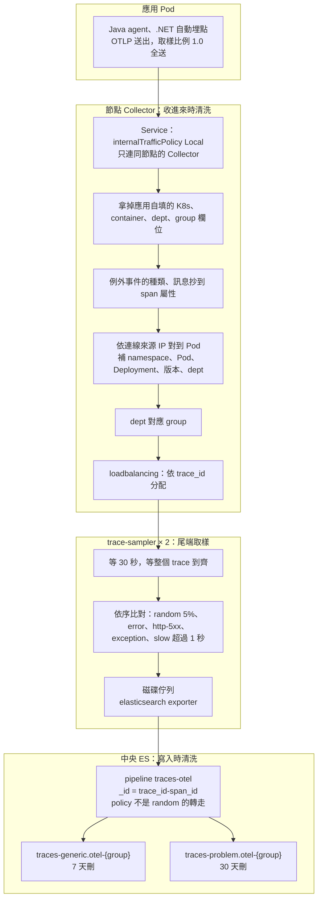

# Trace 進 Elasticsearch

> **類型：原理 Explanation**

## 資料怎麼走

沒有符合任何規則的 trace 不寫入。寫入用集中式資料寫入憑證，重試設定與 metrics、log 相同。

## trace 的種類與取樣類別

OTel 原生格式，用 ES 內建的 `traces-otel@template`，索引模式 `logsdb`。

| 種類 | 說明 |
|---|---|
| Server span | 請求入口。根因分析與 baseline 以它當 API 的單位 |
| Client span | 往外呼叫（HTTP、DB、訊息） |
| Producer／Consumer span | 訊息佇列。消費端的 receive 另起一個 trace，只以 `links` 指回 publish；處理時的 DB 呼叫又自成 trace |
| 業務 span | 應用自己加的（`@WithSpan`），例如派工、批號驗證 |

trace-sampler 依下表決定留不留，第一個符合的就決定，`scope.attributes.tailsampling.policy` 記是哪一條：

| policy | 條件 | 存在哪 | 保留 |
|---|---|---|---|
| `random` | 先隨機抽 5%，不管快慢對錯 | `traces-generic.otel-{group}` | 7 天 |
| `error` | 任一段 `status = ERROR` | `traces-problem.otel-{group}` | 30 天 |
| `http-5xx` | 任一段 HTTP 狀態碼 5xx（status 沒標成 ERROR 的也抓） | 同上 | 30 天 |
| `exception` | 任一段帶例外事件（吞掉例外、回 200 的也抓） | 同上 | 30 天 |
| `slow` | 整個 trace 超過 1 秒 | 同上 | 30 天 |

- baseline 只讀 `random` 那份，統計才不會被「錯的、慢的全留」拉偏。
- 比 1 秒快的變慢（例如 200ms 變 800ms）只剩隨機 5%；實測 1,586 個請求剩 88 個。
- 正常流量留約 5%；k3s 壓測每秒 500 個請求、其中 11% 有問題，有問題的 100% 留下，總量約 15%，每台 trace-sampler 記憶體約 150MB。

## 什麼時候清洗、怎麼清洗

| 階段 | 做什麼 | 為什麼 |
|---|---|---|
| 節點 Collector：拿掉自填欄位 | 刪應用自帶的 `k8s.*`、`container.*`、`dept`、`group`、`data_stream.*` | 應用可以自稱別的 namespace 或部門；刪掉後歸屬只看連線來源，無法冒充 |
| 節點 Collector：補身分 | 依連線來源 IP 對到 Pod，補 namespace、Pod、Deployment、版本、dept，再對應 group | 與 log、metrics 同一套規則；Service 限定只連同節點的 Collector，因為 Collector 只認得本節點的 Pod |
| 節點 Collector：例外抄到屬性 | `exception.type`、`exception.message` 抄到 span 屬性；堆疊不抄 | ES 的 span 文件不存事件，事件另存成一筆 log；抄上來，吞掉的例外才查得到。要看堆疊用 trace_id 找 log |
| 節點 Collector：依 trace_id 分配 | loadbalancing exporter 把同一個 trace 的每一段送到同一台 trace-sampler | 才能判斷整個 trace |
| trace-sampler：等到齊再決定 | 等 30 秒，依上表規則比對；決定過的 trace_id 記住，晚到的段照同一個決定 | 要比最長的請求長；等 10 秒時，比 10 秒長的請求會漏 |
| ES pipeline `traces-otel` | `_id` 設成 `{trace_id}-{span_id}`；`policy` 不是 `random` 的轉到 `traces-problem.otel-{group}` | 重送同一個 span 時 ES 回 409，不會多一份；有問題的 trace 保留較久 |

應用端不抽樣，`otel.traces.sampleRatio` 保持 `1.0`：在應用端一開始就抽樣，出事的請求也只剩抽樣比例。

## 多久壓縮

| 時間點 | 做什麼 |
|---|---|
| 寫入時 | 索引模式 `logsdb`；沒有降解析度 |
| 每天，或主分片到 50GB | ILM rollover |
| 7 天 | `traces-generic.otel-*`（隨機 5%）刪除（`TRACES_DELETE_AFTER`） |
| 30 天 | `traces-problem.otel-*`（有問題的）刪除（`TRACES_PROBLEM_DELETE_AFTER`），事故檢討常常一兩週後才開 |

trace 原文只留幾天；長期要的資料另存：每支 API 的延遲與錯誤率在 metrics，每一段的平常在 `aiops-trace-segments`（每 5 分鐘從 Server span 抽樣統計）。

兩段佇列都寫磁碟。trace-sampler 被強制終止時，掉終止前 31 秒（等待時間加 1 秒）內該台收到的 trace；PVC 滿也掉。ES 停機 30 分鐘、Collector 換版、trace-sampler 換 IP 都不掉。

### 為什麼 trace 留最短

- 量：一個請求在微服務裡分成 5～8 段，每段一筆文件，每筆有固定開銷。trace 全部記的話，每天的量是 log 的 8 倍（低流量服務，每個請求 5 段）到 13 倍（高流量，8 段）。
- ES 裡沒有樹狀索引：`trace_id`、`parent_span_id` 是一般欄位，樹是查詢時依 `trace_id` 撈出來接的。貴的原因是筆數多，不是壓縮率。
- 時間價值遞減快：沒人在乎三天前每一次正常請求花 20ms 還是 22ms，在乎的是最近慢在哪和出事當下的完整呼叫鏈。
- trace 不能全部長存，空間留給有問題的 100% 與隨機的 5%。實測每秒 500 個請求，留下的量約是全部的 15%。

### 每筆大小

測試環境實測，壓縮後、不含副本；正式環境有一份副本要乘 2。

| 資料 | 實測 | 估算用 | 一筆是什麼 |
|---|---|---|---|
| trace | 276 bytes | 400 bytes | 一段（span）。測試的 span 很簡單，真實的帶 HTTP、SQL 等欄位，保守用 400 |

### 怎麼套用

- `traces-otel@custom`（ES 內建模板預留）加 `index.lifecycle.name: traces-otel`；已經存在的 index 也一起換。
- `traces-problem.otel-*` 的模板每次從內建的 `traces-otel@template` 複製組成，多疊 `traces-problem-otel@custom`（換 ILM），ES 升級改了內建組成也會跟上。
- Collector 不用改。寫入憑證的權限 `traces-*.otel-{group}` 本來就涵蓋兩個資料流；根因分析與唯讀角色查 `traces-*.otel-*`，兩邊都讀得到。

### 量太大時怎麼降

- 調低 `RANDOM_PCT`。不要在應用裡調 `sampleRatio`：出事的請求會在一開始就被丟掉。
- 不用 Collector 的 `spanmetrics`：每個 API 的請求數與延遲，應用的 metrics 已經有，每個請求都算，不受 trace 取樣影響。應用端抽樣時 `spanmetrics` 只看得到被抽到的 span，請求數會少算；改成尾端取樣、應用全送後，在取樣之前算就不會少算，但目前不需要。

### 實測（k3s，ES 9.5.5）

| 測什麼 | 結果 |
|---|---|
| 有問題的 trace 分流 | ✅ 寫一筆 `tailsampling.policy: error` 的 span，進到 `traces-problem.otel-{group}`，自動套 `traces-problem-otel` 模板與 30 天政策；`random`、沒有 policy 的留在 `traces-generic` |
| 真的 trace-sampler 取樣後分流 | ✅ 每秒 100 個請求、2 分鐘，正常的隨機留 5%：錯誤、慢、吞掉例外的 1,256 個 trace（5,024 段）全進 `traces-problem.otel-imc`；隨機留下的 615 個 trace（2,460 段）全在 `traces-generic.otel-imc`；兩邊合起來跟壓測統計的「留下」數字一致，沒有漏 |
| 根因分析、trace baseline 回歸 | ✅ 11 項、9 項全過，讀 `traces-*.otel-*`，兩個資料流都看得到 |

保留天數的共用原則與容量估算見 [retention.md](../retention.md)。

## 共同鑰匙圈與 trace 自己的欄位

### 共同鑰匙圈

| 鑰匙 | trace 的路徑 | 來源 | 現況 |
|---|---|---|---|
| 服務 | `resource.attributes.service.name` | Pod label `app.kubernetes.io/name`，其次 `OTEL_SERVICE_NAME`，最後 Deployment 名稱 | ✅ |
| Pod | `resource.attributes.k8s.pod.name` | Collector | ✅ |
| namespace | `resource.attributes.k8s.namespace.name` | Collector | ✅ |
| cluster | `resource.attributes.k8s.cluster.name` | Collector 的 `CLUSTER_NAME` | ✅ |
| trace_id、span_id | `trace_id`、`span_id` | agent 產生並自動傳遞 | ✅ 與 log 互查 |
| 路由 | Server span 的名稱（`GET /lots/{id}`）；`attributes.http.route` 也有，根因分析比的是名稱 | agent | ⚠️ 路由沒參數化、舊 Java agent 的名稱沒有 method 時對不上 metrics |
| 時間窗 | `@timestamp` | span 的開始時間 | ✅ |
| 業務 ID | 名稱未定（暫稱 `txn.id`） | 只放 trace、log | ❌ |

歸屬 label 是 `resource.attributes.dept`、`.group`：決定寫進哪個資料流、誰看得到、保留幾天，不是串接用的鑰匙。

log 用 `trace_id` 對到同一個請求；metrics 沒有 `trace_id`，只能以「服務、路由、時間窗」對到一批 trace。

### trace 自己的欄位與 label

有，只在 trace：

| 類別 | 欄位 | 說明 |
|---|---|---|
| 結構 | `parent_span_id`、`name`、`kind`、`duration`、`status.code`、`links` | 呼叫關係、種類、耗時、狀態、跨 trace 的關聯 |
| 取樣 | `scope.attributes.tailsampling.policy` | 哪條規則留下的；不是 `random` 就轉到 `traces-problem` |
| 例外 | `attributes.exception.type`、`attributes.exception.message` | Collector 從事件抄上來的 |
| 業務 | `attributes.lot.id`、`attributes.equipment.id` | 應用加的批號、機台；工單、配方欄位名稱見 [埋點指引](../../sdk/standards/tracing.md) |

排錯見 [troubleshooting.md](../troubleshooting.md)。
