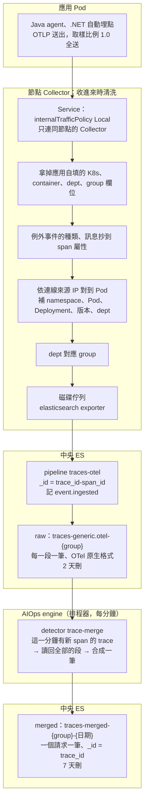

# Trace 進 Elasticsearch

> **類型：原理 Explanation**

## 資料怎麼走

**100% 收、不取樣**：製造業的事故檢討不能少資料。應用全送、Collector 全寫，每一段先原樣進 raw，再由 engine 合成「一個請求一筆」。寫入用集中式資料寫入憑證，重試設定與 metrics、log 相同（決定紀錄：[trace-merge](../pdca/phase1-collect/2026-10-trace-merge.md)；之前的尾端取樣設計與實測在 [trace-durability](../pdca/phase1-collect/2026-10-trace-durability.md)、[durability](../pdca/phase1-collect/2026-10-durability.md)）。

## trace 的種類與兩種存法

| 種類 | 說明 |
|---|---|
| Server span | 請求入口。根因分析與 baseline 以它當 API 的單位 |
| Client span | 往外呼叫（HTTP、DB、訊息） |
| Producer／Consumer span | 訊息佇列。消費端的 receive 另起一個 trace，只以 `links` 指回 publish；處理時的 DB 呼叫又自成 trace |
| 業務 span | 應用自己加的（`@WithSpan`），例如派工、批號驗證 |

| | raw | merged |
|---|---|---|
| 資料流／index | `traces-generic.otel-{group}`（ES 內建 `traces-otel@template`，`logsdb`） | `traces-merged-{group}-{YYYY.MM.dd}`（自己的 template，一天一個 index） |
| 一筆是什麼 | 一段（span），OTel 原生格式 | 一個請求：上層摘要（`root`、`duration_ms`、`error`、`services`、`span_count`）＋`entries`（入口 span）＋`spans`（每一段，`nested`，欄位完整，`attrs`／`resource` 用 `flattened`） |
| 誰寫 | Collector（寫入 key） | `detector trace-merge`（AIOps baseline key），排程器每分鐘跑 |
| 誰讀 | trace 每一段的 baseline、資料品質（只看最近 10 分鐘）、Kibana | 根因分析（事故可能幾天後才查）、Grafana／唯讀角色（`traces-merged-{group}-*`） |
| 保留 | **2 天**（`TRACES_RAW_DELETE_AFTER`）：只是合成前的暫存 | **7 天**（`TRACES_DELETE_AFTER`） |

- 合成不省空間：`nested` 的每一段在 ES 內部仍是一筆隱藏文件；省的是文件的固定開銷。它要解決的是「查一個請求一筆就看完、依服務／API 挑請求不用先撈 span」。
- 晚到的 span：`trace-merge` 看 raw 的 `event.ingested` 找「這一分鐘有新 span 的 trace」，整個 trace 重新合成、覆蓋（`_id` = trace_id），所以合得完整、重跑不會重複。中斷很久會從上次合到的時間分段補（最多 2 天，raw 的保留天數）。
- 根因分析看到的是 1～2 分鐘前合好的請求（排程每分鐘、合到「現在 − 10 秒」）。

## 什麼時候清洗、怎麼清洗

| 階段 | 做什麼 | 為什麼 |
|---|---|---|
| 節點 Collector：拿掉自填欄位 | 刪應用自帶的 `k8s.*`、`container.*`、`dept`、`group`、`data_stream.*` | 應用可以自稱別的 namespace 或部門；刪掉後歸屬只看連線來源，無法冒充 |
| 節點 Collector：補身分 | 依連線來源 IP 對到 Pod，補 namespace、Pod、Deployment、版本、dept，再對應 group | 與 log、metrics 同一套規則；Service 限定只連同節點的 Collector，因為 Collector 只認得本節點的 Pod |
| 節點 Collector：例外抄到屬性 | `exception.type`、`exception.message` 抄到 span 屬性；堆疊不抄 | ES 的 span 文件不存事件，事件另存成一筆 log；抄上來，吞掉的例外才查得到。要看堆疊用 trace_id 找 log |
| ES pipeline `traces-otel` | `_id` 設成 `{trace_id}-{span_id}`；記 `event.ingested` | 重送同一個 span 時 ES 回 409，不會多一份；`trace-merge` 靠 `event.ingested` 找這一分鐘有新 span 的 trace |
| engine `trace-merge` | 讀回那些 trace 全部的段，算入口、總耗時、有沒有錯、經過哪些服務，連每一段一起寫成一筆 | 一個請求一筆 |

應用端不抽樣，`otel.traces.sampleRatio` 保持 `1.0`。

## 多久壓縮

| 時間點 | 做什麼 |
|---|---|
| 寫入時 | raw 索引模式 `logsdb`；merged 一天一個 index；都沒有降解析度 |
| 每天，或主分片到 50GB | raw ILM rollover |
| 2 天 | raw（`traces-generic.otel-*`）刪除（`TRACES_RAW_DELETE_AFTER`） |
| 7 天 | merged（`traces-merged-*`）刪除（`TRACES_DELETE_AFTER`） |

長期要的資料另存：每支 API 的延遲與錯誤率在 metrics，每一段的平常在 `aiops-trace-segments`（每 5 分鐘從 raw 的 Server span 抽樣統計）。幾天後壓縮移到物件儲存（MinIO）另案。

Collector 的佇列寫節點磁碟：ES 停機 30 分鐘、Collector 換版都不掉（[durability](../pdca/phase1-collect/2026-10-durability.md)）。

### 容量

- 一個請求在微服務裡分成 5～8 段，每段一筆文件。100% 收的話每天的量是 log 的 8 倍（低流量服務，每個請求 5 段）到 13 倍（高流量，8 段）；merged 再加一份（`nested` 不省）。
- ES 裡沒有樹狀索引：raw 的 `trace_id`、`parent_span_id` 是一般欄位；merged 把樹存進同一筆，查一個請求不用再接。
- 這是使用者的決定：收值不省，容量用保留天數（raw 2 天、merged 7 天）和之後的冷儲存處理。估算見 [retention.md](../retention.md)。

### 每筆大小

測試環境實測，壓縮後、不含副本；正式環境有一份副本要乘 2。

| 資料 | 實測 | 估算用 | 一筆是什麼 |
|---|---|---|---|
| trace（raw） | 276 bytes | 400 bytes | 一段（span）。測試的 span 很簡單，真實的帶 HTTP、SQL 等欄位，保守用 400 |
| trace（merged） | 未量 | 每段 400 bytes × 段數 | 一個請求；`nested` 的每一段內部仍是一筆 |

### 怎麼套用

- raw：`traces-otel@custom`（ES 內建模板預留）加 `index.lifecycle.name: traces-otel`、`default_pipeline: traces-otel`。
- merged：`template-traces-merged.json`（index template，pattern `traces-merged-*`）＋ ILM `traces-merged`；`elasticsearch-setup.sh` 一起裝。
- 權限：Collector 的寫入 key 只寫 `traces-*.otel-*`；AIOps baseline key 讀 raw、寫 `traces-merged-*`；各部門唯讀角色多 `traces-merged-{group}-*`。
- 排程表（`aiops-engine/code/configs/schedule/schedule.yaml`）有 `trace-merge` 這一列（stage 1、每分鐘）。

### 量太大時怎麼降

- 不要在應用裡調 `sampleRatio`，也不在 Collector 取樣：收值端不省。
- 先縮保留天數（merged 的 7 天、raw 的 2 天不能再短：合成要等晚到的 span）；再把舊的 merged 快照到物件儲存（另案）。
- 不用 Collector 的 `spanmetrics`：每個 API 的請求數與延遲，應用的 metrics 已經有，每個請求都算。

### 實測

| 測什麼 | 結果 |
|---|---|
| 合成一筆（Rancher Desktop，ES 8.19.23） | 見 [trace-merge PDCA](../pdca/phase1-collect/2026-10-trace-merge.md) 的 Check |
| 尾端取樣時期的分流、取樣後數量（ES 9.5.5） | 已拆掉；紀錄在 [tail-sampling 當時的 PDCA](../pdca/phase1-collect/2026-10-trace-durability.md) |

## 共同鑰匙圈與 trace 自己的欄位

### 共同鑰匙圈

| 鑰匙 | trace 的路徑（raw） | 來源 | 現況 |
|---|---|---|---|
| 服務 | `resource.attributes.service.name` | Pod label `app.kubernetes.io/name`，其次 `OTEL_SERVICE_NAME`，最後 Deployment 名稱 | ✅ |
| Pod | `resource.attributes.k8s.pod.name` | Collector | ✅ |
| namespace | `resource.attributes.k8s.namespace.name` | Collector | ✅ |
| cluster | `resource.attributes.k8s.cluster.name` | Collector 的 `CLUSTER_NAME` | ✅ |
| trace_id、span_id | `trace_id`、`span_id` | agent 產生並自動傳遞 | ✅ 與 log 互查 |
| 路由 | Server span 的名稱（`GET /lots/{id}`）；`attributes.http.route` 也有，根因分析比的是名稱 | agent | ⚠️ 路由沒參數化、舊 Java agent 的名稱沒有 method 時對不上 metrics |
| 時間窗 | `@timestamp` | span 的開始時間 | ✅ |
| 業務 ID | 名稱未定（暫稱 `txn.id`） | 只放 trace、log | ❌ |

merged 裡同樣的鑰匙在 `root.service`、`entries.service`／`entries.name`、`spans.resource`（flattened）、`trace_id`、`@timestamp`（根 span 的開始）。

歸屬 label 是 `resource.attributes.dept`、`.group`（merged 的上層 `dept`、`group`）：決定寫進哪個資料流、誰看得到、保留幾天，不是串接用的鑰匙。

log 用 `trace_id` 對到同一個請求；metrics 沒有 `trace_id`，只能以「服務、路由、時間窗」對到一批 trace。

### trace 自己的欄位與 label

有，只在 trace：

| 類別 | 欄位（raw） | merged | 說明 |
|---|---|---|---|
| 結構 | `parent_span_id`、`name`、`kind`、`duration`、`status.code`、`links` | `spans.parent`、`spans.name`、`spans.kind`、`spans.dur_ms`、`spans.error`、`spans.links` | 呼叫關係、種類、耗時、狀態、跨 trace 的關聯 |
| 例外 | `attributes.exception.type`、`attributes.exception.message` | `spans.exception`、`spans.attrs`（flattened） | Collector 從事件抄上來的 |
| 業務 | `attributes.lot.id`、`attributes.equipment.id` | `spans.attrs` | 應用加的批號、機台；工單、配方欄位名稱見 [埋點指引](../../sdk/standards/tracing.md) |
| 摘要 | — | `root.*`、`duration_ms`、`error`、`services`、`span_count`、`entries.*` | 合成時算的，挑請求用 |

排錯見 [troubleshooting.md](../troubleshooting.md)。
