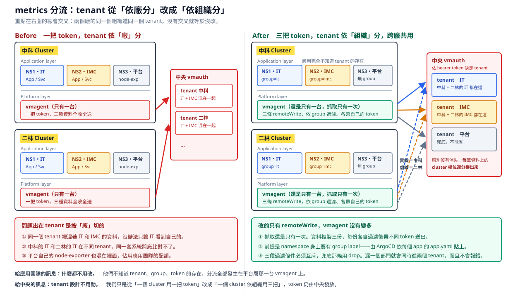

# vmagent 資料分流

一句話：**拆的是 `remoteWrite`，不是 vmagent。** vmagent 維持一台，把出口從一條變成每個 group 一條。

## 這份設定在哪一層：cluster，不是 app

最容易誤會的地方。**這是 cluster 層級的設定，一個 cluster 一份，不是每個 app 一份。**

| | vmstack values（這份） | app 的 chart values |
|---|---|---|
| 幾份 | 一份共用，由 cluster-addons 的 ApplicationSet 部到每個 cluster | 一個 app 一份 |
| 誰改 | 平台團隊 | app 團隊 |
| 有沒有 token | 有三把 | **絕對不能有** |

放進每個 app 的 chart 會讓整套設計垮掉：每個 app team 都要知道 token、改組要通知所有團隊改 regex、而且會變成一個 app 一台 vmagent，同一份資料被抓 N 次。

app 端要做的只有讓 `app-common` 產生一個 VMServiceScrape，跟那台唯一的 vmagent 說「我在這裡，來抓我」。分流全部發生在 vmagent 那一端，app 不知情。

**會搞混是因為 ArgoCD 裡什麼都叫 Application**：`cluster-addons` 也是一個 Application，也有 values 檔，但它是「這個 cluster 要裝哪些平台元件」，不是業務服務。

## 現況

共用 values（`victoria-metrics-k8s-stack`）產生的是「一個 cluster 一台」：

- `selectAllByDefault` 用 chart 預設的 `true`，這一台抓整個 cluster。
- 只有一條 `remoteWrite`、一把 `vmauth-token`。
- 結果：**整個 cluster 的資料全部進同一個 tenant，IT、IMC、平台混在一起。**



把 `vmagent.enabled` 改成 `false` **不是分流**，是把收集器整台刪掉，整廠 metrics 會直接停。分流要靠拆 `remoteWrite`，vmagent 維持一台。

## 分流機制

```
vmagent 抓一次（全 cluster）
        ↓ 依 remoteWrite 條數複製
   ├─ 只留 IT 的      → token: it       → 他們的 tenant
   ├─ 只留 IMC 的     → token: imc      → 他們的 tenant
   └─ 上面兩者都丟掉   → token: platform → 平台 tenant
```

每條出口各自過濾、各自帶 token。tenant 由中央 vmauth 依 token 決定，**這邊不碰 tenant 設計**。

## 前提：資料上要有判斷依據

vmagent 過濾時只看得到 label，所以每筆資料必須帶一個能判斷歸屬的欄位。兩種取得方式：

| 方式 | 怎麼來 | 限制 |
|---|---|---|
| 讀 namespace 的 label | 抓取時把 `dept` label 帶進資料 | 需要 `scrapeClasses` 支援，**已在 operator v0.74.1 實測可用** |
| 用 namespace 名稱比對 | 每筆資料本來就有 `namespace` | 不需要進階功能，但名稱要能對應到 group |

第一種已經在本機環境實測過可用，見下方「本機實測結果」。正式環境要先確認 operator 版本。

**`kubectl explain` 在這裡問不出東西**：chart 裝的 CRD 沒有帶 schema，所以 explain 查不到欄位，API server 也不會驗證。**打錯欄位名稱不會報錯，只會靜默失效。** 要確認設定有沒有生效，只能看 vmagent 產生出來的設定：

```bash
kubectl -n <namespace> get secret vmagent-<名稱> -o jsonpath='{.data.vmagent\.yaml\.gz}' | base64 -d | gunzip | grep -A3 attach_metadata
```

## 要改的 YAML

這一段要寫進 **`victoria-metrics-k8s-stack` 的 values**，也就是你們現在那份共用的 vmagent 設定檔，位置在 `.Values.vmagent.spec`。chart 會把它原封不動塞進 VMAgent 這個 CR，operator 再把 CR 轉成 vmagent 真正在讀的設定。

repo 裡對應的檔案是 [../platform/cluster-addons/vmstack-values.yaml](../platform/cluster-addons/vmstack-values.yaml)，那是**照你們現有的 values 模板改出來的完整版本**，可以直接 diff。只動了三個地方：`vmagent.spec.scrapeClasses`（新增）、`vmagent.spec.remoteWrite`（一條拆三條）、`kube-state-metrics.metricLabelsAllowlist`（新增）。

```yaml
vmagent:
  enabled: true
  spec:
    scrapeInterval: 30s

    # 維持空的。cluster 由 ApplicationSet 的 helm.parameters 注入，
    # 這份 values 是全廠共用的，寫死會讓其他廠掛上錯的 cluster 名。
    externalLabels: {}

    # 前提設定：抓取時把 namespace 的 dept label 帶進每筆資料
    scrapeClasses:
      - name: default
        default: true
        attachMetadata:
          namespace: true
        relabelConfigs:
          - source_labels: [__meta_kubernetes_namespace_label_dept]
            target_label: dept

    remoteWrite:
      - url: https://vmauth.aillm.spil.com.tw/prometheus/api/v1/write
        tlsConfig: {insecureSkipVerify: true}
        bearerTokenSecret: {name: vmauth-token, key: it}
        inlineUrlRelabelConfig:
          - action: keep
            source_labels: [dept]
            regex: "D3120|D3130"
          - target_label: group          # 順手蓋上，AIOps 用得到
            replacement: it

      - url: https://vmauth.aillm.spil.com.tw/prometheus/api/v1/write
        tlsConfig: {insecureSkipVerify: true}
        bearerTokenSecret: {name: vmauth-token, key: imc}
        inlineUrlRelabelConfig:
          - action: keep
            source_labels: [dept]
            regex: "D1110|D1120"
          - target_label: group
            replacement: imc

      # 兜底：node-exporter、平台元件、還沒標 label 的 namespace
      - url: https://vmauth.aillm.spil.com.tw/prometheus/api/v1/write
        tlsConfig: {insecureSkipVerify: true}
        bearerTokenSecret: {name: vmauth-token, key: platform}
        inlineUrlRelabelConfig:
          - action: drop
            source_labels: [dept]
            regex: "D3120|D3130|D1110|D1120"
          - target_label: group
            replacement: platform
```

用名稱比對的話，把 `source_labels: [dept]` 換成 `[namespace]`，regex 換成該 group 的 namespace 樣式。

**三段 regex 要從同一份「部門 → group」對照表渲染，不要手寫。**

## Secret 要跟著改

原本只有一個 `token` key，要變成每個 group 一個。舊的 `token` key 可以留著不刪，已經沒有 remoteWrite 引用它。

token 由中央那邊提供，我們只負責放進 Secret。兩種做法：

### 做法一：Rancher（目前手動階段建議用這個）

1. 切到目標 cluster，進 Storage 底下的 Secrets（路徑依 Rancher 版本略有不同）。
2. 選 vmstack 部署的那個 namespace，**不是應用的 namespace**。
3. 既有的 `vmauth-token` 直接編輯，型別維持 Opaque，用 key/value 的編輯模式逐一加 key：`it`、`imc`、`platform`。
4. 存檔後**一定要重啟 vmagent**，見下方。

### 做法二：kubectl

```bash
kubectl -n <vmstack namespace> create secret generic vmauth-token \
  --from-literal=it=<對方給的 IT token> \
  --from-literal=imc=<對方給的 IMC token> \
  --from-literal=platform=<對方給的平台 token> \
  --dry-run=client -o yaml | kubectl apply -f -
```

### 改完要重啟 vmagent

Secret 的值換了，vmagent 不保證會立刻重讀，切換 token 時不要賭：

```bash
kubectl -n <vmstack namespace> rollout restart deployment/vmagent-<名稱>
```

會不會自動重載還沒實際驗證過。

### 改完這樣驗證

```bash
kubectl -n <vmstack namespace> describe secret vmauth-token
```

會列出每個 key 和 byte 數。**byte 數比 token 實際長度多 1，通常就是結尾多了換行。**

再開 vmagent 的 `/metrics`，找 `vmagent_remotewrite_` 開頭的指標，看每個 URL 的失敗次數與佇列堆積。三條出口分開統計，哪一條的 token 有問題一眼就看得出來。

### 手動建 Secret 的優缺點，以及 Vault 這條路

先講清楚：**手動不是純粹的爛做法**，它有兩個真的優點。

| | 手動建 Secret | Vault + Vault Secrets Operator |
|---|---|---|
| token 經過的地方 | 只有人的手和 API server，**不經過 git、不經過 CI** | 經過 Vault 和 VSO，多兩個元件可能出事 |
| 排查 | `kubectl get secret` 就看到，沒有中間層 | 要查 VSO 的 CR 狀態、Vault 的 auth、路徑對不對 |
| 擴廠 | **每開一廠要人工做一次**，跟「擴廠不能全人工」衝突 | list 加一行，Secret 自動出現 |
| 輪替 token | 每個廠都要進去改一次 | 改 Vault 一處，各廠自動更新 |
| 稽核 | 沒有。誰什麼時候改了什麼只能翻 audit log | Vault 有存取紀錄 |
| 打錯 | **貼多一個換行就一直 401，錯誤訊息不會說原因** | 不會有人工貼上這一步 |
| cluster 重建 | **會漏掉**，而且 vmagent 會起不來 | 跟著 ApplicationSet 一起回來 |

兩廠的時候手動撐得住，**五廠六廠就不行了**：每開一廠要進 UI 貼六次（三把 vmauth token、三把 ES API key），而且貼錯的失敗是靜默的。

### 可以走 Vault，而且路已經鋪一半了

`cluster-addons/vault-secrets-operator/` 已經在每個場區叢集部署，`cctv-inspection-app` 的 ApplicationSet 裡也帶了 `k8sAuthMount`——代表 **Kubernetes 對 Vault 的認證路徑已經在用了**。

所以這條路不是從零開始，要做的是：

1. token 存進 Vault（例如 `secret/observability/vmauth-token`，三個欄位 `it` / `imc` / `platform`）
2. 在 `cluster-addons/` 底下放一個 `VaultStaticSecret` 的 CR，指向那個路徑，產出名為 `vmauth-token` 的 Secret
3. 那份 CR 進 git——**裡面只有「去哪裡拿」，沒有機密本身**，所以可以走 PR 審核
4. ES 的 API key 同樣處理

依你們文件，`repositories/` 和 `clusters/` 也規劃走同一條路，所以這是既定方向，不是為了這個專案另闢蹊徑。

**代價是多一個相依**：Vault 掛掉時，已經存在的 Secret 還在、跑著的 pod 不受影響，但新 pod 和輪替會卡住。這個取捨通常可以接受，但要知道。

### 在 Vault 到位之前

不要為了等 Vault 就停著，但要補一個防呆——**套 values 之前先確認 Secret 的三個 key 都在**：

```bash
for k in it imc platform; do
  kubectl -n <vmstack namespace> get secret vmauth-token -o jsonpath="{.data.$k}" >/dev/null 2>&1     || { echo "vmauth-token 缺少 $k，先補齊再套 values，否則 vmagent 會起不來、整廠 metrics 會停"; exit 1; }
done
```

這一步把「套下去才發現 metrics 停了」換成「套之前就被擋下來」。

### 改 Secret 的坑

- **貼 token 不要多出換行或空白。** 最常見的失敗，多一個看不見的換行就一直 401，錯誤訊息不會告訴你原因。
- **不要用「Edit as YAML」貼部分內容。** 那等於整份取代，沒貼到的 key 會消失。用 key/value 編輯模式。
- **namespace 和 cluster 很容易選錯**，Rancher UI 上尤其。
- **UI 改沒有紀錄可追**，誰在什麼時候改了什麼只能翻 audit log。
- **擴廠時這樣不可行**：每開一個新廠都要手動進 UI 建一次。見下方待確認。

## 驗收

改完之後查一次，確認每個 namespace 只落在一個 tenant：

```
count by (vm_account_id, group, namespace) (up)
```

同一個 namespace 出現在兩個 `vm_account_id`，就是規則寫重疊了。

## 本機實測結果

在本機用 k3d 建了三個叢集模擬（`central`、`zk`、`el`），在 `zk` 上跑完整條路徑驗證過。

**環境**：VictoriaMetrics operator v0.74.1、vmagent v1.148.0、namespace 打上 `dept` label、一個 VMSingle 當儲存、一個 node-exporter 當抓取目標。

**結果**

| namespace | dept label | 進到哪條出口 |
|---|---|---|
| `zk-mes-prod` | `D3120` | IT |
| `vm-monitoring` | 無 | 兜底（platform） |

**確認了三件事**

1. **`scrapeClasses` 加 `attachMetadata` 可用。** 設定確實被渲染成 `attach_metadata: namespace: true`，namespace 的 label 成功變成資料上的 `dept` 欄位。
2. **remoteWrite 拆條分流會動。** 兩條出口各自過濾、各自送出，都回 2XX，資料落點正確。
3. **兜底那條有效。** 沒標 label 的 namespace 自動歸到 platform，資料不會消失。

**跟 log 那邊的欄位是對得起來的。** 八個關聯欄位（`cluster`、`group`、`dept`、`namespace`、`app`、`version`、`pod`、`container`）兩邊一致，比對結果見 [efk.md](efk.md)。其中 `app` 和 `version` 要靠 VMServiceScrape 的 relabel 才會有，`app-common` 模板已經包含，手寫的 scrape 物件會少掉。

**踩到的坑：VMServiceScrape 是用 Service 的 label 去選，不是用 Service 的 pod selector。**

測試時 Service 沒打 label，結果整個 target 不存在，而且**沒有任何錯誤訊息**，只是靜靜地沒資料。`app-common` 模板有幫 Service 打 label，照模板走不會踩到；但既有的服務如果 Service 沒 label，接上去會直接沒資料。

排查方式是看 vmagent 的 targets：

```bash
kubectl -n <namespace> port-forward svc/vmagent-<名稱> 8429
# 然後開 http://localhost:8429/api/v1/targets
```

## 坑

- **原本那條一定要改掉，不能留著再加新的。** 它沒有任何過濾，留著等於每筆資料多送一份到舊 tenant。要把它改成兜底那一條。
- **keep 規則之間必須互斥，沒人會幫你檢查。** 同一筆資料符合兩條就會送去兩個 tenant，而且不會有任何錯誤訊息。
- **兜底那條不能省。** 沒有它，node-exporter 和 kube-state-metrics 的節點層級資料會整批消失。它的 drop regex 必須跟前面所有 keep regex 完全對應，漏一個部門就變成重複送。
- **每多一條出口，每筆資料就多比對一次、多一個磁碟佇列。** 3 條沒問題，之後要切到部門層級（50 條）要重新評估。
- **好處是故障隔離。** 每條出口的佇列獨立，某個 tenant 的 token 過期或寫入失敗，只有那條卡住重試，其他 group 不受影響。

## 待確認

1. **正式環境的 operator 版本。** 本機用 v0.74.1 實測可用，你們那邊要確認版本不會比這舊太多，不然就走名稱比對那條路。
2. 整個 cluster 是不是只有這一台 vmagent。如果應用 namespace 裡還有別的，會重複收，分流做得再對也沒用：

```bash
kubectl get vmagent -A
```

3. 「部門 → group」對照表放哪裡、由誰維護、怎麼渲染進這份 values。
4. **token 怎麼自動進新廠的 cluster？** 現在靠 Rancher 手動建 Secret，2 個 cluster 還行，擴廠之後每開一廠就要手動一次，跟「擴廠不能全部人工」衝突。有 External Secrets、Vault 或 sealed-secrets 的話，token 放中央一份就能自動同步，不用進 UI。
