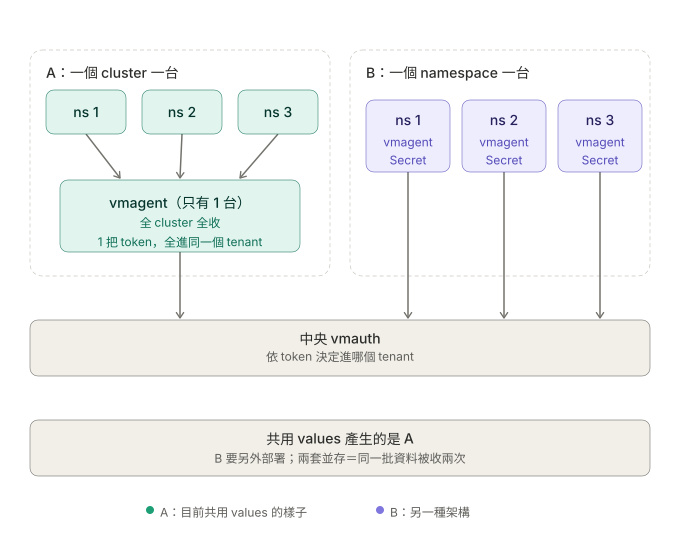

# vmagent 資料分流

一句話：**拆的是 `remoteWrite`，不是 vmagent。** vmagent 維持一台，把出口從一條變成每個 group 一條。

## 現況

共用 values（`victoria-metrics-k8s-stack`）產生的是「一個 cluster 一台」：

- `selectAllByDefault` 用 chart 預設的 `true`，這一台抓整個 cluster。
- 只有一條 `remoteWrite`、一把 `vmauth-token`。
- 結果：**整個 cluster 的資料全部進同一個 tenant，IT、IMC、平台混在一起。**



把 `vmagent.enabled` 改成 `false` **不是分流**，是把收集器整台刪掉，整廠 metrics 會直接停。

## 分流機制

```
vmagent 抓一次（全 cluster）
        ↓ 依 remoteWrite 條數複製
   ├─ 只留 IT 的      → token: it       → 他們的 tenant
   ├─ 只留 IMC 的     → token: imc      → 他們的 tenant
   └─ 上面兩者都丟掉   → token: platform → 平台 tenant
```

每條出口各自過濾、各自帶 token。tenant 由中央 vmauth 依 token 決定，**這邊不碰 tenant 設計**。

## 前提：資料上要有判斷依據

vmagent 過濾時只看得到 label，所以每筆資料必須帶一個能判斷歸屬的欄位。兩種取得方式：

| 方式 | 怎麼來 | 限制 |
|---|---|---|
| 讀 namespace 的 label | 抓取時把 `dept` label 帶進資料 | 需要 `scrapeClasses` 支援，版本待確認 |
| 用 namespace 名稱比對 | 每筆資料本來就有 `namespace` | 不需要進階功能，但名稱要能對應到 group |

先確認第一種能不能用：

```bash
kubectl explain vmagent.spec.scrapeClasses.attachMetadata
```

## 要改的 YAML

```yaml
vmagent:
  enabled: true
  spec:
    scrapeInterval: 30s
    externalLabels: {}

    # 前提設定：抓取時把 namespace 的 dept label 帶進每筆資料
    scrapeClasses:
      - name: default
        default: true
        attachMetadata:
          namespace: true
        relabelConfigs:
          - source_labels: [__meta_kubernetes_namespace_label_dept]
            target_label: dept

    remoteWrite:
      - url: https://vmauth.aillm.spil.com.tw/prometheus/api/v1/write
        tlsConfig: {insecureSkipVerify: true}
        bearerTokenSecret: {name: vmauth-token, key: it}
        inlineUrlRelabelConfig:
          - action: keep
            source_labels: [dept]
            regex: "D3120|D3130"
          - target_label: group          # 順手蓋上，AIOps 用得到
            replacement: it

      - url: https://vmauth.aillm.spil.com.tw/prometheus/api/v1/write
        tlsConfig: {insecureSkipVerify: true}
        bearerTokenSecret: {name: vmauth-token, key: imc}
        inlineUrlRelabelConfig:
          - action: keep
            source_labels: [dept]
            regex: "D1110|D1120"
          - target_label: group
            replacement: imc

      # 兜底：node-exporter、平台元件、還沒標 label 的 namespace
      - url: https://vmauth.aillm.spil.com.tw/prometheus/api/v1/write
        tlsConfig: {insecureSkipVerify: true}
        bearerTokenSecret: {name: vmauth-token, key: platform}
        inlineUrlRelabelConfig:
          - action: drop
            source_labels: [dept]
            regex: "D3120|D3130|D1110|D1120"
          - target_label: group
            replacement: platform
```

用名稱比對的話，把 `source_labels: [dept]` 換成 `[namespace]`，regex 換成該 group 的 namespace 樣式。

**三段 regex 要從同一份「部門 → group」對照表渲染，不要手寫。**

## Secret 要跟著改

原本只有一個 `token` key，要變成每個 group 一個：

```bash
kubectl -n <vmstack namespace> create secret generic vmauth-token \
  --from-literal=it=<對方給的 IT token> \
  --from-literal=imc=<對方給的 IMC token> \
  --from-literal=platform=<對方給的平台 token> \
  --dry-run=client -o yaml | kubectl apply -f -
```

舊的 `token` key 可以留著不刪，已經沒有 remoteWrite 引用它。

## 驗收

改完之後查一次，確認每個 namespace 只落在一個 tenant：

```
count by (vm_account_id, group, namespace) (up)
```

同一個 namespace 出現在兩個 `vm_account_id`，就是規則寫重疊了。

## 坑

- **原本那條一定要改掉，不能留著再加新的。** 它沒有任何過濾，留著等於每筆資料多送一份到舊 tenant。要把它改成兜底那一條。
- **keep 規則之間必須互斥，沒人會幫你檢查。** 同一筆資料符合兩條就會送去兩個 tenant，而且不會有任何錯誤訊息。
- **兜底那條不能省。** 沒有它，node-exporter 和 kube-state-metrics 的節點層級資料會整批消失。它的 drop regex 必須跟前面所有 keep regex 完全對應，漏一個部門就變成重複送。
- **每多一條出口，每筆資料就多比對一次、多一個磁碟佇列。** 3 條沒問題，之後要切到部門層級（50 條）要重新評估。
- **好處是故障隔離。** 每條出口的佇列獨立，某個 tenant 的 token 過期或寫入失敗，只有那條卡住重試，其他 group 不受影響。

## 待確認

1. `scrapeClasses` 你們的 operator 版本支不支援，不支援就走名稱比對那條路。
2. 整個 cluster 是不是只有這一台 vmagent。如果應用 namespace 裡還有別的，會重複收，分流做得再對也沒用：

```bash
kubectl get vmagent -A
```

3. 「部門 → group」對照表放哪裡、由誰維護、怎麼渲染進這份 values。
