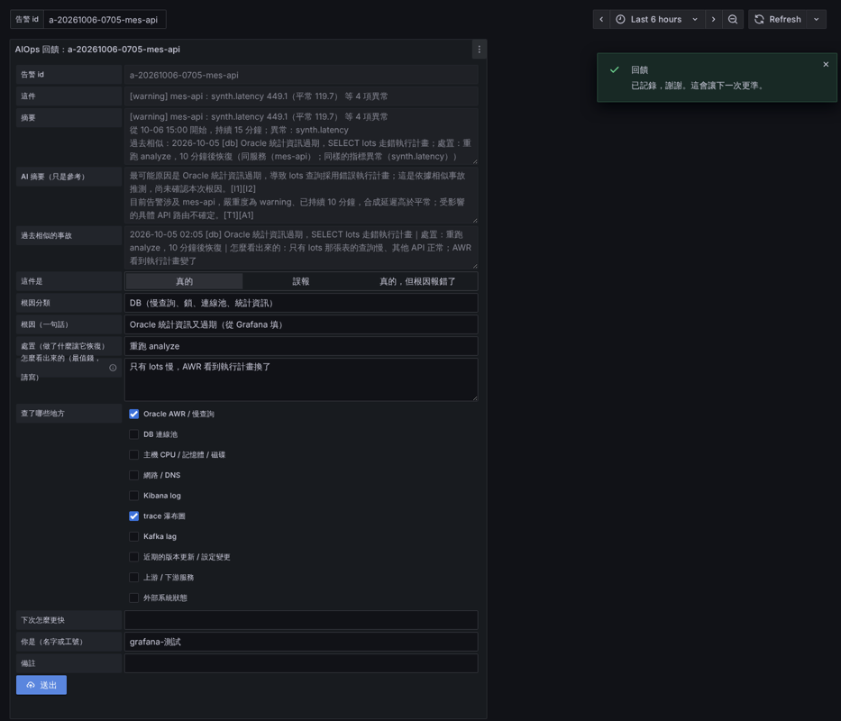

# Grafana：讀 aiops-alerts 發通知

AIOps 把異常合成「一件事」寫進 `aiops-alerts`（`python3 -m investigator alert`，見 [configs/rca](../aiops-engine/code/configs/rca/README.md)）；**通知交給 Grafana**：送到哪、依 dept 分送、夜間、靜音、恢復通知都在 Grafana 設（[pdca/phase3-locate/2026-10-alert-exit.md](../docs/pdca/phase3-locate/2026-10-alert-exit.md)）。

`helmchart/files/` 是 Grafana provisioning 的檔（唯一來源：自建 chart 直接讀它，管 Grafana 的人照著改）；`helmchart/` 是沒有現成 Grafana 時裝一台的 chart（見下面「部署」）；`code/` 只放外掛安裝說明、initContainer 補丁和產生官方 chart values 的腳本；`plugins/` 放回饋表單外掛的 zip（git lfs，連不到 Nexus 時從這裡裝）：

| 檔案 | 內容 | 要改的 |
|---|---|---|
| `datasource.yaml` | ES data source，只讀 `aiops-alerts`、`aiops-anomalies`、`aiops-tuning`、`aiops-feedback` | `ES_URL`、`GRAFANA_ES_API_KEY`（`elasticsearch/kibana-dev-tools.txt` 第 4 段發的 Grafana 唯讀 key） |
| `dashboards/aiops-rca.json`、`aiops-learning.json` | 事故與根因（選一件：LLM 摘要、相似事故、報告全文、這件的異常）；學習迴圈（回饋 → 建議 → 回測 → 核准後的筆數） | 一般不用改 |
| `alert-rules.yaml` | (1) 每一件 `status: open` 的事件一則告警；labels 帶 `alert_id`、`service`、`dept`、`group`、`severity`，annotation 帶摘要與報告連結；(2) `aiops-heartbeat`：10 分鐘沒有心跳 → 「AIOps 停了」送平台；(3) `aiops-baseline-missing`：`detect` 寫的 `detect-status` 的 `missing_baseline > 0` 持續 5 分鐘 → 「基準線不見」送平台 | 一般不用改 |
| `contact-points.yaml` | 各部門的通知管道（範例用 webhook） | 換成你們的 Teams、Email、LINE… |
| `policies.yaml` | 依 `dept` 送到哪個 contact point；沒有 dept（資料品質、節點）送平台 | dept 清單（跟 APM agent 的 `labels.dept` 值一致） |
| `dashboards/aiops-feedback.json` | 回饋表單（Grafana 裡填）：通知的 `feedback` 連結點進來 | 兩個回饋服務網址、要先裝外掛（下面） |

> Grafana 讀哪些 ES 索引、自己存什麼（設定在 repo 檔案、內部 sqlite 在容器裡，Pod 重建會清掉告警歷史）：[docs/data-storage-reference.md](../docs/data-storage-reference.md)。

## 誰負責什麼

原則：**判斷與存放在 AIOps，通知與畫面在 Grafana**。換掉 Grafana，AIOps 的偵測與回饋邏輯不用動，只重做下面「Grafana」那欄的規則與表單。

| 條線 | AIOps（`aiops-engine/`）做 | Grafana（`grafana/`）做 | 管 Grafana 的人做 |
|---|---|---|---|
| 事故通知 | 異常合成一件，寫 `aiops-alerts`（`investigator alert`） | 規則 `aiops-incident` 每件一則；依 `dept` 分送、靜音、結束發恢復 | contact point、哪個 dept 送哪裡、夜間規則 |
| AIOps 停了 | `investigator alert` 每輪寫心跳（`_id: heartbeat`） | 規則 `aiops-heartbeat`：10 分鐘沒心跳送平台 | 平台的 contact point |
| 基準線不見 | `detector detect` 每輪寫 `detect-status`（`missing_baseline`） | 規則 `aiops-baseline-missing`：> 0 持續 5 分鐘送平台 | 同上；處置是手動 `train`（[aiops-engine/README.md](../aiops-engine/README.md)） |
| 事故回饋 | `feedback_web` 驗資料、寫 `aiops-feedback`、`aiops-incidents`（`/api/alert`、`/api/feedback`） | 儀表板 `aiops-feedback` 第一個面板：預填與送出的表單 | 裝 Business Forms 外掛（[INSTALL-form-plugin.md](code/INSTALL-form-plugin.md)）、設回饋服務網址 |
| 漏報回報 | `feedback_web` 驗序列名與時間、寫 `aiops-feedback`（`/api/missed-form`、`/api/missed`） | 同一個儀表板第二個面板 | 同上 |
| 唯讀儀表板 | 寫 `aiops-alerts`、`aiops-anomalies`、`aiops-tuning`、`aiops-feedback` | `aiops-rca`、`aiops-learning`：只讀這幾個索引畫圖 | 給 Grafana 唯讀 key |

兩邊只用下面三個接口接起來，改任何一個，另一邊要一起改：

| 接口 | AIOps 這邊 | Grafana 這邊 | 要一起改的情況 |
|---|---|---|---|
| ES 索引欄位 | 寫 `aiops-alerts` 等索引（欄位見 [aiops-data-reference.md](../docs/aiops-data-reference.md)） | `datasource.yaml` 的唯讀 key；規則與儀表板的查詢直接寫欄位名（`status`、`alert_id`、`dept`、`missing_baseline`…） | 改欄位名或型別 |
| 回饋 HTTP API | `feedback_web`：`GET /api/alert`、`/api/missed-form`；`POST /api/feedback`、`/api/missed` | 表單面板的 `initial.url`、`update.url`；**瀏覽器直接打**，不經 Grafana 後端 | 改路徑或欄位；部署時 URL 要改成使用者瀏覽器連得到的位置、`FEEDBACK_CORS_ORIGIN` 設成 Grafana 的網址 |
| 告警標籤 | `aiops-alerts` 的 `service`、`dept`、`group`、`severity`、`summary`、`report_url` | 規則把它們帶成 labels；`policies.yaml` 依 `dept` 路由；`severity: warning` 的件走永遠靜音的 mute timing（`always`），只有 `critical`、`high` 送通知 | 改 `dept` 清單（要跟 APM agent 的 `labels.dept` 值一致）；要讓 warning 也通知就刪掉第一條路由 |

- 表單的欄位 id 必須等於後端回傳 JSON 的 key（`/api/alert`、`/api/missed-form`）；漏報面板的 series 下拉是靜態列表，要跟 `series.yaml` 的名字一致。這兩點由 `tests/test_grafana_form.py` 擋。
- 更細的通知分工（含管 Grafana 的人要設什麼）的設計紀錄：[alert-exit.md](../docs/pdca/phase3-locate/2026-10-alert-exit.md)。

## 部署

### 公司已經有 Grafana：把 `helmchart/files/` 的檔交給管 Grafana 的人

不用我們的 image 或 chart，只要把 `helmchart/files/` 的檔放進公司 Grafana 的 provisioning 資料夾。`helmchart/files/` 是**內容**；image、chart、手動放檔只是「怎麼送進 Grafana」的方式，選哪個看公司的 Grafana 是誰管、怎麼部署。

| `helmchart/files/` 的檔 | 放到 Grafana 的 | 要改的 |
|---|---|---|
| `datasource.yaml` | `/etc/grafana/provisioning/datasources/` | ES 網址、唯讀 key（環境變數 `ES_URL`、`GRAFANA_ES_API_KEY`） |
| `alert-rules.yaml`、`contact-points.yaml`、`policies.yaml` | `/etc/grafana/provisioning/alerting/` | 通知管道換成公司的、dept 清單（環境變數 `NOTIFY_IT_URL`、`NOTIFY_IMC_URL`、`NOTIFY_PLATFORM_URL`） |
| `dashboards/*.json` | 任一資料夾，例如 `/var/lib/grafana/dashboards/aiops/` | `aiops-feedback.json` 裡寫死的 `http://localhost:18080` 全部換成使用者瀏覽器連得到的回饋服務網址 |
| （檔裡沒有，要自己寫）dashboards provider | `/etc/grafana/provisioning/dashboards/aiops.yaml` | 見下面 |

dashboards provider（告訴 Grafana 去哪個資料夾讀儀表板；我們的 chart 會自動產生這個，公司自己的 Grafana 要自己放）：

```yaml
apiVersion: 1
providers:
  - name: aiops
    folder: AIOps                       # 載進 Grafana 的 AIOps 資料夾
    type: file
    options:
      path: /var/lib/grafana/dashboards/aiops
```

- 檔裡的 `${ES_URL}`、`${GRAFANA_ES_API_KEY}`、`${NOTIFY_*_URL}` 由 Grafana 從**環境變數**展開，所以公司的 Grafana 要有這幾個環境變數（K8s 用 Secret 的 `envFrom`）。
- 檔放好之後重啟 Grafana（或呼叫 provisioning reload 的 API）才會生效。不想動檔案系統，也可以用 Grafana 的 HTTP API 或畫面匯入儀表板、告警，內容一樣。
- 回饋表單外掛：先看公司的 Grafana 有沒有裝（Administration → Plugins 搜 `Business Forms`），裝了、版本是 6.3.1 就什麼都不用做；沒裝照 [INSTALL-form-plugin.md](code/INSTALL-form-plugin.md)。

| 送進 Grafana 的方式 | 怎麼進去 | 改設定時 | 適合 |
|---|---|---|---|
| 公司現有 Grafana，放 provisioning 檔 | 管 Grafana 的人把檔放進上面的資料夾（掛 ConfigMap 或放磁碟） | 改檔、重啟或 reload | 公司已經有 Grafana |
| 自建 image | 把檔 `COPY` 進 image 的 `/etc/grafana/provisioning/`（外掛放 `/var/lib/grafana/plugins/`） | 改檔要重新 build、推 image、重佈 | 要整包固定版本、不能掛外部檔 |
| 我們的 helm chart（下面） | 檔都在 chart 的 `files/` 裡，chart 做成 ConfigMap 掛進 Pod 並產生 provider；外掛用 initContainer | 改檔重跑同一個 helm 指令，Pod 自動重啟 | 公司沒有 Grafana、要自己裝一台 |
| Grafana 的 helm chart（社群維護的 `grafana-community/grafana`；原 `grafana/grafana` 已棄用） | 同樣內容寫進它的 `values`：已經合好一份 [`values-official.yaml`](values-official.yaml)（`helmchart/files/` 的檔由 `code/build-official-values.py` 產生，不手改；改 `helmchart/files/` 後重跑，`--check` 檢查有沒有忘記） | 改 `helmchart/files/`、重跑腳本、重跑 helm | 公司已經用官方 chart 管 Grafana |

### 沒有現成 Grafana：用 `helmchart/` 裝一台

沒有現成 Grafana、或要一台專用的：用 `helmchart/`。data source、告警規則、contact point、policy、3 個儀表板都已經在 chart 的 `files/` 裡（Helm 只讀得到 chart 資料夾內的檔），裝的時候不用再帶檔案：

```bash
kubectl create namespace grafana
kubectl -n grafana create secret generic grafana-env \
  --from-literal=ES_URL=https://<中央 ES>:9200 --from-literal=GRAFANA_ES_API_KEY=<setup 發的 Grafana 唯讀 key> \
  --from-literal=NOTIFY_IT_URL=<IT 的 webhook> --from-literal=NOTIFY_IMC_URL=<IMC 的 webhook> --from-literal=NOTIFY_PLATFORM_URL=<平台的 webhook> \
  --from-literal=GF_SECURITY_ADMIN_PASSWORD=<admin 密碼>
helm upgrade --install grafana grafana/helmchart -n grafana \
  --set image=<nexus>/grafana/grafana:13.0.7 --set plugin.url=https://<nexus>/repository/raw/grafana-plugins/volkovlabs-form-panel-6.3.1.zip \
  --set feedbackUrl=https://<回饋網頁的網址，使用者瀏覽器連得到的>
```

**連不到 Nexus**：外掛 zip 用 repo 裡的 `plugins/volkovlabs-form-panel-6.3.1.zip`（git lfs；clone 後先 `git lfs install && git lfs pull`）。ConfigMap、Secret、Helm release 都有 1MB 上限，zip 放不進 chart，先用腳本切成 ConfigMap，它印出要加的參數，把上面指令的 `--set plugin.url=…` 換成這串：

```bash
args="$(grafana/helmchart/load-plugin.sh -n grafana)"     # 預設讀腳本旁邊的 ../plugins/volkovlabs-form-panel-6.3.1.zip
helm upgrade --install grafana grafana/helmchart -n grafana --set image=… --set feedbackUrl=… ${args}
```

zip 換版：新的 zip 放 `plugins/`、改 `values.yaml` 的 `plugin.sha256`，重跑這兩行。initContainer 接回各段後照樣核對 SHA-256，不符 Grafana 不啟動。

檔裡的 `${ES_URL}`、`${GRAFANA_ES_API_KEY}`、`${NOTIFY_*_URL}` 由 Grafana 從 Secret 的環境變數展開。provisioning 改了再跑同一個指令，Pod 會自己重啟（`checksum/provisioning`）。

## 怎麼運作

- `aiops-alerts` 一件一筆。`status: open` 的那幾筆，`@timestamp` 是 `investigator alert` 最後一次看到它還開著的時間（每次執行都更新）。
- 告警規則查「最近 5 分鐘 `@timestamp`、`status: open`」，依 `alert_id`（再帶 `service`、`dept`、`group`、`severity`、`summary`、`report_url`）分組：**每一件一個告警**。
- 件結束（30 分鐘沒新的異常）→ `status: resolved` → 查不到 → Grafana 發恢復通知。
- `investigator alert` 停了：所有件都查不到，Grafana 會當成全部恢復。所以它每次跑都寫一筆心跳（`_id: heartbeat`、`status: ok`），第二條規則 `aiops-heartbeat` 查 10 分鐘內有沒有心跳，沒有就送平台（`noDataState: Alerting`）。**ES 連不上時**發的是 Grafana 自己的 `DatasourceError`（`execErrState: Error`），不是這條的標題，而且兩條規則各發一則。
- 基準線不見（`aiops-baseline` 掉了、還沒 `train`）：`detect` 照常跑、心跳照常寫，上面兩條都不響。`detector detect` 每輪另寫一筆 `detect-status`（`status: ok`，`missing_baseline` 是沒有 baseline 的序列數），第三條規則 `aiops-baseline-missing` 查它 > 0 持續 5 分鐘才送（剛部署、ES 剛重建還沒 `train` 的前幾輪不響）；沒有這筆是 `detect` 沒跑，交給心跳那條（`noDataState: OK`）。
- 開著的件、心跳的 `@timestamp` 是「最後一次看到」往前 1 分鐘：一件只有一筆、每輪覆蓋，往前寫才不會落在 Grafana 排定評估與送出查詢之間、被當成恢復（[troubleshooting](../docs/troubleshooting.md#grafana-告警)）。
- `summary` 是 Grafana 的 label：內容一變就是另一則（舊的 resolved、新的 firing）。所以 `investigator alert` 寫的 summary 不放「持續 N 分鐘」、「等 N 項異常」這種每分鐘會變的字（Grafana 自己會顯示從何時開始；筆數看 `title`、`anomaly_count`）。
- 通知裡的「回饋」連結：`aiops-alerts.feedback_url`（`rca.yaml` 的 `alerts.feedback_url`，指到 [aiops-engine/code/feedback_web](../aiops-engine/code/feedback_web/__init__.py)）。要帶進通知，在 annotations 再加一個 `feedback: "{{ $labels.feedback_url }}"`，bucketAggs 多一個 terms `feedback_url`（跟 `report_url` 一樣的寫法）。

## 一次就嚴重的異常怎麼到 Grafana

「連續才算」在 AIOps 做完，Grafana 不再等：`aiops-incident` 設 `for: 0s`，每 1 分鐘評估一次，查最近 5 分鐘 `status: open` 的件。件一寫進 `aiops-alerts`，下一次評估就發通知。

```
異常 → aiops-anomalies → investigator alert 合成一件 → aiops-alerts → Grafana 規則 aiops-incident
```

下列異常不用等第二筆就會開一件，到 Grafana 與其他件沒有差別：

| 異常 | 為什麼不用等 |
|---|---|
| `http.error_rate` | `confirm_points: 1`，一跳就是 anomaly |
| 偏離 ≥ 15 倍穩健標準差 | `instant_z: 15`，單點即判定 |
| 靜態規則 `severity: critical` | 直接開一件；規則有 `for:` 的先等那段時間（例如副本不足 3 分鐘） |

- p95 不適用單點即判定（`instant_z: null`），延遲暴衝靠規則「p95 超過 2 秒」。
- 只跳一次的 baseline `warning` 不開件，只併進已經開著的那件。
- 上線前 2～4 週 Grafana 不接 contact point，這些件只出現在儀表板，不通知人（[aiops-engine/README.md](../aiops-engine/README.md#先只寫入不通知)）。

各種異常的判定與哪些會開一件：[rca/README.md](../docs/rca/README.md)、[rca 設定](../aiops-engine/code/configs/rca/README.md)。

## 為什麼 group_by 用 alert_id

一件事已經是 AIOps 合併過的結果（同一個服務的多筆異常）。Grafana 這邊**不要再依 dept 或 service 合併**，不然同一個 dept 的兩件不相關的事會被併成一則通知。

## 回饋表單放在 Grafana 裡（定案：用這個）

> 送出後資料怎麼流（瀏覽器 → 回饋網頁 → ES 三個索引）：[docs/data-storage-reference.md](../docs/data-storage-reference.md#回饋表單的資料流)。

老師傅從通知點 `feedback` 連結，直接在 Grafana 裡填回饋：預填那件告警（標題、摘要、AI 摘要、相似事故），選真的／誤報／根因錯，填根因、處置、怎麼看出來的，按送出。寫回 ES 的還是回饋服務（[aiops-engine/code/feedback_web](../aiops-engine/code/feedback_web/__init__.py)，Grafana 本身不能寫 ES），所以兩邊都要有。

表單欄位（元素 id ＝ `POST /api/feedback` 的 JSON key；測試 `tests/test_grafana_form.py` 比對兩邊一致）：

| 欄位 | id | 寫到哪 |
|---|---|---|
| 可能根因有參考價值？／建議的排查動作有參考價值？（是／否／沒看） | `rca_cause_useful`、`rca_action_useful` | `aiops-feedback`；`detector metrics` 算「RCA 建議採納率」＝兩題正面 ÷ 有回答的（沒看、沒填不算） |
| 這件是（真的／誤報／根因錯） | `verdict` | `aiops-feedback.verdict`、`aiops-incidents.status` |
| 一句話說這件怎麼回事（選填） | `feedback_text` | `aiops-feedback.feedback_text`；LLM 抽成 `extract.{feedback_type, identified_cause, target_service, suggested_action}`，對得到調整種類的再寫一筆 `aiops-tuning`（proposed，`tuning_id` 回填）；抽不到只存原文（`extract.ok: false`）。送出後的提示會說有沒有提建議 |
| 根因分類、根因、處置、怎麼看出來的、查了哪裡、下次怎麼更快（真的時） | `root_cause_category`、`root_cause`、`action`、`how_detected`、`checked`、`improve` | `aiops-incidents` |
| 為什麼不是問題、補充（誤報時） | `fp_reason`、`fp_reason_text` | `aiops-feedback.fp_reason`、`note` |
| 你是、備註 | `by`、`note` | 兩邊 |



要做的：

1. **裝外掛** Business Forms（`volkovlabs-form-panel`，Apache 2.0、Grafana 簽章）。**實測過 Grafana 12.2 與 13.0.7，外掛都用 6.3.1**（6.3.2 以後要 Grafana 12.3 以上，13 也符合，但本專案只驗過 6.3.1）。Grafana 跑在 K8s 上：**用 initContainer**，Grafana 啟動前從 Nexus 下載、核對 SHA-256、解開到外掛資料夾（[grafana/helmchart/](helmchart/)），**不換 Grafana image**；裝在一般主機上：解開放進外掛資料夾、重啟。給管 Grafana 的人照做的那一頁：[INSTALL-form-plugin.md](code/INSTALL-form-plugin.md)。
2. **儀表板**：`helmchart/files/dashboards/` 的 json 已經在 chart 裡（chart 會產生 provider，載進 AIOps 資料夾）。`aiops-feedback.json` 裡寫死的 `http://localhost:18080` 用 `--set feedbackUrl=` 換成**使用者瀏覽器連得到的**回饋服務網址（Ingress），chart 渲染時全部換掉。外掛會把變數做 URL 編碼，所以網址不能用 Grafana 變數，只能渲染時寫死。
3. **回饋服務開 CORS**：`FEEDBACK_CORS_ORIGIN=<Grafana 的網址>`（`aiops-engine/helmchart/values.yaml` 的 `feedback.corsOrigin`），只對 `/api/*`。
4. `alert-rules.yaml` 的 `feedback` annotation 換成你們的 Grafana 網址。

**備案**：外掛還沒裝好、或 Grafana 升級後外掛壞了，用回饋服務自己的小網頁（`rca.yaml` 的 `alerts.feedback_url`），寫進 ES 的東西一樣。實測紀錄：[pdca/phase5-learning-loop/2026-10-grafana-form.md](../docs/pdca/phase5-learning-loop/2026-10-grafana-form.md)。
