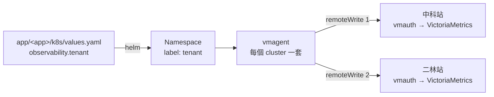

# platform — 給平台團隊：部署 app 與 metrics 分流

這份回答三件事：怎麼把一個 app 部署上 K8s、它的 metrics 怎麼被分到各部門的租戶、
平台這一側的設定怎麼套。對象是管 cluster 與監控的人。

| 想知道 | 看哪一節 |
| --- | --- |
| 資料從 app 到 VictoriaMetrics 經過哪些地方 | [整條路](#整條路) |
| 部署一個 app | [部署一個 app](#部署一個-app) |
| 為什麼 A 部門的資料不會跑到 B 部門 | [怎麼分流](#怎麼分流) |
| 新 cluster 或既有 cluster 套平台設定 | [套平台這一側的設定](#套平台這一側的設定) |
| 部署完怎麼確認 | [怎麼確認有分對](#怎麼確認有分對) |
| 畫面正常但資料不對 | [會安靜壞掉的地方](#會安靜壞掉的地方) |

## 整條路



| 誰 | 做什麼 | 設定在哪 |
| --- | --- | --- |
| app 開發者 | 在 `values.yaml` 寫這個 app 是哪個部門的 | `app/<app>/k8s/values.yaml` |
| chart | 建 namespace，把部門貼成 namespace 的 label | `app/<app>/k8s/templates/namespace.yaml` |
| vmagent | 抓 metrics、依 label 填租戶編號、補廠區、送兩站 | `platform/victoriametrics/vmstack-values.yaml` |
| 兩站的 vmauth | 只驗 token | 不在這個 repo |

app 本身不知道資料送去哪，也不拿任何 token。

## 部署一個 app

目前先做不走 ArgoCD 的路：人下 `helm`。範本是 `app/eqp-collector/`，
完整的逐步操作（含 image 匯入）在它的 [`README.md`](../app/eqp-collector/README.md)。

**1. 寫 `values.yaml`**

```yaml
namespace: eqp-collector-dev     # chart 會自己建這個 namespace

observability:
  dept: D1110                    # 必填：資料屬於哪個部門
  tenant: imc                    # 必填：tsid / bsid / icsd / imc / platform
  system: eqp                    # 選填：業務系統
```

**2. 部署前檢查**（不需要 cluster）

```bash
./tests/validate.sh
```

**3. 部署**

```bash
helm upgrade --install eqp-collector app/eqp-collector/k8s -n default --reset-values --wait --timeout 3m
```

**4. 確認 namespace 的 label**

```bash
kubectl get ns eqp-collector-dev --show-labels
```

要看到 `dept`、`tenant`、`system` 三個 label，值跟 `values.yaml` 一樣。

| 注意 | 原因 |
| --- | --- |
| `-n` 寫 `default`，不是 app 的 namespace | namespace 是 chart 建的，部署當下還不存在 |
| 一定要帶 `--reset-values` | 不帶的話 Helm 沿用上次 `--set` 的值，改了 `tenant` 門牌不會變 |
| 不要先手動建 namespace | chart 會因為 namespace 已存在而失敗；手動建的也沒有 label |

⚠️ `mes-dispatch`、`yms-sim`、`metrics-sim` 的 chart 還是 ArgoCD 的寫法，沒有
`namespace.yaml`。用 `helm` 直接裝得起來，但 namespace 不會有 label，資料全部進
`platform`。要手動部署的 app 得照 `eqp-collector` 的 chart 寫。

## 怎麼分流

vmagent 對每一筆樣本做四件事，全部寫在 `platform/victoriametrics/vmstack-values.yaml`：

| 順序 | 做什麼 | 設定的段落 |
| --- | --- | --- |
| ① | 抓取時把 namespace 的 `tenant` 貼到樣本上；namespace 沒貼的補成 `platform` | `scrapeClasses` |
| ② | 丟掉樣本自己帶的 `vm_account_id`、`vm_project_id` | `inlineRelabelConfig` 第一條 |
| ③ | 依 `tenant` 填 `vm_account_id`；對不到的把 `tenant` 改成 `platform`、填 1000 | `inlineRelabelConfig` 其餘 |
| ④ | 補上 `site` | `externalLabels`，值來自 `platform/victoriametrics/site-<廠區>.yaml` |

VictoriaMetrics 看每筆樣本的 `vm_account_id` 決定放進哪個租戶。

| `tenant` | AccountID |
| --- | --- |
| `tsid` | 1001 |
| `bsid` | 1002 |
| `icsd` | 1003 |
| `imc` | 1004 |
| `platform`、沒貼、寫錯 | 1000 |

新增租戶：在 `inlineRelabelConfig` 的兜底兩條**前面**加一條，AccountID 不能重複，
然後跑 `./tests/validate.sh`。`remoteWrite` 不用動，app 也不用動。

> 租戶隔離靠的是 vmagent 這一側。兩站的 vmauth 只驗 token，不檢查
> `vm_account_id`。① 的補 `platform` 和 ② 少了任何一個，pod 自己在 metric 上寫
> `tenant="tsid"` 或 `vm_account_id="1001"` 就能寫進別人的租戶，不會報錯。

### 兩站各寫一份

| 項目 | 設定 | 說明 |
| --- | --- | --- |
| 兩條 `remoteWrite` | `vmagent.spec.remoteWrite` | 中科站、二林站各一條，送的是同一份 |
| token | Secret `vmauth-token` 的 `ctsp`、`erlin` | 兩站各發各的，每個 cluster 各一把 |
| 送不到時 | `statefulMode`、`statefulStorage` | 排在 PVC 上，每一站各一個佇列，恢復後補送 |
| 暫存上限 | `remoteWriteSettings.maxDiskUsagePerURL` | 每站 20 GiB，PVC 50 GiB。超過時最舊的被丟掉 |

## 套平台這一側的設定

套之前四件事要先成立，缺一個就不要往下：

| 先確認 | 指令 | 不成立時會怎樣 |
| --- | --- | --- |
| 有可用的 StorageClass，給得出 50 GiB | `kubectl get storageclass` | PVC 卡在 Pending，vmagent 起不來，整個 cluster 的 metrics 停掉 |
| Secret `vmauth-token` 有 `ctsp`、`erlin` 兩個 key | `kubectl describe secret vmauth-token -n vm-monitoring` | vmagent 找不到 key，同上 |
| CRD 認得新欄位 | `kubectl apply --dry-run=server` 後比對回來的 spec | 欄位被默默裁掉，分流或暫存失效 |
| 兩個寫入網址已換成真的 | `./tests/validate.sh` 沒有印「佔位」的提醒 | 兩條都送不出去 |

建 Secret，token 不會顯示也不會進指令歷史：

```bash
read -s -p 'ctsp token: ' T1; echo; read -s -p 'erlin token: ' T2; echo
kubectl create secret generic vmauth-token -n vm-monitoring --from-literal=ctsp="$T1" --from-literal=erlin="$T2"; unset T1 T2
```

新的 cluster，整份套：

```bash
helm upgrade --install vmstack <repo>/victoria-metrics-k8s-stack --version 0.91.0 -n vm-monitoring \
  -f platform/victoriametrics/vmstack-values.yaml -f platform/victoriametrics/site-ctsp.yaml
```

已經在跑的 cluster（例如 AP1105），只疊要改的那幾段：

```bash
helm get values vmstack -n vm-monitoring -o yaml > current-values.yaml
helm upgrade vmstack <repo>/victoria-metrics-k8s-stack --version <現在的版本> -n vm-monitoring \
  -f current-values.yaml -f platform/victoriametrics/vmagent-routing-overlay.yaml -f platform/victoriametrics/site-ctsp.yaml
```

二林的 cluster 把 `site-ctsp.yaml` 換成 `site-erlin.yaml`，其他一樣。

⚠️ 已經在跑的 cluster 不要整份套 `vmstack-values.yaml`：它會關掉 vmcluster、換 image
registry、把 `externalLabels` 清空。套 overlay 時 vmagent 會從 Deployment 變成
StatefulSet，重啟一次；沒貼 `tenant` 的 namespace 會從原本的租戶換到 1000。

## 怎麼確認有分對

先把 vmagent 轉到本機（service 名稱依環境不同，用 `kubectl get svc -n vm-monitoring` 找）：

```bash
kubectl port-forward -n vm-monitoring svc/vmagent-vmstack-victoria-metrics-k8s-stack 8429:8429
```

| 看什麼 | 指令 | 正常的樣子 |
| --- | --- | --- |
| 載入的分流規則 | `curl -s localhost:8429/remotewrite-relabel-config` | 七條：一條 `labeldrop`、四條對照、兩條 `^$` 的兜底 |
| target 上的 label | `curl -s localhost:8429/api/v1/targets` | 每個 target 都有 `tenant`，沒貼的是 `platform` |
| 送出狀況 | `curl -s localhost:8429/metrics \| grep vmagent_remotewrite_requests_total` | `1:`、`2:` 都有 2xx，沒有 401 |
| 排隊中的資料 | `curl -s localhost:8429/metrics \| grep vmagent_remotewrite_pending_data_bytes` | 平常接近 0；持續變大表示有一站送不到 |

資料最後進了哪個租戶，要在中央查（每個 AccountID 各查一次）。本機有整條路的實測：

```bash
./tests/tenant-routing/run.sh          # 分流與雙寫
./tests/tenant-routing/run.sh outage   # 停掉一站再恢復，資料有沒有補回來
```

## 會安靜壞掉的地方

每一項都不會有錯誤訊息。

| 症狀 | 原因 | 為什麼沒人會發現 |
| --- | --- | --- |
| 某個部門的資料全部在 1000 | namespace 沒有 `tenant`，或值不在對照裡 | 資料沒有消失，只是在別的租戶；該部門的看板是空的，像是 app 沒吐資料 |
| 改了 `tenant` 沒效 | `helm upgrade` 沒帶 `--reset-values` | Helm 回報成功 |
| 別的部門的租戶裡出現不認識的資料 | 防冒充的規則被拿掉或順序錯了 | vmauth 不檢查租戶編號。`tests/validate.sh` 會擋下這種修改 |
| 每個租戶都被改成 `platform` | 兜底規則的 `regex` 寫成空字串而不是 `^$` | 資料都在，只是全部進 1000 |
| 樣本沒有 `site` | 部署時沒疊 `platform/victoriametrics/site-<廠區>.yaml` | 分流照常，只是兩廠的資料分不出來 |
| 一站停機期間的資料不見了 | 沒開 `statefulMode`，vmagent 又重啟過 | 另一站完整；要兩站對比才看得出來 |
| 很久以前的資料不見了 | 暫存超過上限，最舊的被丟掉 | 沒有告警。要看 `vmagent_remotewrite_pending_data_bytes` |
| 一站一直 401，另一站正常 | 兩把 token 放反、或那一站換了 token 還沒生效 | 看起來像那一站壞了 |
| 套了設定但規則沒變 | CRD 太舊，不認得的欄位被裁掉 | `kubectl apply` 回報成功。`kubectl explain` 也不可靠 |

## 改了設定之後

| 改了什麼 | 要跑 |
| --- | --- |
| 任何 `app/<app>/k8s/values.yaml` | `./tests/validate.sh` |
| `platform/victoriametrics/vmstack-values.yaml` | 同上。overlay 要一起改，檢查會比對兩份 |
| 分流、`remoteWrite`、暫存那幾段 | 再加 `./tests/tenant-routing/run.sh`，動到雙寫或暫存的話加 `outage` |

## 還沒定的

| 項目 | 現況 | 找誰 |
| --- | --- | --- |
| 兩站的寫入網址 | `vmstack-values.yaml` 裡是佔位，`.invalid` 結尾 | Infra |
| token 的發放與更換流程 | 設計是每個 cluster、每一站各一把 | Infra |
| AP1105 的 StorageClass | 沒確認 | AP1105 的管理者 |
| 暫存 20 GiB 夠不夠撐 8 小時 | 沒有實測依據，要在正式的 cluster 量 | 平台團隊 |
| 新 overlay 在 AP1105 的完整流程 | 只在本機 k3d 測過，沒有在 AP1105 的模擬環境走過 | 下一個需求 |
| ArgoCD 的路 | `platform/argocd/applicationset.yaml` 留著，沒有實測 | 之後補做 |

驗證過的版本：operator v0.74.0、VictoriaMetrics v1.148.0、chart 0.91.0。
