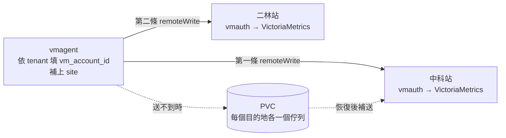

# Spec — 兩廠雙寫

> 已確認。
> 「行為」表的每一列都會變成 `4-acceptance.md` 的一條驗收項。

## 資料怎麼走

## 先實測過的（2026-10-04，`tenant-test`）

operator v0.74.0、VictoriaMetrics v1.148.0，跟 AP1105 一樣。

| 要確認的 | 實際結果 |
| --- | --- |
| 新欄位不會被 CRD 裁掉 | `externalLabels`、`statefulMode`、`statefulStorage`、`remoteWriteSettings` 經 server-side dry-run 都在 |
| 開了 `statefulMode` 之後 | vmagent 從 Deployment 變成 StatefulSet，PVC 掛在暫存目錄 |
| 兩座收到同樣的資料 | `tr-icsd` 在兩座的 1003 都是 3 筆，都帶 `site="ctsp"` |
| 一座停機時另一座不受影響 | 停掉站 1 的入口 70 秒後：站 1 最近 30 秒 0 筆，站 2 照常 9 筆 |
| 每個目的地各自排隊 | 站 1 的佇列從 500 KB 長到 1.3 MB，站 2 的一直是 8 KB |
| vmagent 重啟不掉資料 | 停機中刪掉 pod，新 pod 接著同一個佇列繼續累積 |
| 恢復後補送 | 過去 5 分鐘（含停機的 2 分多鐘）：站 1 90 筆、站 2 87 筆 |
| app 不能冒充廠區 | 自己吐 `site="fake"` 的 pod，樣本上是 `site="ctsp"`，自稱的變成 `exported_site` |

## 設定放哪

| 設定 | 放哪 | 為什麼 |
| --- | --- | --- |
| 兩條 `remoteWrite`、PVC、暫存上限 | `platform/vmstack-values.yaml`，overlay 跟著 | 每個 cluster 都一樣 |
| `site` 的值 | 每個廠區一個小檔：`platform/site-ctsp.yaml`、`platform/site-erlin.yaml`，只有 `vmagent.spec.externalLabels.site` | 每個 cluster 不一樣 |

部署時疊在一起：`-f platform/vmstack-values.yaml -f platform/site-ctsp.yaml`。

## 行為

| 情境 | 預期行為 |
| --- | --- |
| 平常 | 每個 namespace 的樣本同時在兩座的同一個 AccountID，筆數一樣 |
| 每筆樣本 | 帶 `site`，值是該 cluster 的廠區 |
| 租戶分流 | 跟需求 2 一樣。七個情境在兩座各自成立 |
| app 自己吐 `site` | 被忽略，變成 `exported_site` |
| 一座停機 | 另一座照常收，筆數不變 |
| 停機中 vmagent 重啟 | 佇列留在 PVC，恢復後照樣補送 |
| 停機的那座恢復 | 停機期間的樣本補回來：那段時間的筆數不少於另一座的 95% |
| 暫存超過上限 | 最舊的資料被丟掉，不報錯。⚠️ 這次不測，只寫進文件 |
| 部署時沒帶廠區的檔 | 樣本沒有 `site`。`tests/validate.sh` 擋不到部署指令，E2E 會查沒有 `site` 的樣本數要是 0 |
| `platform/site-*.yaml` 帶了 `site` 以外的設定 | `tests/validate.sh` FAIL |
| `vmstack-values.yaml` 的 `remoteWrite` 不是兩條、兩條網址一樣、沒開 `statefulMode`、沒設暫存上限 | `tests/validate.sh` FAIL |

## 邊界與限制

* 輸入的合法範圍：`site` 是 `ctsp` 或 `erlin`。
* 超出範圍時怎麼處理：`tests/validate.sh` 擋下 `platform/site-*.yaml` 裡其他的值。
* 資料量上的限制：暫存上限每個目的地 20 GiB、PVC 50 GiB，是起始值。算法寫在
  `platform/vmstack-values.yaml`：上限 ÷ 每小時暫存量 = 撐得住的小時數。

## 影響到哪些既有行為

| 既有行為 | 會變成怎樣 | 需要改既有測試嗎 |
| --- | --- | --- |
| `remoteWrite` 剛好一條 | 剛好兩條 | 改 `tests/validate.sh`，需求 2 的那條自我檢查反過來 |
| vmagent 是 Deployment | 變成 StatefulSet，pod 名稱從隨機尾碼變成 `-0` | 改 `tests/tenant-routing/run.sh`、`check.py` 裡找 pod 的方式 |
| vmagent 不需要儲存空間 | 每個 cluster 要有可用的 StorageClass，要 50 GiB | 不適用 |
| Secret `vmauth-token` 只有 `token` 一個 key | 兩個 key：`ctsp`、`erlin`，兩座各一把 | 改 `tests/tenant-routing/backends.yaml` |
| `tests/tenant-routing/run.sh` 只起一座 | 起兩座，每個情境兩座都查；另加停機測試 | 改 |
| overlay 帶三段 | 多帶 `statefulMode`、`statefulStorage`、`remoteWriteSettings` | 改 `tests/validate.sh` |
| 樣本沒有 `site` | 多一個 label。既有的查詢與告警不受影響，但同一個 metric 在兩廠會是兩條 | 不適用 |

⚠️ Deployment 換成 StatefulSet 時 vmagent 會重啟，舊 Deployment 由 operator 移除。
已經在跑的環境（AP1105）會有一小段沒抓資料，這放在需求 4 驗。

## 已定的做法

| 項目 | 決定 |
| --- | --- |
| `site` 怎麼給 | 每個廠區一個小檔，部署時多帶一個 `-f` |
| token | 兩座各一把，Secret `vmauth-token` 的 `ctsp`、`erlin` 兩個 key |
| 兩座的寫入網址 | 都放佔位，待 Infra 確認哪個是中科、哪個是二林 |
| 暫存與 PVC | 每個目的地 20 GiB、PVC 50 GiB，StorageClass 用該 cluster 的預設。AP1105 的 StorageClass 待確認 |
| 停機測試 | 跟分流測試分開：`run.sh` 測分流，`run.sh outage` 測停機與補送，日常不跑後者 |

## 這份 spec 不涵蓋的

| 不涵蓋 | 為什麼 |
| --- | --- |
| 查詢端切換、補送期間的資料缺口 | 見 `1-intent.md` |
| 暫存快滿的告警 | 見 `1-intent.md` |
| 跨廠網路中斷的專門測試 | 對 vmagent 來說跟「那一座送不到」是同一件事，停機測試已涵蓋 |
| 暫存超過上限時丟資料的行為 | 要灌滿 20 GiB 才測得到 |
| AP1105 的套用與 Deployment 換 StatefulSet 的中斷時間 | 需求 4 |
