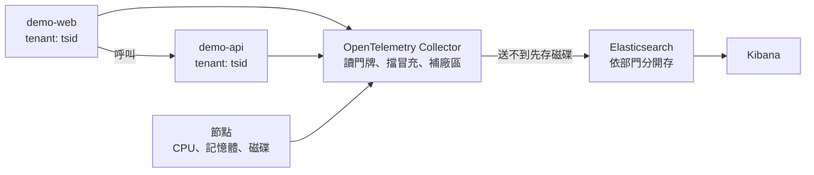

# Spec — 健康度數值經 OpenTelemetry Collector 進 Elasticsearch

> 草稿。這一份要人確認之後，才寫 `3-plan.md`。標 ❓ 的要先回答。
> 「行為」表的每一列都會變成 `4-acceptance.md` 的一條驗收項。
>
> 地基的四件事已在本機實測（2026-10-05），結果在下面「先實測過的」。其餘仍是照一般了解寫的。

## 先實測過的

本機 k3d cluster `obs-test`：Elasticsearch 9.5.3（當時最新，免費版、開帳號密碼）、
OpenTelemetry Collector contrib 0.161.0。用五個只回固定文字的假程式測。
先在 8.19.22 測過一輪，換成 9.5.3 後全部重測，結果一樣，收集程式的設定不用改。

| 要確認的 | 實際結果 |
| --- | --- |
| 讀得到 namespace 的門牌 | 讀得到。樣本上有 `tenant`、`dept`、`system`，值跟 namespace 貼的一樣 |
| 進 Elasticsearch 後依部門分開 | 分得開。自動長出三份資料流，名字結尾分別是 `tsid`、`bsid`、`platform` |
| 沒貼、打錯的進 `platform` | 是。`d-none`、`d-typo`（貼 `imcc`）都在 `platform` 那一份 |
| 擋得住冒充 | 擋得住。自己吐 `tenant="tsid"`、`site="fake"` 的程式，樣本在 `platform`，`site` 是 `ctsp` |
| Elasticsearch 停機再恢復，資料補回來 | 補得回來，但**預設不會**。見下表 |

| 實測時踩到的 | 說明 |
| --- | --- |
| 重試次數寫 0 是「不重試」 | 第一次測：Elasticsearch 停 103 秒，那段時間的資料補回 0 筆，收集程式的 log 寫 `Dropping data`。把重試改成很大的次數、間隔最長 30 秒之後：同樣停 103 秒，補回 11 筆（每 10 秒一筆），沒有丟資料的訊息。9.5.3 上重測補回 10 筆，同樣沒有丟 |
| 刪掉 Service 不算斷線 | 已經連上的連線還在，資料照送。要測停機得把 Elasticsearch 整個停掉 |
| 測試用的 Elasticsearch 要掛磁碟 | 不掛的話一停資料就沒了，驗不了補送 |
| 抓來的資料對不到是哪個 pod | 收集程式只知道對方的位址。要先把位址放進特定的欄位，讀門牌那一步才對得上。設定裡多一段 |

還沒測的：停機中重啟收集程式佇列在不在（要先給它掛磁碟）、server 的數值標成 `icsd`、
容器的資源用量、兩個目的地。這些留到實作時驗。

## 資料怎麼走

## 範例程式

兩支，取代 `eqp-collector` 當範例。放在 `app/demo-web/`、`app/demo-api/`，
結構跟其他 app 一樣（程式加 `k8s/`）。

| 項目 | 內容 |
| --- | --- |
| 做什麼 | `demo-web` 收到請求後呼叫 `demo-api`，`demo-api` 做一點假的運算後回應。沒有任何業務意義 |
| 流量 | `demo-web` 自己定時打自己，不用另外產生流量 |
| 吐的數值 | 請求數（分成功與失敗）、處理時間、進行中的請求數、是不是活著 |
| 可以弄壞的方式 | 變慢、回錯誤、佔 CPU、佔記憶體。各自可以只弄壞其中一支 |
| 怎麼弄壞 | 從外面打一個管理用的網址開關，不用重新部署 |
| log 與 trace | 這一步就會吐，log 帶著 trace 的編號。這一步不收，留給第 2、4 步 |
| 部署方式 | 人下 `helm`，chart 自己建 namespace 並貼門牌，跟 `eqp-collector` 一樣 |

## 收集程式

| 項目 | 內容 |
| --- | --- |
| 程式的數值 | 去每支程式抓，跟 vmagent 一樣的方式 |
| 容器用了多少資源 | 從節點取得每個容器的 CPU 與記憶體 |
| server 的數值 | 每個節點放一個收集程式，讀 CPU、記憶體、磁碟、網路 |
| K8s 回報的狀態 | 節點是不是正常、程式重啟了幾次 |
| 送到哪 | 本機的 Elasticsearch |
| 設定放哪 | `platform/otel/`，跟 `platform/victoriametrics/` 並排，這一步不動後者 |

## 標籤的規則

| 資料 | `tenant` 怎麼來 |
| --- | --- |
| 程式的數值、容器的資源 | 讀 namespace 的門牌 |
| namespace 沒掛門牌，或值不在清單裡 | `platform` |
| 節點的數值、K8s 回報的節點狀態 | 直接標成 `icsd` |
| 收集程式與 Elasticsearch 自己 | `platform` |

每筆另外帶 `dept`、`system`（有的話）、`site`、`cluster`。

允許的 `tenant` 清單只放一份，在收集程式的設定裡。`tests/validate.sh` 從那裡讀。
❓ 見下面第 3 題。

## 行為

| 情境 | 預期行為 |
| --- | --- |
| namespace 貼 `tenant: tsid` | 數值在 Elasticsearch 裡標著 `tsid`，只出現在 `tsid` 那一份 |
| `tsid`、`bsid` 各一個 namespace | 各自只出現在自己那一份 |
| namespace 沒貼、或貼成不在清單裡的值 | 標成 `platform` |
| 節點的 CPU、記憶體、磁碟 | 標成 `icsd`，不管那個節點上跑的是誰的程式 |
| 程式自己吐的數值帶 `tenant="bsid"` | 被忽略，照 namespace 的門牌走 |
| 沒掛門牌的 namespace 裡，程式自己吐 `tenant="tsid"` | 被忽略，進 `platform` |
| 每筆數值 | 帶 `site` 與 `cluster` |
| 把 `demo-api` 弄慢 | `demo-api` 的處理時間變長；`demo-web` 的也跟著變長。兩支在 Elasticsearch 裡都查得到變化的時間點 |
| 讓節點的記憶體吃緊 | `icsd` 那一份裡節點的記憶體數值上升 |
| Elasticsearch 停機幾分鐘再恢復 | 停機期間的數值補回來，筆數不少於正常時段的 95% |
| 收集程式的重試設定被改成不重試 | `tests/validate.sh` FAIL。這個設定錯了不會報錯，停機時資料直接丟掉 |
| 停機中收集程式重啟 | 排隊的資料還在，恢復後照樣補送 |
| 設定兩個目的地，其中一個停機 | 另一個照常收 |

## 邊界與限制

* 輸入的合法範圍：`tenant` 是 `tsid`、`bsid`、`icsd`、`imc`、`platform` 之一。
* 超出範圍時怎麼處理：`tests/validate.sh` 擋下；真的部署上去的話進 `platform`。
* 版本：Elasticsearch 9.5.3、OpenTelemetry Collector contrib 0.161.0，在設定裡寫死。
  Kibana 用跟 Elasticsearch 同一版。
* 授權：只用免費版有的功能。

## 影響到哪些既有行為

| 既有行為 | 會變成怎樣 | 需要改既有測試嗎 |
| --- | --- | --- |
| `platform/victoriametrics/`、`tests/tenant-routing/` | 不動，照樣能跑 | 不用 |
| `tests/validate.sh` 從 VictoriaMetrics 的設定讀允許的 `tenant` | ❓ 第 3 題。這一步之後有兩份設定都寫著部門清單 | 要改，改法看第 3 題 |
| `tests/validate.sh` 的 app 檢查 | 多兩個 app。兩支都是手動 Helm，現有的規則就能檢查 | 不用 |
| `eqp-collector` 是手動 Helm 的範本 | 範本改成 `demo-api`。`eqp-collector` 留著給舊測試用 | `README.md`、`platform/README.md` 的說明要改 |
| 每個 app 的 `vmservicescrape.yaml` | 新的兩支不帶這個檔。它是 VictoriaMetrics 專用的 | 不用 |

⚠️ 新的範例程式不帶 `vmservicescrape.yaml`，所以舊的 vmagent 抓不到它們。
這是刻意的：兩條路各用各的範例，不互相干擾。

## 還沒談定的 ❓

| # | 問題 | 我的建議 |
| --- | --- | --- |
| 1 | Elasticsearch 的版本 | 已定：用最新版。本機釘在 9.5.3，之後升版要重跑這份的驗收 |
| 2 | 資料在 Elasticsearch 裡怎麼依部門分開 | 已實測可行：每個部門一份各自的資料流，名字結尾是部門代號，收集程式照標籤自動分。之後設權限也照這個設 |
| 3 | 允許的 `tenant` 清單放哪 | 這一步先放在收集程式的設定裡，`tests/validate.sh` 改成從這裡讀。VictoriaMetrics 那份留著但不再是正本，第 6 步刪掉 |
| 4 | 本機的 Elasticsearch 要不要開帳號密碼 | 開。正式的一定有，收集程式怎麼帶憑證要一起驗。憑證放 Secret |
| 5 | 本機的 k3d cluster | 已開，叫 `obs-test`。光 Elasticsearch 就佔約 2 GB，還沒裝 Kibana |

## 這份 spec 不涵蓋的

| 不涵蓋 | 為什麼 |
| --- | --- |
| log、trace、異常偵測、找根因 | 總綱拆法的第 2 到 5 步 |
| 誰能看哪個部門的資料 | 見 `1-intent.md` |
| 第二座 Elasticsearch | 見 `1-intent.md` |
| 分層保留與壓縮 | 見 `1-intent.md` |
| 很多 cluster 時設定怎麼發 | 這一步只有一個 cluster |
| Kibana 的儀表板 | 這一步用查詢確認資料在不在、標籤對不對，不做畫面 |
