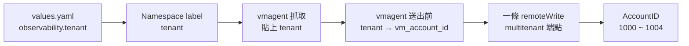

# Spec — 依 `tenant` label 寫進對應的 AccountID

> 已確認。
> 「行為」表的每一列都會變成 `4-acceptance.md` 的一條驗收項。

## 資料怎麼走

## 租戶對照

只有一份，寫在 `platform/victoriametrics/vmstack-values.yaml` 的 vmagent 設定裡。
`tests/validate.sh` 從這裡讀出允許的 `tenant`，不另外維護清單。

| `tenant` | AccountID | 誰 |
| --- | --- | --- |
| `platform` | 1000 | 兜底：沒貼、貼錯、系統元件 |
| `tsid` | 1001 | |
| `bsid` | 1002 | |
| `icsd` | 1003 | `mes-dispatch` |
| `imc` | 1004 | `yms-sim`、`eqp-collector` |

`metrics-sim` 寫 `tenant: platform`。

## 行為

| 情境 | 預期行為 |
| --- | --- |
| namespace 貼 `tenant: icsd` | 樣本帶 `tenant="icsd"`，只出現在 AccountID 1003 |
| 四個租戶各一個 namespace | 各自只出現在自己的 AccountID，其他四個查不到 |
| namespace 沒貼 `tenant` | 樣本帶 `tenant="platform"`，只出現在 1000 |
| namespace 貼 `tenant: imcc`（打錯） | 同上。樣本上的 `tenant` 是 `platform`，不是 `imcc` |
| `node-exporter`、`kube-state-metrics` | 同上 |
| app 自己吐的 metric 帶 `vm_account_id="1001"` | 被忽略，照 namespace 的 `tenant` 走 |
| 沒貼 `tenant` 的 namespace，app 自己吐 `tenant="tsid"` | 被忽略，進 1000 |
| `values.yaml` 寫 `observability.group` | `tests/validate.sh` FAIL：欄位已改名為 `tenant` |
| `values.yaml` 寫 `tenant: it.imc` 或不在對照裡的值 | `tests/validate.sh` FAIL，列出允許的值 |
| 對照裡兩個 `tenant` 指到同一個 AccountID | `tests/validate.sh` FAIL |
| 對照改了，overlay 沒跟著改 | `tests/validate.sh` FAIL，跟現在一樣 |
| vmagent 的 `remoteWrite` | 剛好一條，帶這個 cluster 自己的 token |

⚠️ 倒數第六、第七列是防偽造。vmauth 只驗 token、不檢查 `vm_account_id`，
vmagent 不擋的話，任何 pod 都能把資料寫進別人的租戶，而且不會有錯誤訊息。

## 邊界與限制

* 輸入的合法範圍：`observability.tenant` 是對照表裡的五個值之一，必填。
* 超出範圍時怎麼處理：`tests/validate.sh` 擋下；真的部署上去的話進 `platform`。
* 併發 / 權限 / 資料量上的限制：每個 cluster 一把 token，放 Secret，不進 git。
* `dept`、`system` 兩個 label 不變。

## 影響到哪些既有行為

| 既有行為 | 會變成怎樣 | 需要改既有測試嗎 |
| --- | --- | --- |
| `observability.group`，namespace label `group` | 改名為 `tenant` | 改 `tests/validate.sh` |
| `it` / `imc` / `it.imc` / `platform` | `tsid` / `bsid` / `icsd` / `imc` / `platform` | 同上 |
| `it.imc` 抓一次送兩份 | 不再支援 | 同上，相關自我檢查移除 |
| 三條 `remoteWrite`、三把 token | 一條、一把 | 同上 |
| 租戶由 vmauth 依 token 決定 | 由 vmagent 填的 `vm_account_id` 決定 | 不適用 |
| 允許的值從 `remoteWrite` 推出 | 從對照表推出 | 改 `tests/validate.sh` |
| `platform/victoriametrics/vmagent-routing-overlay.yaml` 要跟 `vmstack-values.yaml` 一致 | 維持，內容換成新設計 | 同上 |
| `platform/argocd/applicationset.yaml` 抄 `dept` / `group` / `system` | 抄 `dept` / `tenant` / `system`。不改的話三個走 ArgoCD 的 app 過不了 `validate.sh` | 同上 |
| `kube_namespace_labels` 帶出 `label_group` | 帶出 `label_tenant` | 不適用 |
| `tests/routing/run.sh`、`tests/ap1105-sim/run.sh` | 壞掉。這次不修，`.agents/project/commands.md` 標明 | 不改，見 `1-intent.md` |
| 三份 `README.md` 裡 `group` 的說明（根目錄 11 處、`eqp-collector` 30 處、`ap1105-sim` 10 處） | 根目錄與 `eqp-collector` 改寫；`ap1105-sim` 不動 | 不適用 |

## 怎麼驗證

| 層 | 用什麼 | 證明什麼 |
| --- | --- | --- |
| 靜態 | `tests/validate.sh` | `values.yaml` 與對照表沒寫錯，namespace label 會照原值 |
| 本機 k3d | 新的一支測試：一座 VictoriaMetrics cluster、vmauth、vmagent，用手動 Helm 部署測試 app | 樣本真的進到對的 AccountID，其他 AccountID 查不到 |

## 已定的做法

| 項目 | 決定 |
| --- | --- |
| k3d 測試 | 放在這個需求，先做一座 VictoriaMetrics。用獨立的 k3d cluster，不動 `k3d-spil` |
| 寫入路徑 | 先用 `/insert/multitenant/prometheus/api/v1/write` 當佔位，檔案裡標明待 Infra 確認 |
| 版本 | 用 AP1105 的：chart 0.91.0、operator v0.74.0、vmauth v1.148.0 |
| 推進方式 | 分三批，每批各自驗收：改名、對照與單條 `remoteWrite`、k3d 實測 |
| 防偽造 | 第二批做規則，第三批用一個故意偽造 label 的 pod 實測 |

## 這份 spec 不涵蓋的

| 不涵蓋 | 為什麼 |
| --- | --- |
| `site` label、雙寫、PVC 與 buffer | 需求 3 |
| AP1105 怎麼從舊分流換過來、舊資料 | 需求 4 |
| 查詢端怎麼依租戶隔離 | 總綱已列為不做 |
| 每個 cluster 的 token 怎麼發、怎麼輪替 | 中央 vmauth 的事。這裡只規定放 Secret |
| log 的分流 | 總綱已列為不做 |
