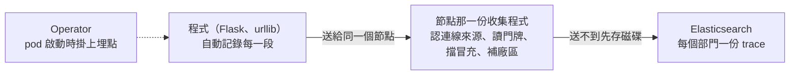

# Spec — trace 經同一套收集程式進 Elasticsearch

> `1-intent.md` 已確認（2026-10-06），五題都照建議，使用者同時說了執行。
> 「行為」表的每一列都會變成 `4-acceptance.md` 的一條驗收項。

## 先實測過的

2026-10-06 在本機的 `obs-test` 上把整條路試通了一次：

| 要確認的 | 實際結果 |
| --- | --- |
| 不改 image 掛得上自動埋點 | 掛得上。pod 多一個標註，Operator 在啟動時塞進去。範例程式裡沒有任何送出 trace 的程式碼 |
| 兩支程式在同一筆 trace 裡 | 是。`demo-api` 收到請求那一段的上一層，就是 `demo-web` 呼叫出去的那一段 |
| 照部門分開 | 分得開。長出一份 `traces-generic.otel-tsid` |
| 標籤跟數值、log 一樣 | 一樣。`tenant`、`dept`、`system`、`site`、`cluster` 都有 |
| log 裡的編號跟 trace 是同一個 | 是。log 的 `trace_id` 現在由自動埋點產生 |
| 不靠程式自己說它是哪個 pod | 做得到。程式自己帶的 pod、namespace 名稱先丟掉，改看連線是從哪個位址進來的，再查那個位址是哪個 pod |

| 試的時候發現的 | 說明 |
| --- | --- |
| 自動埋點會帶上「我是哪個 pod、哪個 namespace」 | 那是程式這一側自己填的，可以亂填。所以不能信，見上面最後一列 |
| Operator 需要一張憑證 | 一開始照預設裝了 cert-manager（v1.21.2）。之後改成測試環境不裝，憑證由 Helm 產生；正式環境用現成的 cert-manager。Operator 是 v0.160.0 |
| 健康檢查每幾秒一次也會變成 trace | 在埋點的設定裡排除 |
| 還沒試的 | 程式冒充別的部門、停機補送、沒掛門牌的 namespace、不認得的框架長什麼樣 |

## 資料怎麼走



## 三個部分

| 部分 | 內容 | 放哪 |
| --- | --- | --- |
| 自動埋點的設定 | 送到哪、全收、只要 trace、排除健康檢查 | `platform/otel/instrumentation.yaml` |
| 收集程式 | 節點那一份多開一個入口收 trace，加一條 pipeline。前面有一個只轉給同節點的 Service | `platform/otel/node-collector.yaml` |
| 範例程式 | 收請求改用 Flask，拿掉手寫傳編號，log 的編號讀自動埋點的。chart 加一個標註 | `app/demo-svc/` |

## app 要做什麼

pod 上加一個標註，值是平台那一份設定的位置：

```yaml
annotations:
  instrumentation.opentelemetry.io/inject-python: "otel-collector/python"
```

不加的話程式照樣跑，只是沒有 trace。

## 標籤的規則

跟數值、log 同一份規則。差別只有「怎麼知道是哪個 pod」：

| 資料 | 怎麼知道是哪個 pod |
| --- | --- |
| 數值 | 收集程式自己去抓的，知道抓的是誰 |
| log | 檔案路徑裡就有 |
| trace | 程式送來的。看連線是從哪個位址進來的。程式自己填的 pod、namespace 不算數 |

## 行為

| 情境 | 預期行為 |
| --- | --- |
| namespace 貼 `tenant: tsid` 的程式送 trace | 只出現在 `tsid` 那一份 |
| `tsid`、`bsid` 各一組範例程式 | 各自只出現在自己那一份 |
| 沒掛門牌的 namespace 裡的程式送 trace | 進 `platform` |
| 每一段 | 帶 `tenant`、`site`、`cluster`，門牌有的話帶 `dept`、`system`。值跟同一個 pod 的數值、log 相同 |
| 一次請求 | `demo-web` 收到、`demo-web` 呼叫出去、`demo-api` 收到，三段在同一筆 trace 裡，上下層接得起來 |
| 誰呼叫誰 | 從 Elasticsearch 查得出「`demo-web` 呼叫 `demo-api`」 |
| 把 `demo-api` 弄慢 400 毫秒 | `demo-api` 那一段變長約 400 毫秒；`demo-web` 那一段也變長，而且看得出時間花在呼叫 `demo-api` |
| 把 `demo-api` 弄成回錯誤 | 那一段標成錯誤；同一個編號查得到兩支程式的 log |
| 程式自己填 `tenant`、`site`、`cluster` | 不算數，不留在資料上 |
| 程式自稱是別的部門的 pod、別的 namespace | 不算數。部門照它實際所在的 namespace，資料上的 pod 與 namespace 是收集程式查到的 |
| 健康檢查的請求 | 不產生 trace |
| pod 沒有加標註 | 程式照樣跑，沒有 trace，不報錯 |
| Elasticsearch 停機幾分鐘再恢復，中間重啟收集程式 | 停機期間的 trace 補回來，筆數不少於平常的 95%。收集程式重啟的那幾十秒不算 |
| 數值與 log | 不受影響：前兩步的測試照樣全過 |

## 邊界與限制

* 只有 Python。其他語言各要一段設定，這裡驗不到。
* 自動埋點只認得常見的框架。範例程式用的 Flask 與 `urllib` 認得；不認得的那一段不會有 trace，也不會報錯。
* 全收，不抽樣。範例程式每秒約 2 個請求，每個請求 4 到 5 段。
* 收集程式重啟的那幾十秒，程式送不進來的 trace 會掉。數值也一樣；log 不會，因為 log 是事後讀檔。
* 入口不驗身分，cluster 裡任何 pod 都能送。擋冒充靠的是不信程式自己說的。
* 版本：cert-manager v1.21.2、OpenTelemetry Operator v0.160.0、Collector contrib 0.161.0、Elasticsearch 9.5.3。

## 影響到哪些既有行為

| 既有行為 | 會變成怎樣 | 需要改既有測試嗎 |
| --- | --- | --- |
| 範例程式用 Python 內建的伺服器、自己產生 `trace_id` | 改用 Flask，`trace_id` 由自動埋點產生。image 多一個相依套件 | log 那一步的「同一個編號兩邊查得到」要重驗 |
| 範例程式沒掛埋點時 log 也有 `trace_id` | 沒掛就沒有 `trace_id` | 不用，測試都有掛 |
| 節點那一份只有往外送，沒有入口 | 多開一個入口與一個 Service | `tests/validate.sh` 要查 Service 只轉同節點 |
| 對 pod 的方式有兩種 | 多第三種：看連線來源。只有前兩種都沒有時才用 | `tests/validate.sh` 要查 trace 那一段有先丟掉程式自己填的 |
| 兩份收集設定的標籤規則一字不差 | 多一段給 trace 用的，兩份都加 | 要改 |
| 測試 cluster 只需要 Elasticsearch 與收集程式 | 還要先裝 cert-manager 與 Operator | `tests/obs/run.sh` 要先檢查有沒有裝，沒有就停下來講清楚 |
| `.agents/project/commands.md` 的建 cluster 指令是三行 | 多兩行安裝指令 | 不用 |
| 節點那一份的記憶體上限 384Mi | 三種資料都在這一份。這一步用範例程式的量驗，上限先不動 | 不用 |

## 這份 spec 不涵蓋的

| 不涵蓋 | 為什麼 |
| --- | --- |
| eBPF | 已定不用 |
| 抽樣、保留多久 | 總綱的分層保留，另外開 |
| 把「誰呼叫誰」整理成固定的資料 | 第 5 步 |
| 真的系統、Python 以外的語言、資料庫與訊息佇列的 trace | 見 `1-intent.md` |
| 入口的身分驗證 | 已定這一步不做 |
| 多個節點時 Service 真的只轉同節點 | 本機只有一個節點，驗不出來。設定由 `tests/validate.sh` 擋 |
| 誰能看哪個部門的 trace、Kibana 的畫面 | 跟前兩步一樣 |
